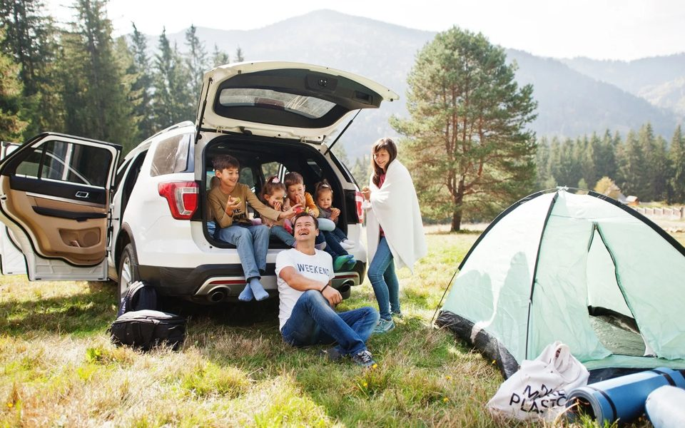
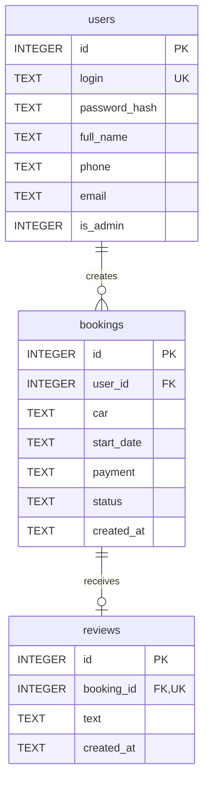

# Ручное воспроизведение версии без Jinja

03.11.2026. Код сайта **944c4b5**, ветка c/plain-html. Эта инструкция заменяет вариант
с Jinja из f513383. Структура SQLite и адреса страниц сохранены; формат POST изменён на JSON.
Редактор макета: **Adobe XD на Windows**, подтверждён пользователем. Файл макета не изменялся.

Материал предназначен для подготовки. Допуск личных файлов на экзамен не указан: использовать
там только разрешённые организатором материалы/DevDocs. Интернет и ИИ не требуются;
личный готовый сайт/макет не переносить. Медиа и пакеты брать из выданных локальных ресурсов.

## 1. Объём, реалистичность и приоритеты

**20527 символов, 454 строк,6 файлов сайта** вместо 30 110/512/11.
Сокращение **31.83%**, примерно треть. Пользователь принял этот результат;
дальнейшая минификация не применялась. Увеличение JavaScript учтено в общем объёме.
Пять скриптов тестов/макета и Mermaid ниже даны для полноты, **не для набора на экзамене**.
Бинарные фото/шрифты/wheels/PNG/нативный файл, официальная Schema и лицензии не набираются.

План 120 отводит 64 минуты коду и 56 другим действиям. Требуется не меньше **321 исправленного
символа в минуту** на знакомом коде; команды/проверки/редактор — в отдельных интервалах.
Это расчёт, **не проведённый хронометраж человека**. Дополнительные ошибки съедают резерв.

| Темп исправленного кода | Чистый набор | +56 минут остальных задач | +30 минут резерва |
|---:|---:|---:|---:|
| 250 | 82.1 | 138.1 | 168.1 |
| 300 | 68.4 | 124.4 | 154.4 |
| 350 | 58.6 | 114.6 | 144.6 |
| 400 | 51.3 | 107.3 | 137.3 |

При 300 симв/мин план немного выходит за 120, при 350 расчётно помещается с резервом.
Но 25 минут макета требуют хорошей репетиции XD. Выполнить две тренировки с нуля без
копирования кода и измерить app/HTML/JS/CSS/макет отдельно. Без этого 120 не обещаны.

Если можно выбирать порядок, при отставании: рабочий М 1 →полный М 4 →обязательные CSS/М 2
→интеграция М 3. Макет весит 25/75: не оставлять его пустым ради декора сайта.
Если порядок модулей предписан, не переставлять их. Частичная сдача не равна полной версии.

## 2. План 120 минут и резерв 30

| Минуты | Задача | Минимальная проверка |
|---|---|---|
|00–05|Окружение/каталоги/Git, начало М 1|Python/Flask доступны офлайн, первый commit|
|05–10|Медиа/шрифты/обработка фото|Точные имена,4 слайда 960×600, Montserrat/Roboto|
|10–15|db.py/schema.sql|py_compile, schema в памяти|
|15–39|app.py|py_compile, GET/api:csrf/user:null/rows[]|
|39–53|static/index.html|Обычные формы/шаблон карточки; JS ещё не набран, скрытые секции ожидаемы|
|53–66|static/script.js|Появились форма/списки, регистрация/вход/заявка|
|66–72|Рабочий М 1, ER из БД, commit|Admin видит заявку, гость не входит; три таблицы/две связи|
|72–80|М 2:style.css|Montserrat/палитра/адаптивность/анимации|
|80–84|М 2:проверки, commit|5 страниц 390×844, слайдер/ошибки/фильтр|
|84–87|М 3:интеграция/FK/микроанимации|FK1, integrity ok, orphans[], два checkpoint commit|
|87–90|М 4:2 экрана/сетка/стили|430×932,4×89, gap14, margin16|
|90–93|Шапка/логотип/меню/поиск|Размеры и четыре пункта меню в двух экранах|
|93–100|Главная|Полное описание/фото/преимущества/CTA/подвал|
|100–108|Решения|6 карточек со всеми текстами|
|108–112|Прототип/hover/save/reopen, commit|Desktop Preview, локальный .xd|
|112–120|Финальный сценарий/Git/сдача|Два владельца, Admin, отзыв, нативный файл|
|120–150|**Резерв, без планового нового функционала**|Локализованные исправления/повторная проверка/сдача|

JavaScript набирается **до первого функционального контроля М 1**: без него JSON/HTML-версия
ещё не показывает формы. CSS можно набрать позже в М 2. Уточнения М 2 (select/дата/отзыв)
сразу есть в app: не писать временную альтернативную реализацию и не менять её затем.

## 3. Подготовительный день и первые 5 минут

Проверить разрешённый Python 3.12x64/Flask 3.1.2, редактор без ИИ, Git, браузер DevTools,
растровый редактор, DBeaver/другой инструмент ER с уже установленным SQLite-драйвером.
Согласовать SQLite/общий экзаменационный сервер, адрес Git и передачу SQLite-файла.
В XD при отключённом интернете проверить новый документ, активацию, local save, reopen,
Preview и Hover. Наличие XD на экзамене подтверждено пользователем; текущий компьютер
не использовался для нативной GUI-проверки. В DevDocs заранее проверить локальные разделы
Python/sqlite3/re/datetime, Flask request/session/g, HTML template/формы, CSS, JS DOM/fetch.

Новый рабочий каталог, UTF-8, Python4 пробела. Не выполнять тренировку поверх готовой версии.

```powershell
python --version
git --version
mkdir static,static/img,static/fonts,docs,module4
git init
git config user.name "Фамилия Имя"
git config user.email "student@exam.local"
git commit --allow-empty -m "M1: start"
```

Имя/email заменить своими. Если репозиторий уже выдан — не повторять init/clone.
Start/end коммиты каждого модуля ставить в фактическое время, без подделки истории.
Разрешён --allow-empty для checkpoint; конец отмечать только после проверки.

### `.gitignore`

7 строк, 72 символов. Проверка: git status не показывает instance/.venv/source/tmp.

<!-- SOURCE .gitignore -->
```text
__pycache__/
*.py[cod]
.venv/
instance/
tmp/
source/
tests/screenshots/
```
<!-- END SOURCE .gitignore -->

### `requirements.txt`

1 строк, 13 символов. Проверка: одна прямая зависимость Flask 3.1.2.

<!-- SOURCE requirements.txt -->
```text
Flask==3.1.2
```
<!-- END SOURCE requirements.txt -->

Если `python -c "import flask"` уже работает в разрешённом Python, использовать его;
не создавать пустое venv без доступных пакетов. В остальных командах указать этот интерпретатор.
Если организатор предоставляет wheelhouse:

```powershell
python -m venv .venv
.\.venv\Scripts\python.exe -m pip install --no-index --find-links "D:\Public\wheels" -r requirements.txt
```

Путь выданной папки подставить фактический. vendor/wheels из нашего проекта — для домашней
репетиции или только если такие пакеты разрешены организатором. Интернет не использовать.
Пакеты должны соответствовать Python/Windows. Нет Flask/локальных пакетов — сразу сообщить
техническому эксперту, не менять стек наугад. Jinja2 — служебная зависимость Flask, но сами
Jinja-шаблоны в новой версии отсутствуют. Не удалять транзитивные wheels, нужные Flask.

Структура: app.py/db.py/schema.sql; static/index.html/style.css/script.js; img/fonts;
docs/er.png; module4/Группа-Таймыр.xd и assets; instance создаётся автоматически вне Git.

### Ресурсы: не набирать бинарные данные

Распакуй выданные вложенные архивы Проводником. Для сайта нужен каталог `media` из
`Прил_1_ОЗ_КИМ_09.02.07-3-2027`, для макета — `Медиа/Медиа` из `Медиа.zip`.
Имена ниже — исходные, не новые сетевые загрузки.

| Из исходного `media` | В проект | Размер результата |
|---|---|---|
| `logo_full.png` | `static/img/logo.png` | 1021×200, копия без растяжения |
| `logo_icon.png` | `static/img/icon.png` | 512×512, копия |
| `090551da81afdfc1980d37fa79b29e683a.jpeg` | `static/img/slide1.jpg` | 960×600 |
| `230108-194143.png` | `static/img/slide2.jpg` | 960×600 |
| `SaitZaglavnaya.format-webp.max-2000x2000.jpegquality-80_4hwhYjV.webp` | `static/img/slide3.jpg` | 960×600 |
| `orig.jpg` | `static/img/slide4.jpg` | 960×600 |
| `1200x900.webp` | `static/img/vesta.jpg` | 960×640 |
| `135246346_s63iN0L.jpeg` | `static/img/fleet.jpg` | 960×600 |
| `cf5de6e2a09af74ff13aad23c69466a4.jpg` | `static/img/handover.jpg` | 720×480 |

В разрешённом графическом редакторе: открыть фото → центральное кадрирование нужного
соотношения → масштабировать с сохранением пропорций → JPEG примерно 82% → точное имя.
Не растягивать фото до 8:5 из другого соотношения. Бинарные JPEG разных редакторов могут
отличаться от Pillow при том же визуальном результате; код сайта от этого не меняется.
Оставить доказательство реальной обработки по правилам сдачи: рабочий файл/снимок редактора.
Это устраняет текущий риск 0/2 по критерию 2.8; простое переименование файла обработкой не является.

Из `fonts/Montserrat/Montserrat` скопировать `Montserrat-Regular.ttf`, `Montserrat-Bold.ttf`,
`Montserrat-Italic.ttf`, `OFL.txt` в `static/fonts`. Не брать похожие Inter/variable-файлы.
Для макета — `Roboto-Regular.ttf`, `Roboto-Bold.ttf`, `OFL.txt` из выданного Roboto.
Веб-шрифты достаточно хранить в static, Roboto для редактора установить средствами ОС.
Макет: исходный `Логотип_полный.png`, фото `large.jpg`; центральный crop фото 796×220,
отображение 398×110. Хранить их в `module4/assets`, шрифты/лицензию рядом с ними.

**Проверка:** девять картинок открываются, четыре slide имеют одинаковые 960×600; три
Montserrat имеют точные имена. Исходники ресурсов разрешены заданием; готовый сайт или
собственный старый макет на экзамен из этой инструкции не переносятся.

## 4. М 1: полный код в порядке набора

SOURCE-маркеры и номера разделов в файлы не вводить. Код без сокращений. Длинные строки
показывать мягким переносом редактора, не ломать строковые литералы. ASCII-кавычки обязательны.

### `db.py`

24 строк, 657 символов. Проверка: `.\.venv\Scripts\python.exe -m py_compile db.py`. PRAGMA foreign_keys=ON и commit в execute обязательны.

<!-- SOURCE db.py -->
```python
import sqlite3


class DB:
    def __init__(self, path):
        self.connection = sqlite3.connect(path)
        self.connection.row_factory = sqlite3.Row
        self.connection.execute('PRAGMA foreign_keys = ON')

    def all(self, sql, params=()):
        return self.connection.execute(sql, params).fetchall()

    def one(self, sql, params=()):
        return self.connection.execute(sql, params).fetchone()

    def execute(self, sql, params=()):
        with self.connection:
            self.connection.execute(sql, params)

    def script(self, sql):
        self.connection.executescript(sql)

    def close(self):
        self.connection.close()
```
<!-- END SOURCE db.py -->

### `schema.sql`

25 строк, 1095 символов. Проверка: проверить SQL в памяти следующей командой; имена/ограничения сохранены.

<!-- SOURCE schema.sql -->
```sql
CREATE TABLE IF NOT EXISTS users (
    id INTEGER PRIMARY KEY,
    login TEXT NOT NULL UNIQUE COLLATE NOCASE,
    password_hash TEXT NOT NULL,
    full_name TEXT NOT NULL,
    phone TEXT NOT NULL,
    email TEXT NOT NULL,
    is_admin INTEGER NOT NULL DEFAULT 0 CHECK(is_admin IN (0, 1))
);
CREATE TABLE IF NOT EXISTS bookings (
    id INTEGER PRIMARY KEY,
    user_id INTEGER NOT NULL REFERENCES users(id),
    car TEXT NOT NULL CHECK(car IN ('LADA Vesta', 'Hyundai Creta', 'Toyota Camry')),
    start_date TEXT NOT NULL,
    payment TEXT NOT NULL CHECK(payment IN ('Наличными', 'Переводом по номеру телефона')),
    status TEXT NOT NULL DEFAULT 'Новая' CHECK(status IN ('Новая', 'Идет аренда', 'Аренда завершена')),
    created_at TEXT NOT NULL DEFAULT CURRENT_TIMESTAMP
);
CREATE INDEX IF NOT EXISTS bookings_user ON bookings(user_id);
CREATE TABLE IF NOT EXISTS reviews (
    id INTEGER PRIMARY KEY,
    booking_id INTEGER NOT NULL UNIQUE REFERENCES bookings(id),
    text TEXT NOT NULL CHECK(length(trim(text)) BETWEEN 1 AND 2000),
    created_at TEXT NOT NULL DEFAULT CURRENT_TIMESTAMP
);
```
<!-- END SOURCE schema.sql -->

```powershell
.\.venv\Scripts\python.exe -c "import sqlite3,pathlib; c=sqlite3.connect(':memory:'); c.executescript(pathlib.Path('schema.sql').read_text(encoding='utf-8')); print('schema OK'); c.close()"
```

INTEGER PRIMARY KEY, UNIQUE NOCASE login, FK users→bookings→reviews, UNIQUE booking_id
отзыва. Не заменять INTEGER на INT и не удалять CHECK/параметры запросов.

### `app.py`

200 строк, 7825 символов. Проверка: py_compile app.py db.py, затем запуск и /api. При отсутствии index.html обычные страницы ещё не готовы.

<!-- SOURCE app.py -->
```python
import os
import re
import secrets
import sqlite3
from datetime import datetime
from pathlib import Path
from flask import Flask, abort, g, jsonify, redirect, request, session
from werkzeug.exceptions import HTTPException
from werkzeug.security import check_password_hash, generate_password_hash
from db import DB

app = Flask(__name__)
Path(app.instance_path).mkdir(exist_ok=True)
key = Path(app.instance_path) / 'secret.key'
try:
    with key.open('x') as file:
        file.write(secrets.token_hex(32))
except FileExistsError:
    pass
app.config.update(SECRET_KEY=key.read_text(), DATABASE=os.environ.get('RENTAL_DB', str(Path(app.instance_path) / 'rental.db')),
                  MAX_CONTENT_LENGTH=32768, SESSION_COOKIE_HTTPONLY=True, SESSION_COOKIE_SAMESITE='Lax')
CARS = ('LADA Vesta', 'Hyundai Creta', 'Toyota Camry')
PAYMENTS = ('Наличными', 'Переводом по номеру телефона')
STATUSES = ('Новая', 'Идет аренда', 'Аренда завершена')


def get_db():
    if 'db' not in g:
        g.db = DB(app.config['DATABASE'])
    return g.db


def check(condition, code):
    if not condition:
        abort(code)


@app.teardown_appcontext
def close_db(error=None):
    if 'db' in g:
        g.pop('db').close()


def init_db():
    db = get_db()
    db.script(Path(app.root_path, 'schema.sql').read_text(encoding='utf-8'))
    if not db.one('SELECT id FROM users WHERE login=?', ('Admin',)):
        db.execute('INSERT INTO users(login,password_hash,full_name,phone,email,is_admin) VALUES(?,?,?,?,?,1)',
                   ('Admin', generate_password_hash('StartNET'), 'Администратор', '', ''))


@app.before_request
def load_user():
    g.user = get_db().one('SELECT * FROM users WHERE id=?', (session.get('user_id'),))
    session.setdefault('csrf', secrets.token_hex(24))
    if request.method == 'POST':
        check(secrets.compare_digest(session['csrf'].encode(), request.form.get('csrf', '').encode()), 400)
    if request.path.startswith(('/bookings', '/admin')):
        if not g.user:
            return redirect('/login')
        check(bool(g.user['is_admin']) == request.path.startswith('/admin'), 403)


@app.after_request
def private_response(response):
    if request.path == '/api' or request.endpoint == 'page':
        response.headers['Cache-Control'] = 'no-store'
    return response


@app.get('/')
def index():
    return redirect('/admin' if g.user and g.user['is_admin'] else '/bookings' if g.user else '/login')


@app.get('/login')
@app.get('/register')
@app.get('/bookings')
@app.get('/bookings/new')
@app.get('/admin')
def page():
    return app.send_static_file('index.html')


@app.get('/api')
def state():
    status = request.args.get('status', '') if g.user and g.user['is_admin'] else ''
    check(not status or status in STATUSES, 400)
    rows = []
    if g.user:
        rows = get_db().all("SELECT b.*,u.full_name,u.phone,u.email,r.text AS review FROM bookings b JOIN users u ON u.id=b.user_id LEFT JOIN reviews r ON r.booking_id=b.id WHERE (? OR b.user_id=?) AND (?='' OR b.status=?) ORDER BY b.id DESC",
                            (g.user['is_admin'], g.user['id'], status, status))
    user = {key: g.user[key] for key in ('id', 'full_name', 'is_admin')} if g.user else None
    return jsonify(user=user, csrf=session['csrf'], rows=[dict(row) for row in rows],
                   status=status, cars=CARS, payments=PAYMENTS, statuses=STATUSES)


@app.post('/register')
def register():
    values = {key: request.form.get(key, '').strip() for key in ('login', 'full_name', 'phone', 'email')}
    password = request.form.get('password', '')
    rules = {
        'login': (r'[A-Za-z0-9]{6,40}', 'Логин'),
        'full_name': (r'[А-Яа-яЁё ]{1,150}', 'ФИО'),
        'phone': (r'8\([0-9]{3}\)[0-9]{3}-[0-9]{2}-[0-9]{2}', 'Телефон'),
        'email': (r"(?=.{1,64}@)[A-Za-z0-9!#$%&'*+/=?^_\x60{|}~-]+(?:\.[A-Za-z0-9!#$%&'*+/=?^_\x60{|}~-]+)*@(?:[A-Za-z0-9](?:[A-Za-z0-9-]{0,61}[A-Za-z0-9])?\.)+[A-Za-z]{2,63}", 'Email')
    }
    errors = {key: label + ': неверное значение.' for key, (pattern, label) in rules.items()
              if not re.fullmatch(pattern, values[key]) or len(values[key]) > 254}
    if not 8 <= len(password) <= 128:
        errors['password'] = 'Пароль: 8–128 символов.'
    if not errors:
        try:
            get_db().execute('INSERT INTO users(login,password_hash,full_name,phone,email) VALUES(?,?,?,?,?)',
                             (values['login'], generate_password_hash(password), values['full_name'], values['phone'], values['email']))
        except sqlite3.IntegrityError:
            errors['login'] = 'Логин занят.'
        else:
            return jsonify(next='/login')
    return jsonify(errors=errors), 400


@app.post('/login')
def login():
    user = get_db().one('SELECT * FROM users WHERE login=?', (request.form.get('login', '').strip(),))
    if not user or not check_password_hash(user['password_hash'], request.form.get('password', '')):
        return jsonify(errors={'password': 'Неверный логин или пароль.'}), 400
    session.clear()
    session['user_id'] = user['id']
    return jsonify(next='/admin' if user['is_admin'] else '/bookings')


@app.post('/logout')
def logout():
    session.clear()
    return jsonify(next='/login')


@app.post('/bookings/new')
def new_booking():
    values, errors = request.form, {}
    if values.get('car') not in CARS:
        errors['car'] = 'Выберите автомобиль.'
    if values.get('payment') not in PAYMENTS:
        errors['payment'] = 'Выберите способ оплаты.'
    try:
        raw = values.get('start_date', '')
        if not re.fullmatch(r'[0-9]{2}\.[0-9]{2}\.[0-9]{4}', raw):
            raise ValueError
        date = datetime.strptime(raw, '%d.%m.%Y').date().isoformat()
    except ValueError:
        errors['start_date'] = 'Дата: ДД.ММ.ГГГГ.'
    if errors:
        return jsonify(errors=errors), 400
    get_db().execute('INSERT INTO bookings(user_id,car,start_date,payment) VALUES(?,?,?,?)',
                     (g.user['id'], values['car'], date, values['payment']))
    return jsonify(next='/bookings')


@app.post('/bookings/<int(max=9223372036854775807):booking_id>/review')
def review(booking_id):
    row = get_db().one('SELECT * FROM bookings WHERE id=? AND user_id=?', (booking_id, g.user['id']))
    check(row, 404)
    check(row['status'] == STATUSES[2], 403)
    text = request.form.get('text', '').strip()
    check(1 <= len(text) <= 2000 and '\0' not in text, 400)
    try:
        get_db().execute('INSERT INTO reviews(booking_id,text) VALUES(?,?)', (booking_id, text))
    except sqlite3.IntegrityError:
        abort(409)
    return jsonify(next='/bookings')


@app.post('/admin/<int(max=9223372036854775807):booking_id>/status')
def change_status(booking_id):
    status = request.form.get('status')
    check(status in STATUSES[1:], 400)
    row = get_db().one('SELECT status FROM bookings WHERE id=?', (booking_id,))
    check(row, 404)
    check(row['status'] != STATUSES[2] or status == STATUSES[2], 409)
    get_db().execute('UPDATE bookings SET status=? WHERE id=? AND status<>?', (status, booking_id, STATUSES[2]))
    selected = request.form.get('filter', '')
    return jsonify(next='/admin?status=' + selected if selected in STATUSES else '/admin', message='Статус обновлён.')


@app.errorhandler(HTTPException)
def error_page(error):
    if request.method != 'POST' and request.path != '/api':
        return error
    headers = dict(error.get_headers())
    headers.pop('Content-Type', None)
    message = {400: 'Проверьте данные формы.', 403: 'Действие запрещено.', 404: 'Заявка не найдена.', 409: 'Действие уже выполнено.'}
    return jsonify(message=message.get(error.code, error.name)), error.code, headers


with app.app_context():
    init_db()

if __name__ == '__main__':
    app.run(host='127.0.0.1', port=int(os.environ.get('PORT', 5000)))
```
<!-- END SOURCE app.py -->

```powershell
.\.venv\Scripts\python.exe -m py_compile app.py db.py
.\.venv\Scripts\python.exe app.py
```

Сервер оставить работающим, открыть http://127.0.0.1:5000/api. Для гостя user:null,
rows:[], csrf48hex; справочники доступны. init_db создаёт Admin/StartNET и instance/rental.db.
Случайный ключ хранится в instance/secret.key, в Git не попадает.
Python не перезапускается автоматически: Ctrl+C →повторить запуск после правок.

### `static/index.html`

77 строк, 4285 символов. Проверка: в исходнике обычный HTML и template. Пока нет JS, скрытые секции не отображаются — это ожидаемо.

<!-- SOURCE static/index.html -->
```html
<!doctype html>
<html lang="ru">
<meta charset="utf-8">
<meta name="viewport" content="width=device-width, initial-scale=1">
<title>Ключ.на.старт</title>
<link rel="icon" href="/static/img/icon.png">
<link rel="stylesheet" href="/static/style.css">
<script src="/static/script.js" defer></script>
<header>
  <a href="/"></a>
  <nav><a class="guest" href="/login">Вход</a><a class="guest" href="/register">Регистрация</a>
    <a class="user" href="/">Кабинет</a>
    <form class="user" action="/logout" method="post"><button>Выйти</button><output class="error"></output></form>
  </nav>
</header>
<p id="notice" role="status"></p>
<main>
  <section id="login" hidden><h1>Вход</h1>
    <form action="/login" method="post" novalidate>
      <label>Логин<input name="login" required></label>
      <label>Пароль<input name="password" type="password" required></label>
      <button>Войти</button><output class="error" role="alert"></output>
    </form>
    <a href="/register">Еще не зарегистрированы? Регистрация</a>
  </section>
  <section id="register" hidden><h1>Регистрация</h1>
    <form action="/register" method="post" novalidate>
      <label>Логин (от 6 символов)<input name="login" maxlength="40" required></label>
      <label>Пароль (от 8 символов)<input name="password" type="password" maxlength="128" required></label>
      <label>ФИО<input name="full_name" maxlength="150" required></label>
      <label>Телефон<input name="phone" placeholder="8(999)123-45-67" required></label>
      <label>Email<input name="email" type="email" required></label>
      <button>Зарегистрироваться</button><output class="error" role="alert"></output>
    </form>
    <a href="/login">Уже зарегистрированы? Вход</a>
  </section>
  <section id="new" hidden><h1>Новая заявка</h1>
    <form action="/bookings/new" method="post" novalidate>
      <label>Автомобиль<select name="car" required></select></label>
      <label>Дата начала<input name="start_date" placeholder="ДД.ММ.ГГГГ" required></label>
      <label>Оплата<select name="payment" required></select></label>
      <button>Отправить</button><output class="error" role="alert"></output>
    </form>
    <a href="/bookings">Вернуться к заявкам</a>
  </section>
  <section id="orders" hidden><h1 id="title">Мои заявки</h1>
    <a id="create" href="/bookings/new">Оформить аренду</a>
    <form id="filter" action="/admin" method="get" hidden>
      <label>Статус<select name="status"></select></label><button>Показать</button>
    </form>
    <p id="count"></p><div id="cards"></div>
    <div id="empty"><h2>Заявок нет</h2></div>
  </section>
  <aside id="promo" hidden><h2>Автомобили в аренду</h2>
    <div class="slider">
      
      
      
      
      <button type="button" data-step="-1" aria-label="Назад">‹</button>
      <button type="button" data-step="1" aria-label="Вперёд">›</button><small id="counter">1 / 4</small>
    </div>
    
  </aside>
</main>
<template id="card">
  <article class="booking">
    <h2></h2><p class="details"></p><p class="contact"></p>
    <form class="status-form" method="post"><input name="filter" type="hidden"><label>Новый статус<select name="status"></select></label><button>Сохранить статус</button><output class="error" role="alert"></output></form>
    <div class="review"><h3>Отзыв</h3><p></p></div>
    <form class="review-form" method="post"><label>Как прошла аренда?<textarea name="text" maxlength="2000" required></textarea></label><button>Оставить отзыв</button><output class="error" role="alert"></output></form>
    <small class="booking-note">Отзыв доступен после завершения аренды.</small>
  </article>
</template>
<footer>Ключ.на.старт · Аренда автомобилей</footer>
<noscript>Включите JavaScript для работы сайта.</noscript>
</html>
```
<!-- END SOURCE static/index.html -->

### `static/script.js`

90 строк, 4272 символов. Проверка: /login показывает форму после /api; обе формы отправляют FormData и показывают ошибки;4 слайда/3000ms/стрелки.

<!-- SOURCE static/script.js -->
```javascript
let data;
const get = (selector, root = document) => root.querySelector(selector);
const path = location.pathname;
function options(select, values, selected = '') {
  select.replaceChildren(new Option('Выберите', ''));
  for (const value of values) select.add(new Option(value, value, false, value === selected));
}
async function start() {
  const response = await fetch('/api' + location.search);
  data = await response.json();
  if (!response.ok) throw new Error(data.message);
  get('#notice').textContent = sessionStorage.notice || '';
  sessionStorage.removeItem('notice');
  document.body.classList.toggle('logged', !!data.user);
  const admin = data.user && data.user.is_admin;
  const page = path === '/bookings/new' ? 'new' : ['/admin', '/bookings'].includes(path) ? 'orders' : path.slice(1);
  get('#' + page).hidden = false;
  get('#promo').hidden = page === 'orders';
  get('.slider').hidden = page === 'new';
  get('#fleet').hidden = page !== 'new';
  options(get('[name=car]'), data.cars);
  options(get('[name=payment]'), data.payments);
  options(get('#filter select'), data.statuses, data.status);
  get('#filter select').options[0].text = 'Все статусы';
  get('#filter').hidden = !admin;
  get('#create').hidden = !!admin;
  get('#title').textContent = admin ? 'Панель администратора' : 'Мои заявки';
  get('#count').textContent = 'Заявок: ' + data.rows.length;
  get('#empty').hidden = data.rows.length > 0;
  for (const row of data.rows) {
    const card = get('#card').content.cloneNode(true);
    const find = selector => get(selector, card);
    const finished = row.status === data.statuses[2];
    find('h2').textContent = row.car;
    find('.details').textContent = 'Заявка № ' + row.id + ' · ' + row.status + '\n' + row.start_date.split('-').reverse().join('.') + ' · ' + row.payment;
    find('.contact').textContent = row.full_name + ' · ' + row.phone + ' · ' + row.email;
    find('img').src = '/static/img/' + ['vesta.jpg', 'slide1.jpg', 'fleet.jpg'][data.cars.indexOf(row.car)];
    const status = find('.status-form');
    status.hidden = !admin || finished;
    status.action = '/admin/' + row.id + '/status';
    status.elements.filter.value = data.status;
    options(status.elements.status, data.statuses.slice(1), row.status);
    find('.review').hidden = !row.review;
    find('.review p').textContent = row.review;
    const review = find('.review-form');
    review.hidden = !!admin || !finished || !!row.review;
    review.action = '/bookings/' + row.id + '/review';
    find('.booking-note').hidden = !!admin || finished;
    get('#cards').append(card);
  }
}
start().catch(error => get('#notice').textContent = error.message);

document.addEventListener('submit', async event => {
  const form = event.target;
  if (form.method === 'get') return;
  event.preventDefault();
  get('output', form).textContent = '';
  try {
    const body = new FormData(form);
    body.set('csrf', data.csrf);
    const response = await fetch(form.action, {method: 'POST', body: body});
    if (response.redirected) { location.href = response.url; return; }
    const result = await response.json();
    if (response.ok) { sessionStorage.notice = result.message || ''; location.href = result.next; return; }
    get('output', form).textContent = Object.values(result.errors || {message: result.message}).join('\n');
  } catch (error) { get('#notice').textContent = 'Ошибка отправки. Обновите страницу.'; }
});

const slides = document.querySelectorAll('.slide');
let current = 0, timer;
const motion = matchMedia('(prefers-reduced-motion: reduce)');
function show(step) {
  slides[current].hidden = true;
  current = (current + step + slides.length) % slides.length;
  slides[current].hidden = false;
  get('#counter').textContent = current + 1 + ' / ' + slides.length;
}
function schedule() {
  clearInterval(timer);
  if (!motion.matches && !document.hidden) timer = setInterval(() => show(1), 3000);
}
for (const button of document.querySelectorAll('[data-step]')) button.onclick = () => {
  show(Number(button.dataset.step));
  schedule();
};
document.addEventListener('visibilitychange', schedule);
motion.addEventListener('change', schedule);
schedule();
addEventListener('pageshow', event => { if (event.persisted) location.reload(); });
```
<!-- END SOURCE static/script.js -->

### Контроль М 1,66–72

1. Гость /bookings,/bookings/new,/admin →вход. Войти Admin/StartNET →/admin.
2. Регистрация Driver01/12345678, Иванов Иван,8(999)123-45-67, ivan@example.ru.
   Войти и создать LADA Vesta/02.12.2026/Наличными. Своя Новая заявка видна, отзыв скрыт.
3. Admin видит эту заявку/контакты, может изменить статус. Даже при простом HTML без CSS
   функциональность уже проверяема, потому что JS набран и /api работает.
4. ER через реальную SQLite в установленном инструменте: создать SQLite connection к
   instance/rental.db →Tables/Diagram →добавить users/bookings/reviews →показать PK/FK/UNIQUE
   →экспорт docs/er.png (или.svg), открыть экспорт. Нужен готовый драйвер без скачивания.
   users1→bookings0..N; bookings1→reviews0..1. Не рисовать виртуальную связь вместо FK.
   [Описание ER DBeaver](https://dbeaver.com/docs/dbeaver/ER-Diagrams/).

Текущая ER проекта была создана вне GUI: её правильная структура не доказывает выполнение
условия «средствами СУБД». Mermaid ниже — для сверки, не замена этого шага.
SQLite/secret.key исключены .gitignore; если файл БД нужен комиссии, передать отдельно
предусмотренным способом после закрытия открытых транзакций.

```powershell
git add .
git commit -m "M1: database and working rental flow"
git commit --allow-empty -m "M2: start design verification"
```

## 5. М 2: CSS и проверки

### `static/style.css`

38 строк, 2393 символов. Проверка: все 5 страниц 390×844/desktop, Montserrat36/24/18/16/12Italic, палитра, видимые ошибки и 44px кнопки.

<!-- SOURCE static/style.css -->
```css
@font-face{font-family:Montserrat;src:url('fonts/Montserrat-Regular.ttf')}
@font-face{font-family:Montserrat;src:url('fonts/Montserrat-Bold.ttf');font-weight:700}
@font-face{font-family:Montserrat;src:url('fonts/Montserrat-Italic.ttf');font-style:italic}
*{box-sizing:border-box}
[hidden],.logged .guest,body:not(.logged) .user{display:none!important}
body{margin:0;color:#212b36;background:#f8f9fa;font:16px/1.6 Montserrat,sans-serif;overflow-wrap:anywhere}
header,main,footer,#notice{max-width:1000px;margin:auto;padding:20px}
header,nav{display:flex;align-items:center;gap:16px;flex-wrap:wrap;justify-content:space-between}
.logo{width:240px}
a{display:inline-flex;align-items:center;min-height:44px;color:#d9480f}
a:hover{color:#212b36}
main{display:grid;grid-template-columns:1fr 1fr;gap:32px;min-height:70vh}
h1{font-size:36px;line-height:1.2}h2{font-size:24px}h3{font-size:18px}
h1,h2,h3,p{margin:0 0 16px}
label{display:block;margin:16px 0;font-weight:700}
button,input,select,textarea{font:inherit;padding:12px;border:1px solid #bbc1c7;border-radius:6px}
input,select,textarea{width:100%;min-width:0;background:white;color:inherit}
button{min-height:44px;background:#d9480f;color:white;cursor:pointer;transition:background .15s}
button:hover{background:#212b36}
:focus-visible{outline:3px solid #d9480f}
img{max-width:100%;display:block;border-radius:6px}
small,footer,.error{font-size:12px;font-style:italic;color:#6c757d}
.error{display:block;color:#d9480f;white-space:pre-line}
#notice:empty{display:none}
#orders{grid-column:1/-1}
.booking{padding:20px;margin-bottom:20px;background:white;animation:appear .2s}
.car-photo{width:150px;height:100px;object-fit:cover;float:right;margin:0 0 12px 12px}
.booking form{clear:both}
.details,.review p{white-space:pre-wrap}
#empty img{width:320px}
.slider{position:relative}
.slide,#fleet{width:100%;aspect-ratio:8/5;object-fit:cover}
.slider button{position:absolute;top:calc(50% - 22px);width:44px;height:44px;padding:0;border-radius:50%;font-size:30px}
[data-step="-1"]{left:12px}[data-step="1"]{right:12px}
#counter{position:absolute;bottom:10px;right:12px;background:#212b36;color:white;padding:0 8px}
@keyframes appear{from{opacity:0}to{opacity:1}}
@media(max-width:700px){main{grid-template-columns:1fr}.car-photo{width:96px;height:84px}}
@media(prefers-reduced-motion:reduce){*{animation:none!important;transition:none!important}}
```
<!-- END SOURCE static/style.css -->

Ctrl+F5. Переключить 5 URL на 390×844. Фото/формы не выходят за экран, поля доступны прокруткой.
За 12–13 секунд проверить все 4 слайда и возврат; обе стрелки меняют картинку и сбрасывают
таймер. В фоне и reduced-motion автосмена намеренно остановлена. Паузы-кнопки нет.
Номер и дату теперь **вводить целиком с разделителями**: необязательные маски удалены.
Сервер проверяет 8(XXX)XXX-XX-XX и существующую ДД.ММ.ГГГГ. Новая 31.02.2026 не сохраняется.
Все ошибки регистрации/входа/заявки выводятся списком в output на соответствующей форме.
Регистрация abc/123/John/+7/bad@ показывает 5 сообщений. Имя кириллицей/пробелами, login ASCII
латиница/цифры≥6, пароль≥8; дубликат регистра login не принимается. Admin имеет 5 букв как
исключение задания: он создаётся init_db, не формой регистрации.

Фильтр Admin отправляет GET/admin?status=..., данные берутся из /api?status=...; после смены
статуса появляется подтверждение. /api не отдаёт чужие заявки даже с подставленным user_id.
В Console нет JS-ошибок, в Network нет 404 ресурсов или внешних CDN.

```powershell
git add .
git commit -m "M2: local responsive interface verified"
git commit --allow-empty -m "M3: start integration verification"
```

## 6. М 3: БД/интеграция,84–87

Нового файла нет. Сверить 5 URL, все формы и API; hover/focus, появление карточки, микроанимации.
Во втором терминале из корня:

```powershell
.\.venv\Scripts\python.exe -c "from db import DB; d=DB('instance/rental.db'); print(d.one('PRAGMA foreign_keys')[0]); print(d.one('PRAGMA integrity_check')[0]); print([tuple(r) for r in d.all('PRAGMA foreign_key_check')]); d.close()"
```

Ожидается 1, ok,[]. PRAGMA относится к соединению:0 в чужой GUI-консоли не равно отключению FK
в DB-классе. Пароли в БД — хеши, личность и роль берутся из сессии/БД, а не формы/URL.
Завершение аренды терминально, отзыв только свой/после завершения/один раз.

```powershell
git commit --allow-empty -m "M3: integration and database verified"
git commit --allow-empty -m "M4: start Taimyr prototype"
```

## 7. Как объяснять обычный код на защите

| Вопрос | Короткий ответ по нашей реализации |
|---|---|
|Где HTML?|static/index.html — обычный документ. Flask отдаёт его send_static_file, не обрабатывает шаблонизатором|
|Почему 5 URL, но один файл?|Сервер проверяет роль на каждом закрытом URL; JS показывает соответствующую секцию. Общая разметка не дублируется|
|Что такое template?|Стандартный HTML-контейнер заготовки. Браузер сам его не показывает; cloneNode(true) копирует карточку. Это не Jinja|
|Откуда заявки?|GET/api:SQL уже отбирает строки по g.user.id либо роли Admin; JS не получает все чужие заявки для последующего скрытия|
|Как отправляется форма?|FormData читает поля; fetch отправляет POST на action.200 с next — переход браузера;400 — ошибки в output|
|Зачем csrf?|Случайный токен сессии добавляется к каждому POST и сравнивается на сервере. Подставить роль этим нельзя|
|Почему textContent?|Вставляет текст, не HTML: отзыв с img/script не создаёт элементы и не выполняется|
|Где ООП?|DB — класс соединения/запросов/транзакций; один экземпляр в g на запрос, teardown закрывает|
|Почему SQL безопасен?|Текст SQL фиксирован; пользовательские значения передаются отдельным кортежем с ?|
|Что делает check?|Обычная функция: при ложном условии abort с HTTP-кодом. Это не assert, который можно отключить оптимизацией|
|Где пароль?|Только password_hash в SQLite; в JSON и cookie пароль/хеш не передаются. Cookie подписан, но это не означает шифрование|
|Как слайдер зациклен?|current меняется по модулю slides.length; setInterval3000, при ручном клике таймер пересоздаётся|
|Что означают скобки?|В Python это словари/кортежи, в JS — функции/объекты. Специального языка  больше нет|

Из JS выучить обычные querySelector, hidden, textContent, for..of, async/await, fetch, FormData,
cloneNode, new Option. `? :` — обычный условный оператор;&&/|| — логические;!! — приведение к boolean;
% в слайдере — остаток деления, не синтаксис шаблона. Уметь прочитать одну карточку и одну
отправку формы вручную. Сокращённый код не отменяет необходимости понимать эти операции.

## 8. М 4: редактор, ограничения текущего файла и порядок действий

Модуль выполняется **в графическом редакторе**, не в Flask и не генератором Python.
Нужен один настоящий `.xd`, `.sketch` или `.fig` с редактируемыми текстами/фигурами/изображениями.
Два PNG — только дополнительные референсы, не замена формата.

Утверждённый `Группа-Таймыр.sketch` имеет проверенную структуру, но не проверен в редакторе;
native hover в нём отсутствует. Ниже геометрия/контент воспроизводят этот макет. Подключение
настоящего hover — отдельная обязательная настройка по оригинальному заданию для устранения
этого известного ограничения; оно не представляется уже работающей функцией файла.
Сайт/его исходники ради этого не меняются. Воспроизводить скрытые неподключённые образцы
вместо настоящего hover на экзамене не нужно.

### 8.1. Базовая сборка в Adobe XD на Windows

1. Создать новый локальный документ и сразу сохранить `module4/Группа-Таймыр.xd` через
   File → Save As Local Document. Повторять Ctrl+S после каждого экрана. Не выбирать
   только облачный документ: на сдаче должен существовать локальный редактируемый файл.
   [Сохранение локально, Adobe](https://helpx.adobe.com/xd/desktop/troubleshooting/cloud-documents-and-creative-cloud-libraries/fix-issues-with-xd-cloud-documents.html).
2. Инструмент Artboard: два экрана 430×932, портрет. Назвать `01 · Главная`, `02 · Решения`.
   Первый на холсте X0, Y0; второй X478, Y0. Далее все координаты относительно своего экрана.
3. Выделить оба: Grid → Layout, Columns4, Gutter14, левое/правое поле 16, Column Width89.
   Получится 4×89+3×14+32=430. Проверить сетку на обоих; это нативная grid, не четыре нарисованные полосы.
   [Настройка сетки, Adobe](https://helpx.adobe.com/xd/desktop/design/artboards-guides-and-layers/work-with-guides-and-grids-in-adobe-xd.html).
4. Создать четыре шрифтовых стиля: Regular14/18, Bold14/18, Bold16/20, Bold28/34.
   Гарнитура Roboto. Первое число — размер px, второе — межстрочный. Не уменьшать текст для
   экономии места ниже 14. Цвет меняется по роли слоя, новых шрифтов/размеров не добавлять.
5. Задать палитру: фон `#F5F8F8`, белый `#FFFFFF`, основной `#0E7583`, текст `#17363B`,
   вторичный `#536A6E`, контур `#D5E3E5`, hover-фон `#EAF3F4`, hover-текст `#085966`.
   Без теней. Карточки radius8; кнопки/поиск radius6, border1.
6. Построить шапку на первом, сгруппировать и дублировать на второй без сдвига.
   Фон шапки белый(0,0,430,96); логотип(16,12,132,35.85), пропорции сохранять.
   Меню: Главная(16,48,192,40), Решения(222,48,192,40). Активная кнопка teal/белый текст,
   неактивная белая/teal. Подпись Bold14/18 по центру. На втором поменять активный пункт.
7. Далее заполнить «Главную» по 8.2, затем построить одну карточку «Решений» и дублировать
   её шесть раз по 8.3. Полный текст переносить из выданного Текст.docx, не сокращать.
   При допустимости копирования выданного текста использовать вставку как plain text.
   Код сайта при этом по-прежнему набирается вручную.

**Контроль:** два артборда 430×932, grid4, Roboto установлен/не заменён, header не перекрывает меню.
Не конвертировать текст в кривые. Не подменять весь экран единым bitmap.

### 8.2. «Главная»: фигуры и изображения

| Объект | X, Y, W, H | Оформление |
|---|---|---|
| Поиск | 16,108,398,44 | Белый, border LINE1, radius6 |
| Лупа | 30,122,13,13 | Контур MUTED, ручка 43,133,2,8 под 45° |
| Фото `large.jpg` | 16,282,398,110 | Центральный crop3.618:1, без растяжения |
| Маркеры преимуществ | 16,535,5,5; 16,561,5,5; 16,605,5,5 | TEAL, radius2 |
| Заказать лицензию | 16,648,398,44 | TEAL/белый, radius6 |
| Скачать пробную версию | 16,700,398,44 | Белый/TEAL, border1, radius6 |
| Линия подвала | 16,758,398,1 | LINE |

Точный текст и рамки ниже извлечены из актуального `.sketch`. Формат стиля: размер/строка,
R=Regular, B=Bold; L/C/R — выравнивание слева/по центру/справа. Высота рамки дана для текущих
переносов, не для обрезания текста. Если редактор переносит иначе, сначала проверить Roboto,
ширину/размер/межстрочный/character spacing0, а не уменьшать шрифт. Все элементы должны остаться
внутри 932px; после нативной проверки возможна коррекция рамок без изменения содержания.

| Полный текст | X, Y, W, H | Стиль / цвет / align |
|---|---|---|
| Главная | 24,59,176,18 | B14/18 #FFFFFF C |
| Решения | 230,59,176,18 | B14/18 #0E7583 C |
| Поиск по продуктам | 54,121,340,18 | R14/18 #536A6E L |
| ПЛАТФОРМА ДАННЫХ | 16,174,398,18 | B14/18 #0E7583 L |
| Таймыр Data Platform Enterprise | 16,202,398,68 | B28/34 #17363B L |
| Отечественная платформа со встроенными средствами защиты для надежного хранения, обработки и резервного копирования корпоративных данных в ИТ-инфраструктурах любого масштаба. Доступны версии для серверного, десктопного, мобильного и встраиваемого сценариев применения | 16,408,398,108 | R14/18 #17363B L |
| Более 800 организаций используют Таймыр Data Platform | 30,530,384,18 | R14/18 #17363B L |
| Непрерывная защита данных от сбоев и утечек на всех этапах хранения | 30,556,384,36 | R14/18 #17363B L |
| Полная совместимость с отечественными ОС и стандартами | 30,600,384,36 | R14/18 #17363B L |
| Заказать лицензию | 24,661,382,18 | B14/18 #FFFFFF C |
| Скачать пробную версию | 24,713,382,18 | B14/18 #0E7583 C |
| Продолжая, вы соглашаетесь с условиями использования и политикой конфиденциальности | 16,772,398,36 | R14/18 #536A6E L |
| © 2025 | 16,820,90,18 | R14/18 #536A6E L |
| Все права защищены | 120,820,294,18 | R14/18 #536A6E R |

**Контроль «Главной»:** подпись лицензии читается, описание полное, три преимущества,
две CTA без переходов на другие экраны, юридический текст, ©2025, права. Нижняя рамка 838,
остаток 94px. Поиск в макете — визуальный элемент, программный поиск не требуется.

### 8.3. «Решения»: карточки

Шапка уже скопирована; активны «Решения». Поиск на этом экране не добавлять.
Карточка белая, border LINE1, radius8; две колонки по 192, между ними 14.
Внутренний отступ 12; заголовок шириной 168, пункты шириной 158 со сдвигом 22.
Маркер пункта 3×3, x карточки+12, y строки+6. Между пунктами 4px после рамки строки.

| Ряд | Левая карточка | Правая | X слева/справа | Y | W×H | Кнопки X слева/справа, Y, W, H |
|---|---|---|---:|---:|---|---|
| 1 | Таймыр Studio | Таймыр Server | 16/222 | 100 | 192×330 | 28/234,378,168,40 |
| 2 | Таймыр Mobile | Таймыр Embedded | 16/222 | 440 | 192×276 | 28/234,664,168,40 |
| 3 | Программный стек «Группы Таймыр» | Техническая поддержка | 16/222 | 726 | 192×158 | 28/234,832,168,40 |

У всех шести кнопок текст «Подробнее», белый фон/teal текст и граница. Не настраивать
переход на другие экраны. Строки пунктов и полный текст каждой карточки:

| Полный текст | X, Y, W, H | Стиль / цвет / align |
|---|---|---|
| Главная | 24,59,176,18 | B14/18 #0E7583 C |
| Решения | 230,59,176,18 | B14/18 #FFFFFF C |
| Таймыр Studio | 28,112,168,20 | B16/20 #0E7583 L |
| Удобство для администратора | 38,142,158,36 | R14/18 #17363B L |
| Универсальность | 38,182,158,18 | R14/18 #17363B L |
| Современность | 38,204,158,18 | R14/18 #17363B L |
| Наглядность | 38,226,158,18 | R14/18 #17363B L |
| Подробнее | 36,389,152,18 | B14/18 #0E7583 C |
| Таймыр Server | 234,112,168,20 | B16/20 #0E7583 L |
| Отказоустойчивый кластер баз данных | 244,142,158,36 | R14/18 #17363B L |
| Централизованное управление конфигурациями | 244,182,158,54 | R14/18 #17363B L |
| Инструменты для разработки и использования прикладного ПО | 244,240,158,72 | R14/18 #17363B L |
| Безопасная среда исполнения контейнерных нагрузок | 244,316,158,54 | R14/18 #17363B L |
| Подробнее | 242,389,152,18 | B14/18 #0E7583 C |
| Таймыр Mobile | 28,452,168,20 | B16/20 #0E7583 L |
| Адаптивность | 38,482,158,18 | R14/18 #17363B L |
| Централизованность | 38,504,158,18 | R14/18 #17363B L |
| Удобство | 38,526,158,18 | R14/18 #17363B L |
| Подробнее | 36,675,152,18 | B14/18 #0E7583 C |
| Таймыр Embedded | 234,452,168,20 | B16/20 #0E7583 L |
| Поддержка основных процессорных архитектур | 244,482,158,54 | R14/18 #17363B L |
| Гибкая система лицензирования | 244,540,158,36 | R14/18 #17363B L |
| Сертификаты ключевых регуляторов | 244,580,158,36 | R14/18 #17363B L |
| Техническая поддержка вендора ОС | 244,620,158,36 | R14/18 #17363B L |
| Подробнее | 242,675,152,18 | B14/18 #0E7583 C |
| Программный стек «Группы Таймыр» | 28,738,168,40 | B16/20 #0E7583 L |
| Экосистема продуктов «Группы Таймыр» | 38,788,158,36 | R14/18 #17363B L |
| Подробнее | 36,843,152,18 | B14/18 #0E7583 C |
| Техническая поддержка | 234,738,168,40 | B16/20 #0E7583 L |
| Консультация 24/7 | 244,788,158,18 | R14/18 #17363B L |
| Подробнее | 242,843,152,18 | B14/18 #0E7583 C |
| © 2025 | 16,896,80,18 | R14/18 #536A6E L |
| Все права защищены | 108,896,306,18 | R14/18 #536A6E R |

**Контроль «Решений»:** шесть карточек и шесть «Подробнее», полный текст Server/Embedded,
footer заканчивается 914, запас 18px. Если есть наложение: сначала ширина 158/шрифт 14/строка 18,
затем соответствие строк таблице. Не сокращать «Инструменты...» или «Контейнерных нагрузок».

### 8.4. Прототип и hover в XD,107–111

Требование переходов: две разные цели, четыре меню-кнопки в двух экранах. Начальный экран
«Главная». В Prototype у меню задать Tap → Transition, Destination нужный артборд,
Animation None. «Главная» на обоих →01, «Решения» на обоих →02; если редактор запрещает
самопереход, текущий пункт остаётся на месте, межэкранные переходы обязательны.
Две CTA и шесть «Подробнее» без переходов на другие экраны.
[Переходы и Desktop Preview, Adobe](https://helpx.adobe.com/xd/desktop/prototype/create-prototypes.html).

Для hover объединить фон+подпись меню в Main Component. В Design: `+` рядом с Default State
→ Hover State; установить pale-фон/teal-border, текст `#085966`. Вернуться в Default State.
Автоматическое hover-событие XD проверить в Preview, включая выход курсора. Состояние
не должно менять геометрию. Настроить Tap в нужную цель и проверить нажатие именно после
наведения; при необходимости добавить Tap для Hover State. Не копировать переход одного
компонента «Главная» на компонент «Решения» без смены destination.
[Hover State, Adobe](https://helpx.adobe.com/xd/desktop/help/create-component-states.html).

Для полного критерия интерактивных состояний добавить видимый Hover State и оставшимся
кнопкам, **без навигационных Tap/переходов**. Если используется Pressed State, это визуальное
состояние компонента, не третий экран и не переход на другую страницу; проверять возврат.
Не тратить время на сложную анимацию: быстрый стабильный отклик важнее декоративного эффекта.

Сохранить локальный `.xd`, закрыть и снова открыть. Проверить оба экрана и переключения.
Показать сетку/текстовый слой/свойство размера — это доказывает редактируемость, не только PNG.
PNG экспортировать лишь дополнительно, если требуется; основная сдача — один нативный файл.

### 8.5. Контроль именно в установленной версии XD

В Desktop Preview выполнить Главная →Решения →Главная. Навести мышь, вывести её за кнопку,
снова навести и нажать: изменение цвета должно возвращаться, переход — срабатывать и в Hover.
Проверить активный и неактивный пункт на обоих экранах. Выделить каждую из восьми CTA:
в Prototype не должно быть Transition на другую монтажную область; Hover State допустим.
Проверить оба размера артбордов, четыре колонки и текстовые слои после повторного открытия
локального `.xd`. Наличие соединительной линии в Design/Prototype без работающего Preview
не является проверкой перехода. Облачная ссылка не заменяет локальный файл сдачи.

Если редактор не предоставлен/не запускается офлайн, сразу зафиксировать проблему у эксперта.
Paint/GIMP подходят для фото, но не сохраняют требуемый интерактивный `.xd/.fig/.sketch`.
Не переименовывать `.png` или `.html` в требуемое расширение. Не набирать генератор макета
из приложения: он длиннее, требует дополнительных ресурсов и не исправляет native hover.

```powershell
git add module4
git commit -m "M4: two editable mobile screens and verified prototype"
```

Сообщение `verified` использовать только после фактического Preview. При проблеме указать
реальный статус в сообщении/сдаче, не объявлять непроверенный переход работающим.

## 9. Финальный сценарий,112–120

Обычное и приватное окно — разные cookie-сессии; две вкладки одного профиля ими не являются.
Тестовые данные: A Driver01/12345678, Иванов Иван,8(999)123-45-67, ivan@example.ru;
B Other01/12345678, Петров Пётр,8(999)765-43-21, petr@example.ru.

| Шаг | Ожидается |
|---|---|
|Гость /bookings,/bookings/new,/admin|Переход на вход|
|Пустая/неверная регистрация, дубликат driver01|Ошибки, нет новой строки|
|Неверный пароль; затем верный|Ошибка на форме; вход|
|A создаёт LADA/02.12.2026/наличные; B Toyota/03.12.2026/перевод|Каждый видит только своё, в том числе в /api|
|B /admin и поддельная смена статуса|403|
|Admin/StartNET|Видит обе заявки/контакты, фильтр работает|
|Новая/Идет аренда|У владельца нет формы отзыва, сервер отвергает POST403|
|Аренда завершена|Владелец может оставить отзыв; чужой 404; повтор 409|
|Отзыв с HTML|Виден текст, не новый img/script|
|5 страниц 390×844/desktop; слайдер|Нет выхода по ширине,4 фото/3 секунды/стрелки|
|XD local save/reopen/Preview|Два экрана, полный текст, grid, переходы, hover, CTA без переходов|

Для серверной проверки отзыва авторизованным A/B в DevTools Console сначала получить токен:

```javascript
const state = await (await fetch('/api')).json();
const response = await fetch('/bookings/1/review', {method:'POST', body:new URLSearchParams({csrf:state.csrf,text:'Проверка'})});
console.log(response.status);
```

Заменить 1 фактическим ID заявки A. До завершения у A403, у B404; после первого отзыва у A409.
Не запускать первым положительным отзывом после завершения, если не хочешь сохранить слово
«Проверка». Успешный POST теперь 200JSON, next обрабатывает JS; старые ожидания 302 не подходят.
400 без csrf доказывает только CSRF, а не проверку владельца/статуса. В GET/api нет password_hash.

Если тесты из приложения уже набраны/допущены — дома:

```powershell
.\.venv\Scripts\python.exe -m unittest discover -s tests -v
```

18 tests/OK, включая 62 реальных HTTP-проверки. Браузерный скрипт требует Edge/websocket-client,
инструменты макета — Pillow/jsonschema/исходную source и официальную Schema. Они не нужны сайту
и **не предполагаются для набора на экзамене**. Ручной контроль выше обязателен при их отсутствии.

```powershell
git add .
git commit -m "exam: final checks"
git status --short
git log --oneline -10
git remote -v
```

Передать в выданный индивидуальный репозиторий на LAN:если remote есть — не заменять,
иначе добавить **выданный URL**, затем `git push -u origin HEAD`. Интернет не нужен для LAN.
Локальный commit не равен удалённой сдаче. Нет remote/ошибка — сообщить эксперту и использовать
регламентный способ, сохранив локальную работу. ER/медиа/нативный .xd должны реально открываться.

## 10. Типичные ошибки набора

| Симптом | Проверить/исправить |
|---|---|
|SyntaxError/IndentationError|ASCII-кавычки,4 пробела, двоеточие, закрытие скобок; py_compile и строка перед traceback|
|Все секции скрыты|JS ещё не набран/404/ошибка Console,/api не вернул JSON; start() должен закончиться|
|В браузере JSON вместо формы|Нативная отправка без работающего JS; проверить listener submit и defer/static path|
|400 на POST|Токен взять из актуального /api; FormData.body.set('csrf', data.csrf); обновить страницу|
|Элемент null/ошибка JS|Сверить id/class/name с index.html; template content не находится обычным querySelector до clone|
|403 не той роли|before_request, реальная g.user.is_admin; скрытие CSS не заменяет серверный check|
|Чужие заявки|WHERE b.user_id и истинный is_admin; никогда не брать owner/role из body или URL|
|Ранний отзыв/дубликат|owner SELECT, status check, UNIQUE reviews.booking_id и 400/403/409|
|Телефон/дата не проходят|Вводить 8(999)123-45-67 и 02.12.2026 целиком; масок больше нет|
|500 в SQL|Имена user_id/car/start_date/payment/status, параметры, точное «Идет аренда» без ё|
|Изменённая схема не действует|CREATE IF NOT EXISTS не миграция; для учебной новой БД задать RENTAL_DB в существующей tmp; не стирать финальную|
|Database locked|Закрыть/commit транзакцию в GUI; не удалять БД|
|Слайдер стоит|Console,4 slide,#counter, data-step, активная вкладка/reduced-motion|
|Фото/шрифты 404|Точное имя/расширение, img/fonts и/static/; не CDN|
|Flask не найден|Тот же Python, что устанавливал локальные wheels; не пустой venv|
|Порт занят|Остановить свой старый сервер; или PORT=5001 и новый URL|
|Python-правки не видны|Ctrl+C и запуск; CSS/JS — Ctrl+F5|
|XD не переносит текст как в таблице|Roboto, ширина,14/18 либо 28/34, tracking0; не уменьшать ниже 14|
|Hover лишь скрытый образец|Main Component/Hover State, реальный Preview и клик после наведения|
|Только облако/PNG|Save As Local Document,.xd существует и открывается повторно|

GET-ошибки сейчас стандартные Flask; POST/API — JSON. Само наличие 403 не означает поломку.
Пароль Admin/StartNET регистрозависимый. На новой учебной БД приложение создаёт его само.
Не отключать CSRF/FK/роли и не менять чужого владельца ради демонстрации.

## 11. Аварийные планы

Отсчёт от 150:30 минут осталось в момент 120. Резерв не планировать как новый модуль.

| Осталось | Действия |
|---|---|
|30|0–2 сохранить/commit;2–17 главный незавершённый блок, обычно native-макет;17–23 переходы/hover/reopen;23–27 smoke;27–30 сдача|
|15|0–2 сохранить;2–7 одна локализованная критичная ошибка;7–11 вход/заявка/Admin/отзыв;11–15 Git/сдача|
|5|0–1 save;1–2 открыть сайт и .xd;2–4 commit/передача;4–5 проверить приём. Без массовых правок|

Если сайт не работает, на 30-минутном резерве выделить≤10 минут на один traceback, затем
сохранить проверяемые части/макет/схему. Если макета нет, два простых экрана с полным текстом
и grid важнее коллажа, но точную композицию за 15 минут не обещать. Защита доступа важнее
косметики. Не сбрасывать Git/БД, не ставить новые библиотеки и не конвертировать файл в спешке.

## 12. Полные вспомогательные исходники

Далее код для полноты домашнего воспроизведения. Не переписывать эти скрипты в экзаменационный
лимит. Mermaid не заменяет ER из СУБД. Генератор макета может перезаписать .sketch:не запускать
поверх ручной работы и не считать его заменой работы в XD. Native hover/GUI в исходном
макете остаются непроверенными ограничениями. Фото/шрифты/Schema/лицензии — ресурсы, не код.

### `docs/er.mmd`

27 строк, 553 символов. Проверка: домашняя проверка по README; никаких сокращений исходника в этом блоке.

<!-- SOURCE docs/er.mmd -->

<!-- END SOURCE docs/er.mmd -->

### `tests/test_app.py`

216 строк, 11440 символов. Проверка: домашняя проверка по README; никаких сокращений исходника в этом блоке.

<!-- SOURCE tests/test_app.py -->
```python
import sqlite3
import tempfile
import unittest
from contextlib import closing
from pathlib import Path


class RentalTest(unittest.TestCase):
    def test_plain_pages_and_state_api(self):
        state = self.client.get('/api')
        self.assertEqual(state.status_code, 200)
        self.assertTrue(state.is_json)
        self.assertEqual(state.json['rows'], [])
        self.assertIsNone(state.json['user'])
        self.assertEqual(len(state.json['csrf']), 48)
        self.assertEqual(state.headers['Cache-Control'], 'no-store')
        for path in ['/login', '/register']:
            page = self.client.get(path)
            self.assertEqual(page.status_code, 200)
            self.assertNotIn('{%', page.text)
            self.assertNotIn('{{', page.text)
            self.assertIn('<form', page.text)
            page.close()

    def setUp(self):
        from app import app, init_db
        self.tmp = tempfile.TemporaryDirectory()
        self.app = app
        app.config.update(TESTING=True, DATABASE=str(Path(self.tmp.name) / 'test.db'))
        with app.app_context():
            init_db()
        self.client = app.test_client()
        self.user = dict(login='Driver01', password='password123', full_name='Иванов Иван Иванович',
                         phone='8(999)123-45-67', email='ivan@example.ru')

    def tearDown(self):
        self.tmp.cleanup()

    def post(self, url, data=None, client=None):
        client = client or self.client
        token = client.get('/api').json['csrf']
        return client.post(url, data={**(data or {}), 'csrf': token})

    def register(self, **changes):
        return self.post('/register', self.user | changes)

    def login(self, login='Driver01', password='password123', client=None):
        return self.post('/login', dict(login=login, password=password), client)

    def query(self, sql, params=()):
        with closing(sqlite3.connect(self.app.config['DATABASE'])) as con:
            return con.execute(sql, params).fetchall()

    def booking(self, **changes):
        return self.post('/bookings/new', dict(car='LADA Vesta', start_date='02.12.2026',
                                              payment='Наличными') | changes)

    def ready(self):
        self.register()
        self.login()
        self.booking()

    def test_registration_stores_hash_and_unique_login(self):
        self.assertEqual(self.register().status_code, 200)
        stored = self.query('SELECT password_hash, is_admin FROM users WHERE login=?', ('Driver01',))[0]
        self.assertNotEqual(stored[0], self.user['password'])
        self.assertEqual(stored[1], 0)
        self.assertEqual(self.register(login='driver01').status_code, 400)
        self.assertEqual(len(self.query('SELECT id FROM users')), 2)

    def test_each_registration_rule_and_required_field(self):
        for field in self.user:
            with self.subTest(empty=field):
                self.assertEqual(self.register(**{field: ''}).status_code, 400)
        for field, value in [('login', 'abc12'), ('login', 'драйвер1'), ('login', "abc' OR 1=1"),
                             ('password', '1234567'), ('full_name', 'John Smith'),
                             ('full_name', '   '), ('phone', '+79991234567'),
                             ('email', 'bad@'), ('email', 'a b@example.ru')]:
            with self.subTest(field=field, value=value):
                response = self.register(**{field: value})
                self.assertEqual(response.status_code, 400)
                self.assertIn(field, response.json['errors'])
        self.assertEqual(len(self.query('SELECT id FROM users')), 1)

    def test_registration_accepts_boundaries_and_yo(self):
        self.assertEqual(self.register(login='User12', password='12345678', full_name='Фёдор Ёлкин').status_code, 200)

    def test_email_rejects_invalid_parts_and_accepts_subdomains(self):
        for i, email in enumerate(['<a>@x.ru', 'a@<x>.ru', 'a@x,com.ru', 'a@-x.ru', 'a@x_.ru',
                                   '.a@example.ru', 'a..b@example.ru', 'a.@example.ru', 'a@example.ru\0',
                                   'a' * 65 + '@example.ru', 'a@' + 'x' * 64 + '.ru']):
            with self.subTest(email=email):
                self.assertEqual(self.register(login=f'BadMail{i:02}', email=email).status_code, 400)
        self.assertEqual(self.register(login='ValidMail1', email='ivan_petrov+rent@sub.example.ru').status_code, 200)
        for i, email in enumerate(["o'connor@example.ru", 'a!b@example.ru']):
            self.assertEqual(self.register(login=f'MailSpecial{i}', email=email).status_code, 200)
        self.assertEqual(len(self.query('SELECT id FROM users')), 4)

    def test_login_failures_and_admin_routing(self):
        self.register()
        for login, password in [('Driver01', 'wrong'), ("' OR 1=1 --", 'password123'), ('', '')]:
            self.assertEqual(self.login(login, password).status_code, 400)
        self.assertEqual(self.login().json['next'], '/bookings')
        self.assertEqual(self.login('Admin', 'StartNET').json['next'], '/admin')

    def test_login_required_and_logout(self):
        for url in ['/bookings', '/bookings/new', '/admin']:
            self.assertEqual(self.client.get(url).status_code, 302)
        self.register()
        self.login()
        self.assertEqual(self.post('/logout').status_code, 200)
        self.assertEqual(self.client.get('/bookings').status_code, 302)

    def test_booking_validates_and_defaults(self):
        self.register()
        self.login()
        for changes in [dict(car='BMW'), dict(start_date='31.02.2026'), dict(start_date='2026-12-02'),
                        dict(start_date='2.12.2026'), dict(payment='Картой'), dict(car='')]:
            self.assertEqual(self.booking(**changes).status_code, 400)
        self.assertEqual(self.booking().status_code, 200)
        self.assertEqual(self.query('SELECT car, start_date, status FROM bookings')[0],
                         ('LADA Vesta', '2026-12-02', 'Новая'))
        self.assertEqual(self.client.get('/api').json['rows'][0]['start_date'], '2026-12-02')

    def test_owner_isolation_and_no_role_escalation(self):
        self.ready()
        self.post('/logout')
        self.register(login='Other01', full_name='Петров Пётр', is_admin='1')
        self.login('Other01')
        self.assertEqual(self.client.get('/api').json['rows'], [])
        self.assertEqual(self.client.get('/admin').status_code, 403)
        self.assertEqual(self.post('/admin/1/status', dict(status='Аренда завершена')).status_code, 403)
        self.assertEqual(self.post('/bookings/1/review', dict(text='Чужой отзыв')).status_code, 404)
        self.booking(user_id='2', status='Аренда завершена')
        self.assertEqual(self.query('SELECT user_id, status FROM bookings WHERE id=2')[0], (3, 'Новая'))

    def test_admin_filter_status_and_review_lifecycle(self):
        self.ready()
        self.assertEqual(self.post('/bookings/1/review', dict(text='Рано')).status_code, 403)
        admin = self.app.test_client()
        self.login('Admin', 'StartNET', admin)
        self.assertIn('Иванов', admin.get('/api').json['rows'][0]['full_name'])
        self.assertEqual(self.post('/admin/1/status', dict(status='???'), admin).status_code, 400)
        self.assertEqual(self.post('/admin/1/status', dict(status='Идет аренда'), admin).status_code, 200)
        self.assertEqual(admin.get('/api?status=Новая').json['rows'], [])
        self.assertEqual(admin.get('/api?status=Идет аренда').json['rows'][0]['car'], 'LADA Vesta')
        self.assertEqual(self.post('/admin/1/status', dict(status='Аренда завершена'), admin).status_code, 200)
        self.assertEqual(self.post('/bookings/1/review', dict(text='   ')).status_code, 400)
        self.assertEqual(self.post('/bookings/1/review', dict(text='<script>alert(1)</script>')).status_code, 200)
        self.assertEqual(self.client.get('/api').json['rows'][0]['review'], '<script>alert(1)</script>')
        self.assertEqual(self.post('/bookings/1/review', dict(text='Ещё')).status_code, 409)
        self.assertEqual(self.post('/admin/1/status', dict(status='Идет аренда'), admin).status_code, 409)
        self.assertEqual(self.post('/admin/999/status', dict(status='Идет аренда'), admin).status_code, 404)

    def test_csrf_rejects_missing_and_wrong_tokens(self):
        self.client.get('/api')
        self.assertEqual(self.client.post('/register', data=self.user).status_code, 400)
        self.assertEqual(self.client.post('/register', data=self.user | {'csrf': 'bad'}).status_code, 400)
        self.assertEqual(len(self.query('SELECT id FROM users')), 1)

    def test_malformed_unicode_csrf_returns_form_error(self):
        self.client.get('/api')
        self.assertEqual(self.client.post('/register', data=self.user | {'csrf': 'подделка'}).status_code, 400)

    def test_foreign_keys_enabled_in_application_connection(self):
        from app import get_db
        with self.app.app_context():
            with self.assertRaises(sqlite3.IntegrityError):
                get_db().execute('INSERT INTO bookings(user_id, car, start_date, payment) VALUES(?,?,?,?)',
                                 (999, 'LADA Vesta', '2026-12-02', 'Наличными'))

    def test_oversized_booking_ids_return_not_found(self):
        self.ready()
        for value in [str(2**63), '9' * 500, '9' * 5000]:
            self.assertEqual(self.post(f'/bookings/{value}/review', dict(text='Текст')).status_code, 404)
        self.login('Admin', 'StartNET')
        for value in [str(2**63), '9' * 500, '9' * 5000]:
            self.assertEqual(self.post(f'/admin/{value}/status', dict(status='Идет аренда')).status_code, 404)

    def test_nul_review_is_validation_error_not_duplicate(self):
        self.ready()
        admin = self.app.test_client()
        self.login('Admin', 'StartNET', admin)
        self.post('/admin/1/status', dict(status='Аренда завершена'), admin)
        self.assertEqual(self.post('/bookings/1/review', dict(text='\0test')).status_code, 400)
        self.assertEqual(self.query('SELECT id FROM reviews'), [])

    def test_api_never_exposes_hashes_or_other_owners(self):
        self.ready()
        api = self.client.get('/api?is_admin=1&user_id=999').json
        self.assertEqual(set(api['user']), {'id', 'full_name', 'is_admin'})
        self.assertNotIn('password', str(api))
        self.assertEqual({r['user_id'] for r in api['rows']}, {2})
        self.post('/logout')
        self.assertEqual(self.client.get('/api?is_admin=1').json['rows'], [])
        self.register(login='Other01')
        self.login('Other01')
        with self.client.session_transaction() as session:
            session['is_admin'] = 1
        self.assertEqual(self.client.get('/api?is_admin=1&user_id=2').json['rows'], [])
        self.assertEqual(self.client.get('/admin').status_code, 403)

    def test_json_errors_and_http_methods(self):
        response = self.register(login='abc')
        self.assertEqual(response.status_code, 400)
        self.assertTrue(response.is_json)
        self.assertIn('login', response.json['errors'])
        response = self.client.get('/logout')
        self.assertEqual(response.status_code, 405)
        self.assertIn('POST', response.headers['Allow'])
        self.login('Admin', 'StartNET')
        self.assertEqual(self.client.get('/api?status=invalid').status_code, 400)


if __name__ == '__main__':
    unittest.main()
```
<!-- END SOURCE tests/test_app.py -->

### `tests/test_http.py`

169 строк, 10307 символов. Проверка: домашняя проверка по README; никаких сокращений исходника в этом блоке.

<!-- SOURCE tests/test_http.py -->
```python
"""End-to-end HTTP audit against a real isolated Flask process (stdlib only)."""
import http.cookiejar
import json
import os
import re
import socket
import sqlite3
import subprocess
import sys
import tempfile
import time
import unittest
import urllib.error
import urllib.parse
import urllib.request
from contextlib import closing
from pathlib import Path

ROOT = Path(__file__).resolve().parents[1]


class NoRedirect(urllib.request.HTTPRedirectHandler):
    def redirect_request(self, *args):
        return None


class Session:
    def __init__(self, base):
        self.base = base
        self.opener = urllib.request.build_opener(NoRedirect, urllib.request.HTTPCookieProcessor(http.cookiejar.CookieJar()))

    def request(self, path, data=None):
        encoded = None if data is None else urllib.parse.urlencode(data).encode()
        try:
            response = self.opener.open(self.base + urllib.parse.quote(path, safe='/?=&'), encoded, timeout=5)
        except urllib.error.HTTPError as error:
            response = error
        with response:
            return response.code, response.headers, response.read().decode('utf-8')

    def post(self, path, data=None, token=True):
        fields = dict(data or {})
        if token:
            fields['csrf'] = json.loads(self.request('/api')[2])['csrf']
        return self.request(path, fields)


class HTTPAudit(unittest.TestCase):
    @classmethod
    def setUpClass(cls):
        cls.temp = tempfile.TemporaryDirectory()
        cls.db = str(Path(cls.temp.name) / 'rental.db')
        with socket.socket() as sock:
            sock.bind(('127.0.0.1', 0))
            cls.base = f'http://127.0.0.1:{sock.getsockname()[1]}'
        cls.server = subprocess.Popen([sys.executable, 'app.py'], cwd=ROOT,
            env=dict(os.environ, RENTAL_DB=cls.db, PORT=cls.base.rsplit(':', 1)[1]),
            stdout=subprocess.DEVNULL, stderr=subprocess.DEVNULL)
        cls.steps, cls.passed = [], False
        for _ in range(100):
            try:
                Session(cls.base).request('/login')
                break
            except OSError:
                time.sleep(.1)
        else:
            cls.server.terminate()
            raise RuntimeError('Isolated HTTP server did not start')

    @classmethod
    def tearDownClass(cls):
        if os.name == 'nt':
            subprocess.run(['taskkill', '/PID', str(cls.server.pid), '/T', '/F'], stdout=subprocess.DEVNULL, stderr=subprocess.DEVNULL)
        else:
            cls.server.terminate()
        cls.server.wait(timeout=5)
        cls.temp.cleanup()
        (ROOT / 'docs/http-results.json').write_text(json.dumps(dict(
            result='PASS' if cls.passed else 'FAIL', transport='real HTTP, four independent cookie jars',
            checks=cls.steps), ensure_ascii=False, indent=2), encoding='utf-8')

    def expect(self, label, response, status):
        self.steps.append(dict(check=label, expected=status, actual=response[0]))
        self.assertEqual(response[0], status, label)
        return response

    def test_real_http_workflow_and_access(self):
        guest, alice, bob, admin = (Session(self.base) for _ in range(4))
        user = dict(login='Driver01', password='Test1234', full_name='Первый Пользователь',
                    phone='8(999)123-45-67', email='driver1@example.ru')
        for path in ['/bookings', '/bookings/new', '/admin']:
            self.expect('guest GET ' + path, guest.request(path), 302)
        response = self.expect('csrf missing', guest.post('/register', user, token=False), 400)
        for field in user:
            self.expect('required ' + field, guest.post('/register', user | {field: ''}), 400)
        for field, value in [('login', 'abc12'), ('login', 'Логин12'), ('password', '1234567'),
                             ('full_name', 'John Smith'), ('phone', '+79991234567'), ('email', '<a>@x.ru')]:
            self.expect('invalid ' + field, guest.post('/register', user | {field: value}), 400)
        self.expect('register Alice', alice.post('/register', user | {'is_admin': '1'}), 200)
        self.expect('duplicate case-insensitive login', guest.post('/register', user | {'login': 'driver01'}), 400)
        self.expect('register Bob', bob.post('/register', user | dict(login='Driver02', full_name='Второй Пользователь')), 200)
        self.expect('wrong password', alice.post('/login', dict(login='Driver01', password='wrong')), 400)
        self.expect('SQL injection login', alice.post('/login', dict(login="' OR 1=1 --", password='Test1234')), 400)
        for client, login, password in [(alice, 'Driver01', 'Test1234'), (bob, 'Driver02', 'Test1234'), (admin, 'Admin', 'StartNET')]:
            response = self.expect('login ' + login, client.post('/login', dict(login=login, password=password)), 200)
            self.assertIn('HttpOnly', response[1].get('Set-Cookie', ''))
            self.assertIn('SameSite=Lax', response[1].get('Set-Cookie', ''))
        booking = dict(car='LADA Vesta', start_date='01.12.2026', payment='Наличными')
        self.expect('guest POST booking', guest.post('/bookings/new', booking), 302)
        self.expect('all booking fields required', alice.post('/bookings/new'), 400)
        for change in [dict(car='BMW'), dict(start_date='31.02.2026'), dict(start_date='2026-12-01'), dict(payment='Картой')]:
            self.expect('invalid booking', alice.post('/bookings/new', booking | change), 400)
        for car in ['LADA Vesta', 'Hyundai Creta', 'Toyota Camry']:
            payment = 'Наличными' if car == 'LADA Vesta' else 'Переводом по номеру телефона'
            self.expect('Alice books ' + car, alice.post('/bookings/new', booking | dict(car=car, payment=payment, user_id='3', status='Аренда завершена')), 200)
        self.expect('Bob books', bob.post('/bookings/new', booking | dict(car='Toyota Camry')), 200)
        ids = lambda response: {row['id'] for row in json.loads(response[2])['rows']}
        self.assertEqual(ids(alice.request('/api')), {1, 2, 3})
        self.assertEqual(ids(bob.request('/api')), {4})
        self.assertEqual(ids(admin.request('/api')), {1, 2, 3, 4})
        self.steps.append(dict(check='owner isolation and admin all four bookings', actual='PASS'))
        for client in [alice, bob]:
            self.expect('regular admin page forbidden', client.request('/admin'), 403)
            self.expect('regular status forbidden', client.post('/admin/1/status', dict(status='Аренда завершена')), 403)
        for path in ['/bookings', '/bookings/new']:
            self.expect('admin regular page forbidden', admin.request(path), 403)
        self.expect('admin user review forbidden', admin.post('/bookings/1/review', dict(text='Admin')), 403)
        self.expect('guest review forbidden', guest.post('/bookings/1/review', dict(text='Guest')), 302)
        self.expect('guest admin status forbidden', guest.post('/admin/1/status', dict(status='Идет аренда')), 302)
        self.expect('new review forbidden', alice.post('/bookings/1/review', dict(text='Early')), 403)
        self.expect('start rent', admin.post('/admin/1/status', dict(status='Идет аренда')), 200)
        self.expect('active review forbidden', alice.post('/bookings/1/review', dict(text='Early')), 403)
        self.expect('foreign review forbidden', bob.post('/bookings/1/review', dict(text='Foreign')), 404)
        self.expect('finish rent', admin.post('/admin/1/status', dict(status='Аренда завершена')), 200)
        self.expect('foreign finished review forbidden', bob.post('/bookings/1/review', dict(text='Foreign')), 404)
        self.expect('empty review rejected', alice.post('/bookings/1/review', dict(text='   ')), 400)
        self.expect('NUL review rejected', alice.post('/bookings/1/review', dict(text='\0test')), 400)
        review = 'Уникальный отзыв <script>alert(1)</script>'
        self.expect('owner finished review saved', alice.post('/bookings/1/review', dict(text=review)), 200)
        self.expect('duplicate review rejected', alice.post('/bookings/1/review', dict(text='Again')), 409)
        for client in [alice, admin]:
            rows = json.loads(client.request('/api')[2])['rows']
            self.assertEqual(next(row for row in rows if row['id'] == 1)['review'], review)
            self.assertNotIn('password', str(rows))
        self.assertNotIn('Уникальный отзыв', json.loads(bob.request('/api')[2])['rows'].__str__())
        for status, wanted in [('Новая', {2, 3, 4}), ('Идет аренда', set()), ('Аренда завершена', {1})]:
            self.assertEqual(ids(admin.request('/api?status=' + status)), wanted)
        self.expect('unknown filter rejected', admin.request('/api?status=bad'), 400)
        self.expect('unknown status rejected', admin.post('/admin/2/status', dict(status='bad')), 400)
        self.expect('terminal status protected', admin.post('/admin/1/status', dict(status='Идет аренда')), 409)
        self.expect('oversized review ID', alice.post('/bookings/9223372036854775808/review', dict(text='Text')), 404)
        self.expect('oversized status ID', admin.post('/admin/9223372036854775808/status', dict(status='Идет аренда')), 404)
        response = self.expect('GET logout is read-only', alice.request('/logout'), 405)
        self.assertIn('POST', response[1]['Allow'])
        self.expect('logout', alice.post('/logout'), 200)
        self.expect('logged-out history blocked', alice.request('/bookings'), 302)
        with closing(sqlite3.connect(self.db)) as con:
            self.assertEqual(con.execute('PRAGMA integrity_check').fetchone()[0], 'ok')
            self.assertEqual(con.execute('PRAGMA foreign_key_check').fetchall(), [])
            self.assertEqual(con.execute('SELECT user_id,status FROM bookings WHERE id=1').fetchone(), (2, 'Аренда завершена'))
            self.assertEqual(con.execute('SELECT is_admin FROM users WHERE login="Driver01"').fetchone()[0], 0)
            self.assertNotEqual(con.execute('SELECT password_hash FROM users WHERE login="Driver01"').fetchone()[0], 'Test1234')
            self.assertEqual(con.execute('SELECT COUNT(*) FROM reviews').fetchone()[0], 1)
        self.steps.append(dict(check='database integrity, FK, hashes, stored ownership/role, one review', actual='PASS'))
        type(self).passed = True


if __name__ == '__main__':
    unittest.main()
```
<!-- END SOURCE tests/test_http.py -->

### `tests/browser_check.py`

207 строк, 11407 символов. Проверка: домашняя проверка по README; никаких сокращений исходника в этом блоке.

<!-- SOURCE tests/browser_check.py -->
```python
"""Real Edge checks via CDP; development-only dependency: websocket-client."""
import base64
import json
import os
import socket
import subprocess
import sys
import time
import urllib.request
from pathlib import Path
from uuid import uuid4
import websocket

ROOT = Path(__file__).resolve().parents[1]
OUT = ROOT / 'tests/screenshots'
OUT.mkdir(exist_ok=True)
WORK = ROOT / 'tmp' / ('browser-' + uuid4().hex)
WORK.mkdir(parents=True)
EDGE = Path(os.environ.get('PROGRAMFILES(X86)', 'C:/Program Files (x86)')) / 'Microsoft/Edge/Application/msedge.exe'
def free_port():
    with socket.socket() as sock:
        sock.bind(('127.0.0.1', 0))
        return sock.getsockname()[1]


port, debug_port = free_port(), free_port()
base_url = f'http://127.0.0.1:{port}'
env = dict(os.environ, RENTAL_DB=str(WORK / 'browser.db'), PORT=str(port))
server = subprocess.Popen([sys.executable, 'app.py'], cwd=ROOT, env=env,
                          stdout=subprocess.DEVNULL, stderr=subprocess.DEVNULL)
browser = subprocess.Popen([str(EDGE), '--headless=new', '--disable-gpu', '--no-first-run',
                            f'--remote-debugging-port={debug_port}', '--remote-allow-origins=*',
                            '--user-data-dir=' + str(WORK / 'profile'), 'about:blank'],
                           stdout=subprocess.DEVNULL, stderr=subprocess.DEVNULL)
ws = None
events, serial = [], 0


def cmd(method, **params):
    global serial
    serial += 1
    number = serial
    ws.send(json.dumps(dict(id=number, method=method, params=params)))
    while True:
        message = json.loads(ws.recv())
        if message.get('id') == number:
            assert 'error' not in message, message
            return message.get('result', {})
        events.append(message)


def js(expression):
    result = cmd('Runtime.evaluate', expression=expression, returnByValue=True)
    assert 'exceptionDetails' not in result, result
    return result.get('result', {}).get('value')


def wait_path(path):
    for _ in range(100):
        if js('location.pathname') == path and js('document.readyState') == 'complete' and js("typeof data !== 'undefined' && data && !!document.querySelector('main>section:not([hidden])')"):
            return
        time.sleep(.05)
    raise AssertionError('Navigation did not reach ' + path)


def go(path):
    cmd('Page.navigate', url=base_url + path)
    wait_path(path)


def submit(values, path, selector='main>section:not([hidden]) form'):
    js('Object.entries(' + json.dumps(values) + ').forEach(([k,v])=>document.querySelector(' +
       json.dumps(selector) + ').elements[k].value=v)')
    js('document.querySelector(' + json.dumps(selector) + ').requestSubmit()')
    time.sleep(.2)
    wait_path(path)


def screenshot(name):
    js('document.fonts.ready')
    time.sleep(.45)
    assert js('document.documentElement.scrollWidth <= innerWidth'), name + ' horizontal overflow'
    assert js('[...document.images].every(i => i.complete && i.naturalWidth > 0)'), name + ' broken image'
    result = cmd('Page.captureScreenshot', format='png', captureBeyondViewport=True)
    (OUT / (name + '.png')).write_bytes(base64.b64decode(result['data']))


try:
    for _ in range(100):
        try:
            targets = json.load(urllib.request.urlopen(f'http://127.0.0.1:{debug_port}/json', timeout=1))
            urllib.request.urlopen(base_url + '/login', timeout=1).close()
            break
        except OSError:
            time.sleep(.1)
    else:
        raise AssertionError('Test server or Edge did not start')
    ws = websocket.create_connection(next(t['webSocketDebuggerUrl'] for t in targets if t['type'] == 'page'), timeout=15)
    cmd('Page.enable'); cmd('Runtime.enable'); cmd('Network.enable')
    cmd('Emulation.setDeviceMetricsOverride', width=390, height=844, deviceScaleFactor=1, mobile=True)
    go('/login'); screenshot('login-mobile')
    assert js("document.querySelector('main>section:not([hidden]) [name=login]').getBoundingClientRect().bottom < innerHeight"), 'Login form is below the first mobile screen'
    assert js("Math.abs(document.querySelector('.slide').clientWidth / document.querySelector('.slide').clientHeight - 1.6) < .02"), 'Slider image is distorted'
    assert js('getComputedStyle(document.body).fontFamily').startswith('Montserrat')
    assert js("document.fonts.check('16px Montserrat')")
    assert js("document.querySelectorAll('.slide').length") == 4
    assert js("document.querySelectorAll('.slider [data-step]').length") == 2
    assert js("document.querySelectorAll('.slider .pause').length") == 0
    active_slide = "[...document.querySelectorAll('.slide')].findIndex(slide => !slide.hidden)"
    assert js(active_slide) == 0
    for expected in [1, 2, 3, 0]:
        time.sleep(3.05)
        assert js(active_slide) == expected, 'Automatic slideshow did not advance or wrap'
        assert js("document.querySelector('#counter').textContent") == f'{expected + 1} / 4'
    js("document.querySelector('[data-step=\"-1\"]').click()")
    assert js(active_slide) == 3
    js("document.querySelector('[data-step=\"1\"]').click()")
    assert js(active_slide) == 0
    time.sleep(1.8)
    js("document.querySelector('[data-step=\"1\"]').click()")
    time.sleep(1.3)
    assert js(active_slide) == 1, 'Manual control did not restart the three-second interval'
    time.sleep(1.85)
    assert js(active_slide) == 2
    assert js("[...document.querySelectorAll('.slider [data-step]')].every(button=>{const b=button.getBoundingClientRect(),s=button.closest('.slider').getBoundingClientRect();return b.width>=44 && b.height>=44 && b.left>=s.left && b.right<=s.right && b.top>=s.top && b.bottom<=s.bottom})"), 'Slider arrows must fit inside the photo and have 44px targets'
    cmd('Emulation.setEmulatedMedia', features=[dict(name='prefers-reduced-motion', value='reduce')])
    frozen = js(active_slide)
    time.sleep(3.1)
    assert js(active_slide) == frozen, 'Reduced-motion must stop automatic rotation'
    js("document.querySelector('[data-step=\"1\"]').click()")
    assert js(active_slide) == (frozen + 1) % 4
    cmd('Emulation.setEmulatedMedia', features=[])
    go('/register'); screenshot('register-mobile')
    assert js("document.querySelector('main>section:not([hidden]) [name=login]').getBoundingClientRect().bottom < innerHeight"), 'Registration form is below the first mobile screen'
    submit(dict(login='bad', password='123', full_name='John', phone='+7', email='<a>@x.ru'), '/register')
    assert js("document.querySelector('#register output').textContent.trim().split('\\n').length") == 5
    screenshot('register-errors-mobile')
    submit(dict(login='Browser01', password='password123', full_name='Иванов Иван',
                phone='8(999)123-45-67', email='browser@example.ru'), '/login')
    submit(dict(login='Browser01', password='wrong'), '/login')
    assert js("document.querySelector('#login output').textContent.trim().split('\\n').length") == 1
    screenshot('login-errors-mobile')
    submit(dict(login='Browser01', password='password123'), '/bookings')
    screenshot('bookings-empty-mobile')
    go('/bookings/new'); screenshot('new-mobile')
    submit(dict(car='', start_date='31.02.2026', payment=''), '/bookings/new')
    assert js("document.querySelector('#new output').textContent.trim().split('\\n').length") == 3
    screenshot('new-errors-mobile')
    submit(dict(car='Toyota Camry', start_date='02.12.2026', payment='Переводом по номеру телефона'), '/bookings')
    screenshot('bookings-mobile')
    assert js("!document.querySelector('.review-form:not([hidden])')")
    submit({}, '/login', 'header form')
    submit(dict(login='Admin', password='StartNET'), '/admin')
    screenshot('admin-mobile')
    submit(dict(status='Идет аренда'), '/admin', '.status-form')
    screenshot('admin-renting-mobile')
    submit(dict(status='Аренда завершена'), '/admin', '.status-form')
    js("document.querySelector('#filter select').value='Новая'")
    js("document.querySelector('#filter').requestSubmit()")
    time.sleep(.3)
    assert js("!document.querySelector('.booking')"), 'Status filter failed'
    go('/admin')
    submit({}, '/login', 'header form')
    submit(dict(login='Browser01', password='password123'), '/bookings')
    screenshot('review-mobile')
    submit(dict(text='Удобно  и быстро. Спасибо!'), '/bookings', 'main .review-form')
    assert js("document.querySelector('.review').textContent.includes('') && !window.XSS && !document.querySelector('.review img')")
    screenshot('review-saved-mobile')
    go('/bookings/new')
    submit(dict(car='LADA Vesta', start_date='03.12.2026', payment='Наличными'), '/bookings')
    assert js("document.querySelector('.car-photo').getAttribute('src').endsWith('vesta.jpg')")
    assert js("document.querySelector('.car-photo').getBoundingClientRect().right <= innerWidth"), 'Photo must fit the mobile card'
    screenshot('bookings-two-mobile')
    cmd('Emulation.setDeviceMetricsOverride', width=1440, height=1000, deviceScaleFactor=1, mobile=False)
    screenshot('bookings-desktop')
    submit({}, '/login', 'header form')
    submit(dict(login='Admin', password='StartNET'), '/admin')
    screenshot('admin-desktop')
    submit({}, '/login', 'header form')
    screenshot('login-desktop')
    assert not [e for e in events if e.get('method') == 'Runtime.exceptionThrown']
    external = [e['params']['request']['url'] for e in events if e.get('method') == 'Network.requestWillBeSent'
                and not e['params']['request']['url'].startswith(('http://127.0.0.1:', 'data:', 'about:'))]
    assert not external, external
    typography = js("({h1:getComputedStyle(document.querySelector('h1')).fontSize,h2:getComputedStyle(document.querySelector('h2')).fontSize,body:getComputedStyle(document.body).fontSize,family:getComputedStyle(document.body).fontFamily})")
    assert typography['h1'] == '36px' and typography['h2'] == '24px' and typography['body'] == '16px'
    report = dict(result='PASS', mobile='390x844', desktop='1440x1000', typography=typography, external_requests=external,
                  screenshots=sorted(p.name for p in OUT.glob('*.png')),
                  checks=['registration', 'login', 'booking', 'admin status', 'filter', 'review',
                          'owner review availability', 'slider 3000ms: all four slides and wrap', 'overlay arrows, counter, no pause', 'manual control restarts timer',
                          'visible errors: five registration fields, login, three booking fields', 'reduced-motion and manual control', 'mobile forms above fold', 'model-specific photo and mobile cards', 'XSS payload is visible plain text, not an image or executable code', 'plain HTML and JSON API', 'all pages: no horizontal overflow', 'fonts/images local', 'no JS exceptions'])
    (ROOT / 'docs/browser-results.json').write_text(json.dumps(report, ensure_ascii=False, indent=2), encoding='utf-8')
    print(json.dumps(report, ensure_ascii=False, indent=2))
finally:
    if ws:
        try:
            cmd('Browser.close')
        except (OSError, websocket.WebSocketException):
            pass
        ws.close()
    for process in (browser, server):
        process.terminate()
        try:
            process.wait(timeout=3)
        except subprocess.TimeoutExpired:
            process.kill()
            process.wait(timeout=3)
```
<!-- END SOURCE tests/browser_check.py -->

### `module4/build_design.py`

248 строк, 16590 символов. Проверка: домашняя проверка по README; никаких сокращений исходника в этом блоке.

<!-- SOURCE module4/build_design.py -->
```python
"""Build genuine, editable Sketch design and deterministic reference previews.
Python + Pillow + jsonschema; all visual inputs are local exam media.
"""
from pathlib import Path
import json, uuid, zipfile, copy, shutil, io
from PIL import Image, ImageDraw, ImageFont, ImageOps
import jsonschema

ROOT=Path(__file__).resolve().parents[1]
OUT=Path(__file__).resolve().parent
MEDIA=ROOT/'source'/'Медиа'/'Медиа'
SCHEMA=OUT/'sketch-file-format-6.5.0.schema.json'
S=json.loads(SCHEMA.read_text(encoding='utf-8')); D=S['definitions']
ASSETS=OUT/'assets'; ASSETS.mkdir(exist_ok=True)
for n in ['Roboto-Regular.ttf','Roboto-Bold.ttf','OFL.txt']:
    shutil.copy2(MEDIA/'Roboto'/'Roboto'/n,ASSETS/n)
shutil.copy2(MEDIA/'Логотип_полный.png',ASSETS/'logo.png')
# Embedded, locally cropped photo. Original is retained alongside for manual editing.
shutil.copy2(MEDIA/'large.jpg',ASSETS/'photo-original.jpg')
ImageOps.fit(Image.open(MEDIA/'large.jpg').convert('RGB'),(796,220)).save(ASSETS/'photo.jpg',quality=94)

def uid(): return str(uuid.uuid4()).upper()
def default(s):
    if '$ref' in s: return default(D[s['$ref'].split('/')[-1]])
    if 'const' in s:return s['const']
    if 'enum' in s:return s['enum'][0]
    if 'oneOf' in s:return default(s['oneOf'][0])
    if s.get('title')=='UUID':return uid()
    t=s.get('type')
    if t=='object':return {k:default(s['properties'][k]) for k in s.get('required',[]) if k in s.get('properties',{})}
    if t=='array':return [default(s['items']) for _ in range(s.get('minItems',0))]
    if t=='boolean':return False
    if t in ['integer','number']:return s.get('minimum',0)
    if t=='string':
        p=s.get('pattern','')
        if p.startswith('^[0-9A-F]'):return uid()
        if p.startswith('^{(('):return '{{0, 0}, {1, 0}, {1, 1}, {0, 1}}'
        if p.startswith('^{-?'):return '{0, 0}'
        return ''
    return None

def obj(n):return default(D[n])
def color(h,a=1):
    c=obj('Color');c.update(red=int(h[1:3],16)/255,green=int(h[3:5],16)/255,blue=int(h[5:7],16)/255,alpha=a);return c
TEAL='#0E7583'; INK='#17363B'; MUTED='#536A6E'; LINE='#D5E3E5'; PALE='#EAF3F4'; WHITE='#FFFFFF'; BG='#F5F8F8'
def style(fill=None,border=None):
    v=obj('Style');v.update(miterLimit=10,startMarkerType=0,endMarkerType=0,windingRule=1)
    v['contextSettings']={'_class':'graphicsContextSettings','opacity':1,'blendMode':0}
    v['colorControls'].update(brightness=0,contrast=1,hue=0,saturation=1)
    v['fills']=[];v['borders']=[];v['shadows']=[]
    if fill:
        f=obj('Fill');f.update(isEnabled=True,color=color(fill),fillType=0,patternTileScale=1);f['contextSettings'].update(opacity=1,blendMode=0);v['fills']=[f]
    if border:
        b=obj('Border');b.update(isEnabled=True,color=color(border),fillType=0,position=1,thickness=1);b['contextSettings'].update(opacity=1,blendMode=0);v['borders']=[b]
    return v
def frame(x,y,w,h):return dict(_class='rect',constrainProportions=False,x=x,y=y,width=w,height=h)
def layer(n,name,x,y,w,h):
    a=obj(n);a.update(name=name,frame=frame(x,y,w,h),isVisible=True,resizingConstraint=63,booleanOperation=-1,layerListExpandedType=0)
    return a

FONTS={}
def font(size,bold=False,scale=1):
    key=(size,bold,scale)
    if key not in FONTS:FONTS[key]=ImageFont.truetype(str(ASSETS/('Roboto-Bold.ttf' if bold else 'Roboto-Regular.ttf')),round(size*scale))
    return FONTS[key]
def wrap(s,w,size=14,bold=False):
    f=font(size,bold);ls=[]
    for p in s.split('\n'):
        row=''
        for word in p.split():
            trial=(row+' '+word).strip()
            if row and f.getlength(trial)>w:ls.append(row);row=word
            else:row=trial
        ls.append(row)
    return ls

# Every scene instruction has an equivalent native Sketch layer.
class Scene:
    def __init__(self,name,artid):self.name=name;self.id=artid;self.layers=[];self.draw=[];self.buttons=[]
    def rect(self,name,x,y,w,h,fill=WHITE,border=None,r=0):
        a=layer('Rectangle',name,x,y,w,h);a.update(style=style(fill,border),isClosed=True,fixedRadius=r,hasConvertedToNewRoundCorners=True)
        pts=[]
        for p in ['{0, 0}','{1, 0}','{1, 1}','{0, 1}']:
            q=obj('CurvePoint');q.update(point=p,curveFrom=p,curveTo=p,curveMode=1,cornerRadius=r);pts.append(q)
        a['points']=pts;self.layers.append(a);self.draw.append(('rect',x,y,w,h,fill,border,r));return a
    def text(self,s,x,y,w,size=14,bold=False,c=INK,line=18,align=0,name=None):
        lines=wrap(s,w,size,bold);h=len(lines)*line
        a=layer('Text',name or s[:55],x,y,w,h)
        att={'MSAttributedStringFontAttribute':{'_class':'fontDescriptor','attributes':{'name':'Roboto-Bold' if bold else 'Roboto-Regular','size':size}},'MSAttributedStringColorAttribute':color(c),'paragraphStyle':{'_class':'paragraphStyle','alignment':align,'maximumLineHeight':line,'minimumLineHeight':line,'paragraphSpacing':0}}
        a.update(attributedString={'_class':'attributedString','string':s,'attributes':[{'_class':'stringAttribute','location':0,'length':len(s.encode('utf-16-le'))//2,'attributes':copy.deepcopy(att)}]},textBehaviour=1,lineSpacingBehaviour=2,glyphBounds='{{0, 0}, {'+str(w)+', '+str(h)+'}}',style=style())
        a['style']['textStyle']={'_class':'textStyle','verticalAlignment':0,'encodedAttributes':att}
        a['userInfo']={'org.exam.module4':{'referenceLines':lines,'lineHeight':line}}
        self.layers.append(a);self.draw.append(('text',x,y,w,h,lines,size,bold,c,line,align));return h
    def image(self,path,x,y,w,h,name):
        a=layer('Bitmap',name,x,y,w,h);a.update(image={'_class':'MSJSONFileReference','_ref_class':'MSImageData','_ref':'images/'+path.name},intendedDPI=72,clippingMask='{{0, 0}, {1, 0}, {1, 1}, {0, 1}}',style=style());self.layers.append(a);self.draw.append(('image',x,y,w,h,path));return a
    def button(self,label,x,y,w,h=40,primary=False,dest=None,name=None):
        start=len(self.layers)
        self.rect((name or label)+' / фон',x,y,w,h,TEAL if primary else WHITE,TEAL,6)
        self.text(label,x+8,y+(h-18)/2,w-16,bold=True,c=WHITE if primary else TEAL,align=2,name=(name or label)+' / подпись')
        pieces=self.layers[start:];self.layers=self.layers[:start]
        g=layer('Group',name or label,x,y,w,h);g['layers']=pieces;g['hasClickThrough']=False
        for p in pieces:p['frame']['x']-=x;p['frame']['y']-=y
        if dest:g['flow']={'_class':'MSImmutableFlowConnection','destinationArtboardID':dest,'animationType':0,'maintainScrollPosition':False}
        g['userInfo']={'org.exam.module4':{'role':'navigation' if dest else 'button','default':'normal','hoverTextColor':'#085966' if dest else 'unchanged','destination':dest}}
        self.layers.append(g);self.buttons.append({'label':label,'x':x,'y':y,'width':w,'height':h,'destination':dest})
        return g

HOME=uid(); SOLUTIONS=uid(); scenes=[Scene('01 · Главная',HOME),Scene('02 · Решения',SOLUTIONS)]
def header(s,active):
    s.rect('Область меню',0,0,430,96,WHITE)
    im=Image.open(ASSETS/'logo.png');ratio=im.width/im.height
    s.image(ASSETS/'logo.png',16,12,132,132/ratio,'Таймыр / исходный полный логотип')
    s.button('Главная',16,48,192,40,active=='Главная',HOME,'Меню / Главная')
    s.button('Решения',222,48,192,40,active=='Решения',SOLUTIONS,'Меню / Решения')

s=scenes[0];header(s,'Главная')
s.rect('Поиск / поле',16,108,398,44,WHITE,LINE,6)
# Search icon consists of editable native oval and rectangle.
a=layer('Oval','Поиск / линза',30,122,13,13);a.update(style=style(None,MUTED),isClosed=True)
a['points']=[]
for point,fr,to in [('{0.5, 0}','{0.223858, 0}','{0.776142, 0}'),('{1, 0.5}','{1, 0.223858}','{1, 0.776142}'),('{0.5, 1}','{0.776142, 1}','{0.223858, 1}'),('{0, 0.5}','{0, 0.776142}','{0, 0.223858}')]:
    p=obj('CurvePoint');p.update(point=point,curveFrom=fr,curveTo=to,hasCurveFrom=True,hasCurveTo=True,curveMode=2);a['points'].append(p)
s.layers.append(a)
b=layer('Rectangle','Поиск / ручка',43,133,2,8);b.update(style=style(MUTED),rotation=-45,isClosed=True,points=[])
for point in ['{0, 0}','{1, 0}','{1, 1}','{0, 1}']:
    p=obj('CurvePoint');p.update(point=point,curveFrom=point,curveTo=point,curveMode=1);b['points'].append(p)
s.layers.append(b)
s.draw.append(('search',30,122,13,13,MUTED))
s.text('Поиск по продуктам',54,121,340,c=MUTED)
s.text('ПЛАТФОРМА ДАННЫХ',16,174,398,bold=True,c=TEAL)
s.text('Таймыр Data Platform Enterprise',16,202,398,size=28,bold=True,line=34)
s.image(ASSETS/'photo.jpg',16,282,398,110,'Дата-центр / фото из Медиа')
description='Отечественная платформа со встроенными средствами защиты для надежного хранения, обработки и резервного копирования корпоративных данных в ИТ-инфраструктурах любого масштаба. Доступны версии для серверного, десктопного, мобильного и встраиваемого сценариев применения'
h=s.text(description,16,408,398)
y=408+h+14
facts=['Более 800 организаций используют Таймыр Data Platform','Непрерывная защита данных от сбоев и утечек на всех этапах хранения','Полная совместимость с отечественными ОС и стандартами']
for fact in facts:
    s.rect('Преимущество / маркер',16,y+5,5,5,TEAL,r=2)
    hh=s.text(fact,30,y,384,bold=False);y+=hh+8
s.button('Заказать лицензию',16,y+4,398,44,True)
s.button('Скачать пробную версию',16,y+56,398,44)
foot=y+114
s.rect('Подвал / линия',16,foot,398,1,LINE)
s.text('Продолжая, вы соглашаетесь с условиями использования и политикой конфиденциальности',16,foot+14,398,c=MUTED)
s.text('© 2025',16,foot+62,90,c=MUTED)
s.text('Все права защищены',120,foot+62,294,c=MUTED,align=1)
HOME_END=foot+80

products=[
 ('Таймыр Studio',['Удобство для администратора','Универсальность','Современность','Наглядность']),
 ('Таймыр Server',['Отказоустойчивый кластер баз данных','Централизованное управление конфигурациями','Инструменты для разработки и использования прикладного ПО','Безопасная среда исполнения контейнерных нагрузок']),
 ('Таймыр Mobile',['Адаптивность','Централизованность','Удобство']),
 ('Таймыр Embedded',['Поддержка основных процессорных архитектур','Гибкая система лицензирования','Сертификаты ключевых регуляторов','Техническая поддержка вендора ОС']),
 ('Программный стек «Группы Таймыр»',['Экосистема продуктов «Группы Таймыр»']),
 ('Техническая поддержка',['Консультация 24/7'])]

def card_h(title,bullets):
    return 12+len(wrap(title,168,16,True))*20+10+sum(len(wrap(b,158))*18 for b in bullets)+(len(bullets)-1)*4+8+40+12

s=scenes[1];header(s,'Решения');y=100
rows=[]
for row in range(3):
    pair=products[row*2:row*2+2];height=max(card_h(*p) for p in pair);rows.append(height)
    for col,(title,bullets) in enumerate(pair):
        x=16+206*col;start=len(s.layers)
        s.rect(title+' / карточка',x,y,192,height,WHITE,LINE,8)
        yy=y+12;s.text(title,x+12,yy,168,16,True,TEAL,20);yy+=len(wrap(title,168,16,True))*20+10
        for b in bullets:
            s.rect('Пункт / маркер',x+12,yy+6,3,3,TEAL,r=1)
            hh=s.text(b,x+22,yy,158);yy+=hh+4
        s.button('Подробнее',x+12,y+height-52,168,40,name=title+' / Подробнее')
        # Group cards while retaining every text, shape and button as editable children.
        pieces=s.layers[start:];s.layers=s.layers[:start]
        g=layer('Group',title,x,y,192,height);g['layers']=pieces;g['hasClickThrough']=True
        for p in pieces:p['frame']['x']-=x;p['frame']['y']-=y
        s.layers.append(g)
    y+=height+10
s.text('© 2025',16,y+2,80,c=MUTED)
s.text('Все права защищены',108,y+2,306,c=MUTED,align=1)
SOL_END=y+20

# Hidden native shape/text groups preserve the visual hover state for GUI setup.
for s in scenes:
    states=layer('Group','Состояния / hover меню · спецификация',0,0,430,96)
    states['isVisible']=False;states['layers']=[];states['userInfo']={'org.exam.module4':{'interaction':'NOT IMPLEMENTED: these editable hover samples are not connected to native triggers. Desired menu hover: text #085966, fill #EAF3F4.'}}
    for xx,label in [(16,'Главная'),(222,'Решения')]:
        state=Scene('hover',uid());state.rect('Hover / фон',xx,48,192,40,PALE,TEAL,6);state.text(label,xx+8,59,176,bold=True,c='#085966',align=2)
        group=layer('Group',label+' / Hover',xx,48,192,40);group['layers']=state.layers
        for a in group['layers']:a['frame']['x']-=xx;a['frame']['y']-=48
        states['layers'].append(group)
    s.layers.append(states)

print('Measured bottom extents',HOME_END,SOL_END,'card rows',rows)
assert HOME_END<=932,(HOME_END,'Home content exceeds viewport')
assert SOL_END<=932,(SOL_END,'Solutions content exceeds viewport')

def render(s,scale=3):
    im=Image.new('RGB',(430*scale,932*scale),BG);d=ImageDraw.Draw(im)
    for op in s.draw:
        kind=op[0]
        if kind=='rect':
            _,x,y,w,h,fill,border,r=op;d.rounded_rectangle((round(x*scale),round(y*scale),round((x+w)*scale),round((y+h)*scale)),r*scale,fill=fill,outline=border,width=scale)
        elif kind=='text':
            _,x,y,w,h,lines,size,bold,c,line,align=op;f=font(size,bold,scale)
            for i,t in enumerate(lines):
                tx=x*scale
                if align==1:tx+=(w*scale-f.getlength(t))
                if align==2:tx+=(w*scale-f.getlength(t))/2
                # Pillow top anchor provides predictable, non-clipping text previews.
                d.text((round(tx),round((y+i*line)*scale)),t,font=f,fill=c,anchor='lt')
        elif kind=='image':
            _,x,y,w,h,path=op;p=Image.open(path).convert('RGBA').resize((round(w*scale),round(h*scale)),Image.Resampling.LANCZOS);im.paste(p,(round(x*scale),round(y*scale)),p)
        elif kind=='search':
            _,x,y,w,h,c=op;d.ellipse((x*scale,y*scale,(x+w)*scale,(y+h)*scale),outline=c,width=2*scale);d.line(((x+w-1)*scale,(y+h-1)*scale,(x+w+5)*scale,(y+h+5)*scale),fill=c,width=2*scale)
    return im.resize((430,932),Image.Resampling.LANCZOS)

ims=[]
for i,s in enumerate(scenes):
    im=render(s);im.save(OUT/f'{i+1:02d}-{["home","solutions"][i]}.png');ims.append(im)
preview=Image.new('RGB',(908,980),'#DFE8E9')
for i,im in enumerate(ims):preview.paste(im,(16+i*446,24))
preview_bytes=io.BytesIO();preview.save(preview_bytes,format='PNG')

page=layer('Page','Модуль 4 · Группа Таймыр · 430×932',0,0,908,932);page['layers']=[]
for i,s in enumerate(scenes):
    a=layer('Artboard',s.name,i*478,0,430,932)
    a.update(do_objectID=s.id,layers=s.layers,hasBackgroundColor=True,backgroundColor=color(BG),includeBackgroundColorInExport=True,isFlowHome=i==0,resizesContent=False)
    a['prototypeViewport']={'_class':'MSImmutablePrototypeViewport','name':'Mobile 430 × 932','size':'{430, 932}'}
    a['layout']={'_class':'layoutGrid','isEnabled':True,'columnWidth':89,'gutterHeight':8,'gutterWidth':14,'horizontalOffset':16,'numberOfColumns':4,'rowHeightMultiplication':1,'totalWidth':398,'guttersOutside':False,'drawHorizontal':False,'drawHorizontalLines':False,'drawVertical':True}
    a['userInfo']={'org.exam.module4':{'screenSize':[430,932],'grid':'4 columns × 89, gap 14, margins 16','content':s.name,'scrollRequired':False}}
    page['layers'].append(a)

doc=default(S['properties']['document']);doc.update(colorSpace=1,pages=[page]);doc['assets']['colors']=[color(c) for c in [TEAL,INK,MUTED,LINE,PALE,WHITE,BG]]
meta=obj('Meta');meta.update(commit='generated-from-published-specification',version=146,compatibilityVersion=99,app='com.bohemiancoding.sketch3',autosaved=0,variant='NONAPPSTORE',appVersion='96',build=0)
meta['created']=dict(commit='generated-from-published-specification',appVersion='96',build=0,app='com.bohemiancoding.sketch3',compatibilityVersion=99,version=146,variant='NONAPPSTORE')
meta['pagesAndArtboards']={page['do_objectID']:{'name':page['name'],'artboards':{s.id:{'name':s.name} for s in scenes}}}
user={'document':{'pageListHeight':120,'pageListCollapsed':0},page['do_objectID']:{'scrollOrigin':'{0, 0}','zoomValue':0.7}}
expanded={'document':doc,'meta':meta,'user':user}
jsonschema.Draft7Validator(S).validate(expanded)
archive_doc=copy.deepcopy(doc);archive_doc['pages']=[{'_class':'MSJSONFileReference','_ref_class':'MSImmutablePage','_ref':'pages/'+page['do_objectID']}]
sketch=OUT/'Группа-Таймыр.sketch'
with zipfile.ZipFile(sketch,'w',zipfile.ZIP_DEFLATED) as z:
    for name,data in [('document.json',archive_doc),('meta.json',meta),('user.json',user),('pages/'+page['do_objectID']+'.json',page)]:z.writestr(name,json.dumps(data,ensure_ascii=False,separators=(',',':')))
    for n in ['logo.png','photo.jpg']:z.write(ASSETS/n,'images/'+n)
    z.writestr('previews/preview.png',preview_bytes.getvalue())

with zipfile.ZipFile(sketch) as z:assert z.testzip() is None
print('Built',sketch.name,'with official schema validation; native GUI/playback NOT TESTED, hover NOT IMPLEMENTED')
```
<!-- END SOURCE module4/build_design.py -->

### `module4/verify_design.py`

232 строк, 14526 символов. Проверка: домашняя проверка по README; никаких сокращений исходника в этом блоке.

<!-- SOURCE module4/verify_design.py -->
```python
"""Check the delivered Sketch ZIP. Structural PASS does not mean native playback PASS."""
from pathlib import Path
from collections import Counter
from xml.etree import ElementTree as ET
import hashlib, io, json, math, struct, zipfile
import jsonschema
from PIL import Image, ImageFont, ImageOps

HERE = Path(__file__).resolve().parent
ROOT = HERE.parent
MEDIA = ROOT / 'source' / 'Медиа' / 'Медиа'


def postscript_names(path):
    """Read TrueType nameID 6 without installing fontTools."""
    data = path.read_bytes()
    for i in range(struct.unpack_from('>H', data, 4)[0]):
        tag, _, offset, _ = struct.unpack_from('>4sIII', data, 12 + 16*i)
        if tag == b'name':
            break
    else:
        raise AssertionError('Missing TTF name table')
    _, count, strings = struct.unpack_from('>HHH', data, offset)
    names = set()
    for i in range(count):
        platform, _, _, name_id, length, pos = struct.unpack_from('>HHHHHH', data, offset + 6 + i*12)
        if name_id == 6:
            raw = data[offset + strings + pos:offset + strings + pos + length]
            names.add(raw.decode('utf-16-be' if platform in (0, 3) else 'mac_roman'))
    return names


def walk(layers, ox=0, oy=0, shown=True, ancestors=()):
    for layer in layers:
        f = layer['frame']; x, y = ox + f['x'], oy + f['y']
        visible = shown and layer['isVisible']
        yield layer, x, y, visible, ancestors
        yield from walk(layer.get('layers', []), x, y, visible, ancestors + (layer,))


def source_texts():
    with zipfile.ZipFile(ROOT / 'docs' / 'original' / 'Текст.docx') as z:
        root = ET.fromstring(z.read('word/document.xml'))
    ns = {'w': 'http://schemas.openxmlformats.org/wordprocessingml/2006/main'}
    screens = [[], []]; index = None
    for p in root.findall('.//w:p', ns):
        value = ''.join(t.text or '' for t in p.findall('.//w:t', ns)).strip()
        if not value:
            continue
        if value in ('Экран 1', 'Экран 2'):
            index = int(value[-1]) - 1; continue
        assert index is not None
        if value.startswith(('Меню навигации:', 'Кнопки:')):
            screens[index].extend(t.strip() for t in value.split(':', 1)[1].split(','))
        elif value.startswith('Кнопка:'):
            screens[index].append(value.split(':', 1)[1].strip())
        elif value != 'Окно поиска':
            screens[index].append(value)
    return screens


def rgb(c):
    return tuple(round(c[k]*255) for k in ('red', 'green', 'blue'))


def luminance(c):
    v = [n/255 for n in c]
    v = [n/12.92 if n <= .04045 else ((n+.055)/1.055)**2.4 for n in v]
    return .2126*v[0] + .7152*v[1] + .0722*v[2]


def contrast(a, b):
    l1, l2 = sorted((luminance(a), luminance(b)))
    return (l2+.05)/(l1+.05)


archive = HERE / 'Группа-Таймыр.sketch'
schema_path = HERE / 'sketch-file-format-6.5.0.schema.json'
# Compared byte-for-byte with the published 6.5.0 package during this audit.
schema_sha256 = hashlib.sha256(schema_path.read_bytes()).hexdigest()
assert schema_sha256 == '563e7d563cdb4eae44a60f06f7bea7ae42cba415d094b918798753e43bcdd988'
schema = json.loads(schema_path.read_text(encoding='utf-8'))
assert schema['$id'].endswith('@6.5.0/dist/file-format.schema.json')
font_names = {}
for weight in ('Regular', 'Bold'):
    name = 'Roboto-' + weight; path = HERE / 'assets' / (name + '.ttf')
    assert path.read_bytes() == (MEDIA / 'Roboto' / 'Roboto' / path.name).read_bytes()
    font_names[name] = sorted(postscript_names(path)); assert name in font_names[name]

source = source_texts()
styles, ids, board_stats, contrast_rows = set(), set(), [], []
visible_count = hidden_count = flow_count = button_count = bitmap_count = layer_count = 0
with zipfile.ZipFile(archive) as z:
    assert len(z.namelist()) == len(set(z.namelist())) and z.testzip() is None
    document, meta, user = (json.loads(z.read(n + '.json')) for n in ('document', 'meta', 'user'))
    pages = []
    for ref in document['pages']:
        assert ref['_class'] == 'MSJSONFileReference' and ref['_ref_class'] == 'MSImmutablePage'
        pages.append(json.loads(z.read(ref['_ref'] + '.json')))
    jsonschema.Draft7Validator(schema).validate({'document': {**document, 'pages': pages}, 'meta': meta, 'user': user})
    assert meta['version'] == 146 and len(pages) == 1
    boards = pages[0]['layers']
    assert len(boards) == 2 and all(a['_class'] == 'artboard' for a in boards)
    assert boards[0]['isFlowHome'] and not boards[1]['isFlowHome']
    assert z.read('images/logo.png') == (MEDIA / 'Логотип_полный.png').read_bytes()
    assert z.read('images/photo.jpg') == (HERE / 'assets' / 'photo.jpg').read_bytes()
    assert (HERE / 'assets' / 'photo-original.jpg').read_bytes() == (MEDIA / 'large.jpg').read_bytes()
    expected_photo = io.BytesIO()
    ImageOps.fit(Image.open(MEDIA / 'large.jpg').convert('RGB'), (796, 220)).save(expected_photo, format='JPEG', quality=94)
    assert z.read('images/photo.jpg') == expected_photo.getvalue()
    for index, board in enumerate(boards):
        assert (board['frame']['width'], board['frame']['height']) == (430, 932)
        assert board['prototypeViewport']['size'] == '{430, 932}'
        assert board['name'] == ('01 · Главная', '02 · Решения')[index]
        grid = board['layout']
        assert grid['isEnabled'] and grid['numberOfColumns'] == 4 and grid['columnWidth'] == 89
        assert grid['gutterWidth'] == 14 and grid['horizontalOffset'] == 16 and grid['totalWidth'] == 398
        assert 16 + 4*89 + 3*14 + 16 == 430
        records = list(walk(board['layers'])); expected = source[index].copy()
        if index == 0:
            expected.insert(2, 'Поиск по продуктам')
        actual, hidden, bottoms, rects = [], [], [], []
        board_buttons, search_fields = [], []
        for record_index, (a, x, y, visible, ancestors) in enumerate(records):
            layer_count += 1; assert a['do_objectID'] not in ids; ids.add(a['do_objectID'])
            f = a['frame']
            assert all(math.isfinite(f[k]) for k in ('x', 'y', 'width', 'height'))
            assert f['width'] > 0 and f['height'] > 0
            assert x >= 0 and y >= 0 and x + f['width'] <= 430 + 1e-8 and y + f['height'] <= 932 + 1e-8, (a['name'], f)
            if ancestors:
                parent = ancestors[-1]['frame']
                assert f['x'] >= 0 and f['y'] >= 0 and f['x']+f['width'] <= parent['width']+1e-8 and f['y']+f['height'] <= parent['height']+1e-8, (a['name'], 'outside parent')
            if a['name'] == 'Поиск / поле':
                search_fields.append([x, y, f['width'], f['height']])
            st = a.get('style', {})
            if st:
                assert st['contextSettings']['opacity'] == 1 and st['contextSettings']['blendMode'] == 0
                assert not any(e.get('isEnabled') for k in ('shadows', 'innerShadows') for e in st.get(k, []))
                for k in ('fills', 'borders'):
                    for e in st.get(k, []):
                        if e['isEnabled']:
                            assert e['contextSettings']['opacity'] == 1 and e['color']['alpha'] == 1
            if visible:
                bottoms.append(y + f['height'])
            if a['_class'] in ('rectangle', 'oval'):
                assert a['isClosed'] and len(a['points']) == 4
            if a['_class'] == 'text':
                value = a['attributedString']['string']; runs = a['attributedString']['attributes']
                assert len(runs) == 1 and runs[0]['location'] == 0
                assert runs[0]['length'] == len(value.encode('utf-16-le'))//2
                attrs = runs[0]['attributes']; assert attrs == st['textStyle']['encodedAttributes']
                ft = attrs['MSAttributedStringFontAttribute']['attributes']
                assert ft['name'] in font_names and ft['size'] >= 14
                lines = a['userInfo']['org.exam.module4']['referenceLines']
                line_height = attrs['paragraphStyle']['minimumLineHeight']
                styles.add((ft['name'], ft['size'], line_height))
                assert attrs['paragraphStyle']['maximumLineHeight'] == line_height
                assert ' '.join(' '.join(lines).split()) == ' '.join(value.split())
                assert f['height'] == len(lines)*line_height
                font = ImageFont.truetype(str(HERE / 'assets' / (ft['name']+'.ttf')), ft['size'])
                assert max(font.getlength(t) for t in lines) <= f['width']
                assert sum(font.getmetrics()) <= line_height, (value, font.getmetrics(), line_height)
                if visible:
                    actual.append(value); visible_count += 1
                    rects.append((value, x, y, f['width'], f['height']))
                    background = rgb(board['backgroundColor'])
                    for prior, px, py, pv, _ in records[:record_index]:
                        pf = prior['frame']; fills = prior.get('style', {}).get('fills', [])
                        if pv and prior['_class'] == 'rectangle' and px <= x and py <= y and px+pf['width'] >= x+f['width'] and py+pf['height'] >= y+f['height'] and fills:
                            background = rgb(fills[0]['color'])
                    fg = rgb(attrs['MSAttributedStringColorAttribute']); ratio = contrast(fg, background)
                    assert ratio >= 4.5, (value, ratio)
                    contrast_rows.append(('#%02X%02X%02X' % fg, '#%02X%02X%02X' % background, round(ratio, 3)))
                else:
                    hidden.append(value); hidden_count += 1
                    assert any(p['name'] == 'Состояния / hover меню · спецификация' and not p['isVisible'] for p in ancestors)
            if 'flow' in a:
                assert visible and a['_class'] == 'group' and a['name'] in ('Меню / Главная', 'Меню / Решения')
                expected_id = boards[0 if a['name'].endswith('Главная') else 1]['do_objectID']
                assert a['flow']['destinationArtboardID'] == expected_id; flow_count += 1
            if a['_class'] == 'group' and a.get('userInfo', {}).get('org.exam.module4', {}).get('role') in ('navigation', 'button'):
                button_count += 1; assert f['width'] >= 40 and f['height'] >= 40
                board_buttons.append([a['name'], x, y, f['width'], f['height'], 'flow' in a])
                if a['userInfo']['org.exam.module4']['role'] == 'button':
                    assert not any('flow' in t for t, *_ in walk([a]))
            if a['_class'] == 'bitmap':
                bitmap_count += 1; assert a['image']['_ref'] in z.namelist()
                assert st['contextSettings']['opacity'] == 1
                with Image.open(io.BytesIO(z.read(a['image']['_ref']))) as image:
                    assert abs(f['width']/f['height'] - image.width/image.height) < 1e-8
        assert actual == expected, {'screen': index+1, 'missing': list((Counter(expected)-Counter(actual)).elements()), 'extra': list((Counter(actual)-Counter(expected)).elements()), 'order_matches': actual == expected}
        assert hidden == ['Главная', 'Решения']
        assert search_fields == ([[16, 108, 398, 44]] if index == 0 else [])
        expected_buttons = ['Меню / Главная', 'Меню / Решения'] + (['Заказать лицензию', 'Скачать пробную версию'] if index == 0 else [a['name']+' / Подробнее' for a in board['layers'] if a['_class'] == 'group' and a['name'] != 'Состояния / hover меню · спецификация' and not a['name'].startswith('Меню /')])
        assert [b[0] for b in board_buttons] == expected_buttons
        assert [b[5] for b in board_buttons] == [True, True]+[False]*(len(expected_buttons)-2)
        for i, first in enumerate(rects):
            for second in rects[i+1:]:
                _, x1, y1, w1, h1 = first; _, x2, y2, w2, h2 = second
                assert min(x1+w1, x2+w2) <= max(x1, x2) or min(y1+h1, y2+h2) <= max(y1, y2), (first, second)
        board_stats.append({'screen': board['name'], 'size': [430, 932], 'visible_texts': len(actual), 'source_texts': len(source[index]), 'layers': len(records), 'visible_content_bottom_px': max(bottoms), 'bottom_margin_px': 932-max(bottoms), 'buttons_name_x_y_width_height_has_flow': board_buttons})

assert styles == {('Roboto-Regular', 14, 18), ('Roboto-Bold', 14, 18), ('Roboto-Bold', 16, 20), ('Roboto-Bold', 28, 34)}
assert flow_count == 4 and button_count == 12 and bitmap_count == 3
for name in ('01-home.png', '02-solutions.png'):
    with Image.open(HERE / name) as im:
        assert im.size == (430, 932)

report = {
    'result': 'PARTIAL: native hover is not implemented; editor rendering and playback are not tested',
    'automated_checks': 'PASS', 'archive_crc': 'PASS', 'official_schema': '6.5.0 / draft-07',
    'schema_sha256': schema_sha256,
    'format_version': meta['version'], 'artboards': board_stats, 'layers_excluding_artboards': layer_count,
    'visible_text_layers': visible_count, 'hidden_hover_text_layers': hidden_count,
    'exact_source_text_occurrences': sum(map(len, source)), 'extra_visible_text': ['Поиск по продуктам'],
    'text_order_and_multiplicity': 'PASS per screen', 'hidden_text_allowlist': 'PASS: exactly two menu labels per screen',
    'typography_styles': sorted(styles), 'ttf_postscript_names': font_names,
    'utf16_ranges': 'PASS', 'pillow_metrics_and_text_box_overlap': 'PASS; this is not CoreText verification',
    'native_navigation_connections': flow_count, 'buttons_without_transition': button_count-flow_count,
    'button_minimum_height_px': 40, 'search_target_px': [398, 44],
    'bitmap_layers': bitmap_count, 'source_media_and_crop': 'PASS byte-for-byte/recomputed crop',
    'geometry_opacity_shapes': 'PASS; all frames inside artboards, opacity 1, closed four-point shapes',
    'text_contrasts_fg_bg_ratio': sorted(set(contrast_rows)),
    'reference_pngs': 'Pillow references, not native editor exports',
    'native_app_open_test': 'NOT TESTED: coordinated Cua/Windows inventory found no Sketch, Figma or Adobe XD editor', 'native_coretext_rendering': 'NOT TESTED',
    'native_prototype_playback': 'NOT TESTED', 'native_hover': 'NOT IMPLEMENTED',
    'sha256': hashlib.sha256(archive.read_bytes()).hexdigest(),
    'source_docx_sha256': hashlib.sha256((ROOT/'docs'/'original'/'Текст.docx').read_bytes()).hexdigest(),
    'source_pdf_sha256': hashlib.sha256((ROOT/'docs'/'original'/'Вариант 3.pdf').read_bytes()).hexdigest()
}
(HERE/'verification-report.json').write_text(json.dumps(report, ensure_ascii=False, indent=2)+'\n', encoding='utf-8')
print(json.dumps(report, ensure_ascii=True, indent=2))
```
<!-- END SOURCE module4/verify_design.py -->

## 13. Сверка исходников

SHA256 нормализованного текста LF; строковые блоки соответствуют текущим файлам.
CRLF в Windows допустим, специально минифицировать ничего не нужно.

| Файл | Строк | Символов | SHA256 LF |
|---|---:|---:|---|
| `.gitignore` | 7 | 72 | `ee57e7db86f07ab7fb024e10ed7b4a4f305f0c089775e26fd249a9a47ae7fd9d` |
| `requirements.txt` | 1 | 13 | `6979faed9b4726634bb0ff2b36f3e5a080e4d89a162dc1f264fce99bae332a8a` |
| `db.py` | 24 | 657 | `6dfb56013588d2bd2136770fb949ff8a1a0b9d7385d7cfaa194d506768b88530` |
| `schema.sql` | 25 | 1095 | `bfef029decfe3d0b9dca3b19d171c187ed3c92bee4c48a3e030309482effe9fe` |
| `app.py` | 200 | 7825 | `e18ec275cd3483aa5fe8978bd5aa63f3093dc24727505f711652a1290629aa7c` |
| `static/index.html` | 77 | 4285 | `51f036a0f1734d4664998adda5b2567ac2d624de1494fca200bc9bc5caef9c37` |
| `static/script.js` | 90 | 4272 | `380a374924955d96523b204feb7e1c6863ea8eabc5cb79ad438feb1c6a79eb93` |
| `static/style.css` | 38 | 2393 | `ce382791bcd7a24442aae703dd422ef6fe558c7984e67e8c2e1b6f895a9ddee3` |
| `docs/er.mmd` | 27 | 553 | `47bb6c5dabb3edf255b322d96f7c346dda2aad8b98c15b97b58f51ebf83c033b` |
| `tests/test_app.py` | 216 | 11440 | `d7e67d12ab6ee9e3d9f88460215198d941a576a070b9ad5f201080592121ead5` |
| `tests/test_http.py` | 169 | 10307 | `28be77f6d73322df8cd34ef3ccef92ea4f094da3a637efe42ccb4a0bcaf469e6` |
| `tests/browser_check.py` | 207 | 11407 | `1d67b37b264d0a3a7e726634a890d5db0f9c1484b2e4111bd09350d2236d7f7b` |
| `module4/build_design.py` | 248 | 16590 | `2e9a9d245e2d30a1410feb29fb734a1d950454950489c77c859de815cb252e2c` |
| `module4/verify_design.py` | 232 | 14526 | `2fd03fc3934d79cdfaeacf1fe7df1f92850f48cda8a40300c5aa62fdb859aec6` |

## 14. Фактически выполненная проверка руководства

- Все14 SOURCE-блоков совпадают с текущими исходниками по символам и SHA256 LF.
- Из блоков собран отдельный проект:18 tests/OK за41,388s, включая62 HTTP-проверки.
- Текущий код прошёл Edge390×844/1440×1000: формы/ошибки, статусы/отзывы/фильтр,
  4 слайда/3000ms/стрелки, локальные фото/шрифты и XSS как текст, без JS-исключений.
- 47 видимых текстов макета сверены по порядку/кратности с настоящим .sketch.
- Шпаргалка отрендерена в2 страницы A4 (поля11mm, основной10pt, таблицы9,4pt,
  моноширинный8,3pt), обе страницы визуально проверены. Другой движок может изменить пагинацию.
- Проверки человека на скорость набора и нативного GUI Adobe XD не проводились.
  Для XD используются точная геометрия/тексты макета и документация Adobe; Preview/reopen
  и настоящий hover необходимо отрепетировать в предоставленном редакторе.

