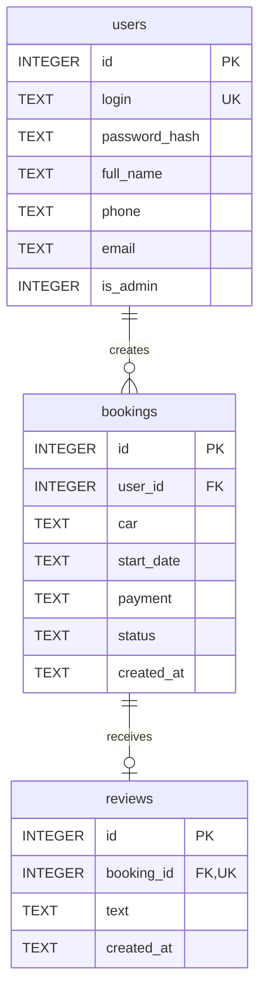

# Ручное воспроизведение «Ключ.на.старт» и «Группы Таймыр»

Утверждённая версия: commit `131dbe7698c200b2b91ce16b558f4c6f33893332`.
Исходники приложения совпадают с `f0313a7`; позднейшие изменения касались отчётов.
Руководство создано 02.11.2026. Имена переменных, маршруты и схема не изменены.
Редактор экзамена подтверждён пользователем: **Adobe XD на Windows**, итог макета — локальный `.xd`.

Это материал для подготовки. Допуск личного руководства/шпаргалки на экзамен не указан:
из разрешения DevDocs он не следует. На экзамене используй только официально разрешённые
материалы и ПО. План не требует ИИ, интернета, переноса готового проекта или заранее
подготовленного личного `.sketch`. Код набирается вручную; медиа берутся из выданных архивов.

## 1. Реалистичность времени и маршрут по руководству

Обязательное ядро сайта — **11 файлов, 512 строк, 30 110 символов**. Два конфигурационных
файла, команды, действия в редакторах и исправления — сверх этого объёма.
В приложении ниже приведены также все пять исходников тестов/инструментов и ER Mermaid,
но они **не входят в экзаменационный набор**: их переписывание добавит более тысячи строк.
Бинарные медиа, шрифты, wheels, чужая JSON Schema и лицензии не набираются как код.
SVG/PNG/SQLite/нативный дизайн — результаты работы соответствующих инструментов.

Для плана 120 на набор сайта отведено 64 минуты, на остальные действия 56 минут, включая
25 минут макета. Нужен устойчивый **чистый темп около 471 символа/мин**, уже с исправлениями.
Автодополнение/вставка готовых исходников в расчёт не заложены.

| Чистый темп кода | Только 30 110 символов | Весь план +56 мин | Вместе с резервом 30 мин |
|---:|---:|---:|---:|
| 250 симв/мин | 120,4 мин | 176,4 | 206,4 |
| 300 симв/мин | 100,4 мин | 156,4 | 186,4 |
| 350 симв/мин | 86,0 мин | 142,0 | 172,0 |
| 400 симв/мин | 75,3 мин | 131,3 | 161,3 |
| 471 симв/мин | 63,9 мин | 119,9 | 149,9 |
| 500 симв/мин | 60,2 мин | 116,2 | 146,2 |

**Вывод:** без измеренной репетиции полный объём за 120 минут обещать нельзя. При темпе
300–400 даже расчётная модель не оставляет 30 минут резерва; при 300 превышает весь экзамен.
25 минут макета — тоже напряжённый бюджет для знакомого редактора. Это модель, не выполненный
хронометраж человека. После двух полных репетиций выбирай основной или балльный порядок ниже.

Читай разделы 2–4 до экзамена. На тренировке набирай файлы разделов 5–6 по порядку,
проверяй интеграцию по разделу 7, затем собирай макет по разделу 8.
Раздел 9 — финальные проверки; 10 — ошибки; 11 — аварийные действия; 12 — состав сдачи.
Раздел 13 — полный вспомогательный код для домашней проверки, не для ручного набора в 150 минут.

## 2. Поминутный план 120 + резерв 30

Это целевой сценарий для уже отработанного темпа; это не утверждение, что он реалистичен
для любого исполнителя. Модули выполняются по порядку. Итоговые уточнения М 2 сразу входят
в код М 1: не писать свободный ввод автомобиля, чтобы через полчаса переделывать на select.

| Минуты | Действие / модуль | Минимальная проверка на границе |
|---|---|---|
| 00–05 | Среда, каталоги, Git, начало М 1 | Python/Flask доступны офлайн, первый commit |
| 05–09 | Шрифты и подготовка ресурсов | Все имена/размеры по таблице; запись результата обработки в графическом редакторе |
| 09–13 | `db.py`, `schema.sql` — 49 строк | py_compile и выполнение schema в памяти |
| 13–35 | `app.py` — 206 строк | py_compile без ошибки, список маршрутов |
| 35–54 | Шесть шаблонов — 111 строк | Все `` закрыты; шесть файлов имеют точные имена |
| 54–57 | Первый запуск, регистрация, вход, одна заявка, Admin | Новая заявка видна владельцу/Admin; гостю кабинет закрыт |
| 57–61 | ER из настоящей SQLite, конец М 1 | Три таблицы, две связи, экспорт диаграммы; commit |
| 61–76 | Начало М 2; полный `style.css` — 115 строк | Палитра/Montserrat, пять страниц 390×844 |
| 76–80 | Полный `script.js` — 31 строка | Четыре фото,3 секунды, обе стрелки, маски |
| 80–83 | Проверки М 2, конец М 2 | Ошибки форм, фильтр, отзыв после завершения; commit |
| 83–86 | М 3: интеграция, микроанимации, проверка БД | FK=1 в DB, целостность, hover/focus/reduced-motion; два checkpoint commit |
| 86–89 | Начало М 4: два экрана, сетка, четыре стиля | 430×932,4 колонки, поля 16, gap14 |
| 89–92 | Общая шапка, логотип, меню, поиск | Два артборда, меню 40px, перенос шапки без сдвига |
| 92–99 | Наполнение «Главной» | Полный текст, фото, преимущества, две CTA, подвал |
| 99–107 | Шесть карточек «Решений» | Весь текст, три ряда, footer в 932px |
| 107–111 | Переходы/hover, сохранение, конец М 4 | Preview туда/обратно; локальный редактируемый файл; commit |
| 111–120 | Финальный контроль и сдача | Два владельца, права, статусы/отзыв, сохранённый макет, Git/передача |
| 120–150 | **Резерв, без планового нового функционала** | Исправления, повторная проверка, восстановление/сдача |

Если порядок модулей разрешено выбирать и темп не позволяет план 120, эффективный порядок
по весам таблицы: **рабочий М 1 → полноценный М 4 → обязательные CSS/адаптивность/слайдер М 2 →
проверки М 3 → украшения**. Не трать 25 минут на шлифовку сайта, оставляя макет пустым:
блок макета весит 25/75. Сначала получить рабочие страницы; затем рано выделить 25–30 минут
на оба экрана/сохранение/переходы. При обязательной последовательности модулей использовать
перестановку нельзя — работай по основной таблице и контрольным точкам отставания.
Частичная сдача по приоритетам не является точным воспроизведением всех утверждённых файлов.

Цель 85% по переданной таблице — минимум 64/75. Условные 48/50 за сайт требуют хотя бы 16/25
за макет. Это ориентир распределения времени, не гарантия баллов. Улучшение hover сайта
не заменяет hover макета: критерии 3.1–3.4 относятся к «Группе Таймыр».

## 3. Подготовительный день: что должно уже работать офлайн

- Уточнить рабочий каталог, механизм сдачи, адрес локального Git-сервера и допустимую СУБД.
  Оригинал предусматривает общий сервер; согласовать SQLite и способ передачи файла БД,
  если организатор требует серверную БД. Не менять стек на экзамене наугад.
- Проверить Python3.12x64, Flask3.1.2, Git, браузер с DevTools, редактор кода без ИИ,
  графический редактор растровых изображений и инструмент ER с готовым SQLite-драйвером.
- На подготовительном дне проверить новый документ в Adobe XD **при отключённом
  интернете**: создание, локальное сохранение, закрытие/открытие, Preview, Hover.
  Пользователь подтвердил XD на Windows на экзамене; проверить его установленную версию,
  активацию и локальный цикл сохранения на конкретном рабочем месте. В текущем окружении
  проекта редактор не был доступен для реальной GUI-проверки, поэтому инструкция не выдаёт
  документированные действия за уже выполненный нативный тест.
- Проверить в локальном DevDocs разделы Python `sqlite3/re/datetime/pathlib`, Flask
  `request/session/g/abort`, Jinja наследование/макросы, CSS Grid/Flex/media, JS DOM/timers.
  Если нужный раздел отсутствует, не рассчитывать скачать его на экзамене.
- Установку пакетов/шрифтов/драйверов и вход в лицензии выполнить заранее средствами
  организатора. Справки в интернете в конце руководства нужны для подготовки, не для экзамена.
- Две репетиции:1) код с нуля без копирования; 2) весь цикл с редактором и сдачей.
  Записать фактические минуты на app/templates/CSS/макет и реальные ошибки. При отставании
  более 10 минут уже на первой половине не рассчитывать «ускориться вдвое» в конце.

## 4. Первые 9 минут: среда, Git и локальные ресурсы

Команды ниже — PowerShell из нового рабочего каталога, выданного организатором. Не запускать
их в каталоге утверждённого проекта, если цель — тренировочная работа с нуля.
Создай папку через Проводник, открой в редакторе и терминале. Сохраняй UTF-8, отступ Python4 пробела.

Финальная структура рабочего набора (tests/tools — только домашнее приложение):

```text
project/
  .gitignore
  requirements.txt
  app.py
  db.py
  schema.sql
  templates/base.html
  templates/auth.html
  templates/_booking.html
  templates/bookings.html
  templates/new.html
  templates/admin.html
  static/style.css
  static/script.js
  static/img/                 9 локальных изображений
  static/fonts/               Montserrat Regular/Bold/Italic + OFL
  docs/er.png                 экспорт ER из инструмента СУБД
  module4/Группа-Таймыр.xd     либо .sketch/.fig, один основной макет
  module4/assets/             логотип, фото, Roboto + OFL
  instance/                   автоматически создаётся, вне Git
```

```powershell
python --version
git --version
mkdir templates,static,static/img,static/fonts,docs,module4
git init
git config user.name "Фамилия Имя"
git config user.email "student@exam.local"
git commit --allow-empty -m "M1: start database and application"
```

Имя/email заменить на свои данные по правилам площадки. Если рабочая копия репозитория уже
выдана, не повторять init/clone: проверить `git status`. Начальные коммиты ставить в реальное
время, не создавать задним числом историю. На границе каждого модуля — start/end checkpoint.
Если файловых изменений ещё нет, `--allow-empty` допустим для обозначения начала этапа.
Конец отмечать только после минимальной проверки. М 3 в этой версии уже интегрирован, поэтому
его коммиты могут фиксировать именно фактическую проверку, не выдуманное изменение кода.

Создай вручную два конфигурационных файла:

### `.gitignore`


7 строк, 72 символов. После набора: `git status` не должен показывать `.venv`, `instance`, распакованные исходные медиа и временные результаты.

<!-- SOURCE .gitignore -->
```text
__pycache__/
*.py[cod]
.venv/
instance/
tmp/
source/
tests/screenshots/
```
<!-- END SOURCE .gitignore -->

### `requirements.txt`


1 строк, 13 символов. После набора: строго одна строка `Flask==3.1.2`. Это единственная прямая runtime-зависимость.

<!-- SOURCE requirements.txt -->
```text
Flask==3.1.2
```
<!-- END SOURCE requirements.txt -->

Сначала `python -c "import flask; print('Flask OK')"`. Если Flask уже установлен в разрешённом
Python, можно использовать этот интерпретатор непосредственно; во всех командах ниже заменить
`.\.venv\Scripts\python.exe` на него. Не создавать пустое venv, если пакетов для него нет.

Если организатор предоставляет локальную папку wheels, создать окружение и установить из неё:

```powershell
python -m venv .venv
.\.venv\Scripts\python.exe -m pip install --no-index --find-links "D:\Public\wheels" -r requirements.txt
.\.venv\Scripts\python.exe -c "import flask,sqlite3; print('runtime OK')"
```

`D:\Public\wheels` — пример, подставить выданный путь. `vendor/wheels` нашего репозитория
работает при домашней репетиции, но наличие/разрешение переноса этой личной папки на экзамен
не предполагается. Wheelhouse из проекта рассчитан на CPython3.12/Windowsx64; при другой
платформе нужны соответствующие локальные пакеты организатора. Без Flask и локального
источника установки офлайн-запуск невозможен: сообщить техническому эксперту сразу.

### Ресурсы: не набирать бинарные данные

Распакуй выданные вложенные архивы Проводником. Для сайта нужен каталог `media` из
`Прил_1_ОЗ_КИМ_09.02.07-3-2027`, для макета — `Медиа/Медиа` из `Медиа.zip`.
Имена ниже — исходные, не новые сетевые загрузки.

| Из исходного `media` | В проект | Размер результата |
|---|---|---|
| `logo_full.png` | `static/img/logo.png` | 1021×200, копия без растяжения |
| `logo_icon.png` | `static/img/icon.png` | 512×512, копия |
| `090551da81afdfc1980d37fa79b29e683a.jpeg` | `static/img/slide1.jpg` | 960×600 |
| `230108-194143.png` | `static/img/slide2.jpg` | 960×600 |
| `SaitZaglavnaya.format-webp.max-2000x2000.jpegquality-80_4hwhYjV.webp` | `static/img/slide3.jpg` | 960×600 |
| `orig.jpg` | `static/img/slide4.jpg` | 960×600 |
| `1200x900.webp` | `static/img/vesta.jpg` | 960×640 |
| `135246346_s63iN0L.jpeg` | `static/img/fleet.jpg` | 960×600 |
| `cf5de6e2a09af74ff13aad23c69466a4.jpg` | `static/img/handover.jpg` | 720×480 |

В разрешённом графическом редакторе: открыть фото → центральное кадрирование нужного
соотношения → масштабировать с сохранением пропорций → JPEG примерно 82% → точное имя.
Не растягивать фото до 8:5 из другого соотношения. Бинарные JPEG разных редакторов могут
отличаться от Pillow при том же визуальном результате; код сайта от этого не меняется.
Оставить доказательство реальной обработки по правилам сдачи: рабочий файл/снимок редактора.
Это устраняет текущий риск 0/2 по критерию 2.8; простое переименование файла обработкой не является.

Из `fonts/Montserrat/Montserrat` скопировать `Montserrat-Regular.ttf`, `Montserrat-Bold.ttf`,
`Montserrat-Italic.ttf`, `OFL.txt` в `static/fonts`. Не брать похожие Inter/variable-файлы.
Для макета — `Roboto-Regular.ttf`, `Roboto-Bold.ttf`, `OFL.txt` из выданного Roboto.
Веб-шрифты достаточно хранить в static, Roboto для редактора установить средствами ОС.
Макет: исходный `Логотип_полный.png`, фото `large.jpg`; центральный crop фото 796×220,
отображение 398×110. Хранить их в `module4/assets`, шрифты/лицензию рядом с ними.

**Проверка:** девять картинок открываются, четыре slide имеют одинаковые 960×600; три
Montserrat имеют точные имена. Исходники ресурсов разрешены заданием; готовый сайт или
собственный старый макет на экзамен из этой инструкции не переносятся.

## 5. М 1: точные файлы в порядке ручного набора

В кодовых блоках SOURCE нет сокращений и номеров строк. Не переносить комментарии-маркеры
SOURCE в исходники. Длинные строки показывать мягким переносом редактора, а не вставкой
случайного перевода строки внутрь кавычек. Печатать ASCII-кавычки, не типографские.

### `db.py`

Не потерять `PRAGMA foreign_keys = ON` и `with self.connection`: это FK и фиксация изменений.

24 строк, 657 символов. После набора: `.\.venv\Scripts\python.exe -m py_compile db.py` завершается без ошибки.

<!-- SOURCE db.py -->
```python
import sqlite3


class DB:
    def __init__(self, path):
        self.connection = sqlite3.connect(path)
        self.connection.row_factory = sqlite3.Row
        self.connection.execute('PRAGMA foreign_keys = ON')

    def all(self, sql, params=()):
        return self.connection.execute(sql, params).fetchall()

    def one(self, sql, params=()):
        return self.connection.execute(sql, params).fetchone()

    def execute(self, sql, params=()):
        with self.connection:
            self.connection.execute(sql, params)

    def script(self, sql):
        self.connection.executescript(sql)

    def close(self):
        self.connection.close()
```
<!-- END SOURCE db.py -->

### `schema.sql`


25 строк, 1095 символов. После набора: выполнить команду ниже: `schema OK`. Таблицы создаются сначала users, затем bookings, затем reviews.

<!-- SOURCE schema.sql -->
```sql
CREATE TABLE IF NOT EXISTS users (
    id INTEGER PRIMARY KEY,
    login TEXT NOT NULL UNIQUE COLLATE NOCASE,
    password_hash TEXT NOT NULL,
    full_name TEXT NOT NULL,
    phone TEXT NOT NULL,
    email TEXT NOT NULL,
    is_admin INTEGER NOT NULL DEFAULT 0 CHECK(is_admin IN (0, 1))
);
CREATE TABLE IF NOT EXISTS bookings (
    id INTEGER PRIMARY KEY,
    user_id INTEGER NOT NULL REFERENCES users(id),
    car TEXT NOT NULL CHECK(car IN ('LADA Vesta', 'Hyundai Creta', 'Toyota Camry')),
    start_date TEXT NOT NULL,
    payment TEXT NOT NULL CHECK(payment IN ('Наличными', 'Переводом по номеру телефона')),
    status TEXT NOT NULL DEFAULT 'Новая' CHECK(status IN ('Новая', 'Идет аренда', 'Аренда завершена')),
    created_at TEXT NOT NULL DEFAULT CURRENT_TIMESTAMP
);
CREATE INDEX IF NOT EXISTS bookings_user ON bookings(user_id);
CREATE TABLE IF NOT EXISTS reviews (
    id INTEGER PRIMARY KEY,
    booking_id INTEGER NOT NULL UNIQUE REFERENCES bookings(id),
    text TEXT NOT NULL CHECK(length(trim(text)) BETWEEN 1 AND 2000),
    created_at TEXT NOT NULL DEFAULT CURRENT_TIMESTAMP
);
```
<!-- END SOURCE schema.sql -->

```powershell
.\.venv\Scripts\python.exe -c "import sqlite3,pathlib; c=sqlite3.connect(':memory:'); c.executescript(pathlib.Path('schema.sql').read_text(encoding='utf-8')); print('schema OK'); c.close()"
```

Ключи: users.id → bookings.user_id; bookings.id → reviews.booking_id. UNIQUE на login
и booking_id отзыва; `COLLATE NOCASE` для логина; CHECK для роли/моделей/оплат/статусов/отзыва.
Не заменять целочисленный INTEGER PRIMARY KEY на INT: семантика SQLite различается.

### `app.py`

Набирать целиком в одном файле. Самые рискованные места: regex email, пять защищённых endpoint, WHERE владельца, предел ID и проверка статуса отзыва.

206 строк, 9281 символов. После набора: `.\.venv\Scripts\python.exe -m py_compile app.py db.py`; затем список маршрутов ниже.

<!-- SOURCE app.py -->
```python
import os
import re
import secrets
import sqlite3
from datetime import datetime
from pathlib import Path

from flask import Flask, abort, flash, g, redirect, render_template, request, session, url_for
from werkzeug.exceptions import HTTPException
from werkzeug.security import check_password_hash, generate_password_hash
from db import DB

app = Flask(__name__)
Path(app.instance_path).mkdir(exist_ok=True)
key_path = Path(app.instance_path) / 'secret.key'
try:
    with key_path.open('x') as key_file:
        key_file.write(secrets.token_hex(32))
except FileExistsError:
    pass
app.config.update(SECRET_KEY=key_path.read_text(), DATABASE=os.environ.get('RENTAL_DB', str(Path(app.instance_path) / 'rental.db')),
                  MAX_CONTENT_LENGTH=32768, SESSION_COOKIE_HTTPONLY=True, SESSION_COOKIE_SAMESITE='Lax')
CARS = ('LADA Vesta', 'Hyundai Creta', 'Toyota Camry')
CAR_IMAGES = dict(zip(CARS, ('vesta.jpg', 'slide1.jpg', 'fleet.jpg')))
PAYMENTS = ('Наличными', 'Переводом по номеру телефона')
STATUSES = ('Новая', 'Идет аренда', 'Аренда завершена')


def get_db():
    if 'db' not in g:
        g.db = DB(app.config['DATABASE'])
    return g.db


@app.teardown_appcontext
def close_db(error=None):
    if 'db' in g:
        g.pop('db').close()


def init_db():
    db = get_db()
    db.script(Path(app.root_path, 'schema.sql').read_text(encoding='utf-8'))
    if not db.one('SELECT id FROM users WHERE login=?', ('Admin',)):
        db.execute('INSERT INTO users(login,password_hash,full_name,phone,email,is_admin) VALUES(?,?,?,?,?,1)',
                   ('Admin', generate_password_hash('StartNET'), 'Администратор', '', ''))


@app.before_request
def load_user():
    g.user = get_db().one('SELECT * FROM users WHERE id=?', (session.get('user_id'),))
    session.setdefault('csrf', secrets.token_hex(24))
    if request.method == 'POST' and not secrets.compare_digest(session['csrf'].encode(), request.form.get('csrf', '').encode()):
        abort(400, 'Форма устарела. Обновите страницу и повторите действие.')
    if request.endpoint in ('bookings', 'new_booking', 'review', 'admin', 'change_status'):
        if not g.user:
            return redirect(url_for('login'))
        if bool(g.user['is_admin']) != (request.endpoint in ('admin', 'change_status')):
            abort(403, 'Недостаточно прав для этой страницы.')


@app.context_processor
def common():
    return dict(cars=CARS, car_images=CAR_IMAGES, payments=PAYMENTS, statuses=STATUSES)


@app.template_filter('date_ru')
def date_ru(value):
    return datetime.strptime(value, '%Y-%m-%d').strftime('%d.%m.%Y')


@app.route('/')
def index():
    return redirect(url_for('admin' if g.user and g.user['is_admin'] else 'bookings' if g.user else 'login'))


@app.route('/register', methods=['GET', 'POST'])
def register():
    errors, values = {}, {}
    if request.method == 'POST':
        values = {key: request.form.get(key, '').strip() for key in ('login', 'full_name', 'phone', 'email')}
        password = request.form.get('password', '')
        rules = dict(login=(r'[A-Za-z0-9]{6,40}', 'Латиница и цифры: от 6 до 40 символов.'),
                     full_name=(r'[А-Яа-яЁё ]{1,150}', 'Введите ФИО кириллицей и пробелами.'),
                     phone=(r'8\([0-9]{3}\)[0-9]{3}-[0-9]{2}-[0-9]{2}', 'Используйте формат 8(XXX)XXX-XX-XX.'),
                     email=(r"(?=.{1,64}@)[A-Za-z0-9!#$%&'*+/=?^_`{|}~-]+(?:\.[A-Za-z0-9!#$%&'*+/=?^_`{|}~-]+)*@(?:[A-Za-z0-9](?:[A-Za-z0-9-]{0,61}[A-Za-z0-9])?\.)+[A-Za-z]{2,63}", 'Введите корректный email.'))
        for key, (pattern, message) in rules.items():
            if not re.fullmatch(pattern, values[key]) or len(values[key]) > 254:
                errors[key] = message
        if not 8 <= len(password) <= 128:
            errors['password'] = 'Пароль: от 8 до 128 символов.'
        if get_db().one('SELECT id FROM users WHERE login=?', (values['login'],)):
            errors['login'] = 'Этот логин уже занят.'
        if not errors:
            try:
                get_db().execute('INSERT INTO users(login,password_hash,full_name,phone,email) VALUES(?,?,?,?,?)',
                                 (values['login'], generate_password_hash(password), values['full_name'], values['phone'], values['email']))
            except sqlite3.IntegrityError:
                errors['login'] = 'Этот логин уже занят.'
            else:
                flash('Пользователь создан. Войдите в личный кабинет.')
                return redirect(url_for('login'))
    return render_template('auth.html', title='Регистрация', register=True, errors=errors, values=values), 400 if errors else 200


@app.route('/login', methods=['GET', 'POST'])
def login():
    errors, values = {}, dict(login=request.form.get('login', '').strip())
    if request.method == 'POST':
        user = get_db().one('SELECT * FROM users WHERE login=?', (values['login'],))
        if not user or not check_password_hash(user['password_hash'], request.form.get('password', '')):
            errors['password'] = 'Неверный логин или пароль.'
        else:
            session.clear()
            session['user_id'] = user['id']
            return redirect(url_for('admin' if user['is_admin'] else 'bookings'))
    return render_template('auth.html', title='Вход', register=False, errors=errors, values=values), 400 if errors else 200


@app.post('/logout')
def logout():
    session.clear()
    return redirect(url_for('login'))


@app.get('/bookings')
def bookings():
    rows = get_db().all('SELECT b.*, r.text AS review FROM bookings b LEFT JOIN reviews r ON r.booking_id=b.id WHERE b.user_id=? ORDER BY b.id DESC', (g.user['id'],))
    return render_template('bookings.html', title='Мои заявки', rows=rows)


@app.route('/bookings/new', methods=['GET', 'POST'])
def new_booking():
    errors, values = {}, request.form
    if request.method == 'POST':
        if values.get('car') not in CARS:
            errors['car'] = 'Выберите автомобиль из списка.'
        if values.get('payment') not in PAYMENTS:
            errors['payment'] = 'Выберите способ оплаты.'
        try:
            raw = values.get('start_date', '')
            if not re.fullmatch(r'[0-9]{2}\.[0-9]{2}\.[0-9]{4}', raw):
                raise ValueError
            date = datetime.strptime(raw, '%d.%m.%Y').strftime('%Y-%m-%d')
        except ValueError:
            errors['start_date'] = 'Введите существующую дату в формате ДД.ММ.ГГГГ.'
        if not errors:
            get_db().execute('INSERT INTO bookings(user_id,car,start_date,payment) VALUES(?,?,?,?)',
                             (g.user['id'], values['car'], date, values['payment']))
            flash('Заявка отправлена. Администратор рассмотрит её в ближайшее время.')
            return redirect(url_for('bookings'))
    return render_template('new.html', title='Новая заявка', errors=errors, values=values), 400 if errors else 200


@app.post('/bookings/<int(max=9223372036854775807):booking_id>/review')
def review(booking_id):
    row = get_db().one('SELECT * FROM bookings WHERE id=? AND user_id=?', (booking_id, g.user['id']))
    if not row:
        abort(404, 'Заявка не найдена.')
    if row['status'] != STATUSES[2]:
        abort(403, 'Отзыв доступен только после завершения аренды.')
    text = request.form.get('text', '').strip()
    if not 1 <= len(text) <= 2000 or '\0' in text:
        abort(400, 'Отзыв: от 1 до 2000 символов, без нулевых символов.')
    try:
        get_db().execute('INSERT INTO reviews(booking_id,text) VALUES(?,?)', (booking_id, text))
    except sqlite3.IntegrityError:
        abort(409, 'Отзыв для этой заявки уже оставлен.')
    flash('Спасибо! Ваш отзыв сохранён.')
    return redirect(url_for('bookings'))


@app.get('/admin')
def admin():
    status = request.args.get('status', '')
    if status and status not in STATUSES:
        abort(400, 'Неизвестный статус фильтра.')
    rows = get_db().all("SELECT b.*,u.full_name,u.phone,u.email,r.text AS review FROM bookings b JOIN users u ON u.id=b.user_id LEFT JOIN reviews r ON r.booking_id=b.id WHERE (?='' OR b.status=?) ORDER BY b.id DESC", (status, status))
    return render_template('admin.html', title='Панель администратора', rows=rows, selected=status)


@app.post('/admin/<int(max=9223372036854775807):booking_id>/status')
def change_status(booking_id):
    status = request.form.get('status')
    if status not in STATUSES[1:]:
        abort(400, 'Выберите допустимый статус.')
    row = get_db().one('SELECT status FROM bookings WHERE id=?', (booking_id,))
    if not row:
        abort(404, 'Заявка не найдена.')
    if row['status'] == STATUSES[2] and status != STATUSES[2]:
        abort(409, 'Завершённую аренду нельзя возобновить.')
    get_db().execute('UPDATE bookings SET status=? WHERE id=? AND status<>?', (status, booking_id, STATUSES[2]))
    flash('Статус заявки обновлён.')
    return redirect(url_for('admin', status=request.form.get('filter') if request.form.get('filter') in STATUSES else ''))


@app.errorhandler(HTTPException)
def error_page(error):
    return render_template('base.html', title=f'Ошибка {error.code}', message=error.description), error.code, error.get_headers()


with app.app_context():
    init_db()

if __name__ == '__main__':
    app.run(host='127.0.0.1', port=int(os.environ.get('PORT', 5000)))
```
<!-- END SOURCE app.py -->

```powershell
.\.venv\Scripts\python.exe -m flask --app app routes
```

Проверить `register`, `login`, `logout`, `bookings`, `new_booking`, `review`, `admin`,
`change_status`, `index`, `static`. Импорт уже создаёт instance/БД и Admin, но до набора
шаблонов браузерные страницы ещё не готовы. Не отлаживать TemplateNotFound раньше времени.

### Договорённости между app и шаблонами — не переименовывать

| Поле/переменная | Где должно совпасть |
|---|---|
| `login`, `password`, `full_name`, `phone`, `email` | register/form/users |
| `car`, `start_date`, `payment` | new/form/bookings |
| `text` | textarea/POST review; в БД reviews.text |
| `status`, `filter` | admin/select/hidden; выбранный фильтр в `selected` |
| `rows`, `row`, `errors`, `values` | render_template и Jinja |
| `cars`, `car_images`, `payments`, `statuses` | context_processor и Jinja |
| `csrf` | session, hidden input, серверная проверка |

Правильная строка статуса — **Идет аренда**, без ё. Admin имеет пять букв по заданию:
он создаётся init_db, а не формой регистрации с минимумом 6. Не «чинить» это несовпадение.

### `templates/base.html`

Это общий шаблон. Макрос csrf наследуется дочерними шаблонами и используется включаемой карточкой.

28 строк, 1696 символов. После набора: в начале объявлен macro csrf, есть block content, локальные style/script, header/footer.

<!-- SOURCE templates/base.html -->
```html
<input type="hidden" name="csrf" value="{{ session.csrf }}">
<!doctype html>
<html lang="ru">
<head>
  <meta charset="utf-8">
  <meta name="viewport" content="width=device-width, initial-scale=1">
  <title>{{ title }} · Ключ.на.старт</title>
  <link rel="icon" href="{{ url_for('static', filename='img/icon.png') }}">
  <link rel="stylesheet" href="{{ url_for('static', filename='style.css') }}">
  <script src="{{ url_for('static', filename='script.js') }}" defer></script>
</head>
<body>
<header class="header"><a class="logo" href="{{ url_for('index') }}"></a>
  <nav aria-label="Основная навигация">
  
    <a class="nav-link" href="{{ url_for('admin' if g.user.is_admin else 'bookings') }}">{{ 'Все заявки' if g.user.is_admin else 'Мои заявки' }}</a>
    <a class="nav-link" href="{{ url_for('new_booking') }}">Оформить аренду</a>
    <form method="post" action="{{ url_for('logout') }}">{{ csrf() }}<button class="text-button">Выйти</button></form>
  <a class="nav-link" href="{{ url_for('login') }}">Вход</a><a class="nav-link" href="{{ url_for('register') }}">Регистрация</a>
  </nav>
</header>
<main>
  <div class="notice" role="status">{{ notice }}</div>
  <section class="form-page"><h1>{{ title }}</h1><p>{{ message }}</p><a class="button" href="{{ url_for('index') }}">На главную</a></section>
</main>
<footer class="footer">Ключ.на.старт · Аренда автомобилей</footer>
</body>
</html>
```
<!-- END SOURCE templates/base.html -->

### `templates/auth.html`


39 строк, 2827 символов. После набора: register=True выводит пять полей, False — два; кнопка регистрации называется «Зарегистрироваться».

<!-- SOURCE templates/auth.html -->
```html


<label class="field">{{ label }}<input name="{{ name }}" type="{{ type }}" placeholder="{{ placeholder }}" autocomplete="{{ autocomplete }}" maxlength="{{ maxlength }}" value="{{ values.get(name, '') if type != 'password' else '' }}" required aria-invalid="true" aria-describedby="error-{{ name }}">
<span class="field-error" id="error-{{ name }}">{{ errors[name] }}</span></label>


<div class="entry-layout">
<section class="entry-form">
  <h1>{{ title }}</h1>
  <p class="muted">{{ 'Все поля обязательны для заполнения.' if register else 'Ваши заявки и отзывы — в личном кабинете.' }}</p>
  <form method="post" novalidate>
    {{ csrf() }}
    {{ field('login', 'Логин', placeholder='От 6 букв латиницей или цифр' if register else 'Ваш логин', autocomplete='username', maxlength=40) }}
    {{ field('password', 'Пароль', 'password', 'Не менее 8 символов' if register else 'Ваш пароль', 'new-password' if register else 'current-password', 128) }}
    
    {{ field('full_name', 'ФИО', placeholder='Иванов Иван Иванович', autocomplete='name', maxlength=150) }}
    {{ field('phone', 'Телефон', 'tel', '8(999)123-45-67', 'tel', 15) }}
    {{ field('email', 'Электронная почта', 'email', 'name@example.ru', 'email') }}
    
    <button class="button full">{{ 'Зарегистрироваться' if register else 'Войти' }}</button>
  </form>
  <p class="auth-switch"><a href="{{ url_for('login' if register else 'register') }}">{{ 'Уже зарегистрированы? Вход' if register else 'Еще не зарегистрированы? Регистрация' }}</a></p>
</section>
<section class="entry-visual">
  <h2>Аренда автомобилей</h2>
  <p>LADA Vesta, Hyundai Creta и Toyota Camry.<br>Выберите модель, дату начала аренды и способ оплаты.</p>
  <div class="slider" aria-roledescription="карусель" aria-label="Аренда автомобилей">
    
    <figure class="slide" hidden><figcaption>{{ caption }}</figcaption></figure>
    
    <button class="slider-arrow" type="button" data-step="-1" aria-label="Предыдущее изображение">‹</button>
    <button class="slider-arrow" type="button" data-step="1" aria-label="Следующее изображение">›</button>
    <span class="slide-count" aria-live="off">1 / 4</span>
  </div>
  <p class="hint">Оплата наличными или переводом по номеру телефона. Заявку рассматривает администратор.</p>
</section>

</div>

```
<!-- END SOURCE templates/auth.html -->

### `templates/_booking.html`

Начальный символ подчёркивания в имени обязателен. Файл не extends base: он включается внутрь двух страниц.

14 строк, 1977 символов. После набора: обычный пользователь получает фото и свою карточку; Admin — контакты/форму статуса; отзыв зависит от статуса.

<!-- SOURCE templates/_booking.html -->
```html
<article class="booking booking-user">

<div class="booking-content">
  <div class="card-heading"><span>Заявка № {{ row.id }}</span><span class="status status-{{ statuses.index(row.status) }}">{{ row.status }}</span></div><h2>{{ row.car }}</h2>
  <dl><div><dt>Клиент</dt><dd>{{ row.full_name }}</dd></div><div><dt>Телефон</dt><dd>{{ row.phone }}</dd></div><div><dt>Email</dt><dd>{{ row.email }}</dd></div><div><dt>Начало аренды</dt><dd>{{ row.start_date|date_ru }}</dd></div><div><dt>Оплата</dt><dd>{{ row.payment }}</dd></div></dl>
</div>

<form class="status-form" method="post" action="{{ url_for('change_status', booking_id=row.id) }}">{{ csrf() }}<input type="hidden" name="filter" value="{{ selected }}"><label class="field">Новый статус<select name="status"><option selected>{{ status }}</option></select></label><button class="button">Сохранить статус</button></form>

<div class="review"><h3>{{ 'Отзыв клиента' if g.user.is_admin else 'Ваш отзыв' }}</h3><p>{{ row.review }}</p></div>

<form class="review" method="post" action="{{ url_for('review', booking_id=row.id) }}">{{ csrf() }}<label class="field">Как прошла аренда?<textarea name="text" rows="3" maxlength="2000" required placeholder="Поделитесь впечатлениями"></textarea></label><button class="button">Оставить отзыв</button></form>
<p class="hint booking-note">Отзыв доступен после завершения аренды.</p>
</article>
```
<!-- END SOURCE templates/_booking.html -->

### `templates/bookings.html`


8 строк, 696 символов. После набора: на пустом кабинете есть изображение handover и ссылка создания; на непустом include карточек.

<!-- SOURCE templates/bookings.html -->
```html


<div class="page-heading"><div><h1>Мои заявки</h1><p class="muted">{{ g.user.full_name }}</p></div><a class="button" href="{{ url_for('new_booking') }}">Оформить аренду</a></div>
<div class="cards">

<section class="empty"><div><h2>У вас пока нет заявок</h2><p>Выберите автомобиль и дату начала аренды. Отправленная заявка появится здесь.</p><a href="{{ url_for('new_booking') }}" class="button">Создать заявку</a></div></section>
</div>

```
<!-- END SOURCE templates/bookings.html -->

### `templates/new.html`


13 строк, 2039 символов. После набора: ровно car/start_date/payment, обе select имеют пустой вариант; все ошибки возвращаются на форму.

<!-- SOURCE templates/new.html -->
```html


<div class="entry-layout"><section class="entry-form"><h1>Новая заявка</h1><p class="muted">Все поля обязательны для заполнения.</p>
<form method="post" novalidate>
  {{ csrf() }}
  <label class="field">Автомобиль<select name="car" required aria-invalid="true" aria-describedby="error-car"><option value="">Выберите автомобиль</option><option selected>{{ car }}</option></select><span class="field-error" id="error-car">{{ errors.car }}</span></label>
  <label class="field">Дата начала аренды<input name="start_date" placeholder="ДД.ММ.ГГГГ" maxlength="10" inputmode="numeric" value="{{ values.get('start_date', '') }}" required aria-invalid="true" aria-describedby="error-date"><span class="field-error" id="error-date">{{ errors.start_date }}</span></label>
  <label class="field">Способ оплаты<select name="payment" required aria-invalid="true" aria-describedby="error-payment"><option value="">Выберите способ оплаты</option><option selected>{{ payment }}</option></select><span class="field-error" id="error-payment">{{ errors.payment }}</span></label>
  <button class="button full">Отправить</button><a class="back-link" href="{{ url_for('bookings') }}">Вернуться к заявкам</a>
</form></section>
<aside class="entry-visual"><h2>Автомобили в аренду</h2><ul class="model-list"><li>{{ car }}</li></ul><p class="hint">Заявка поступит администратору со статусом «Новая». Изменения статуса появятся в личном кабинете.</p></aside>
</div>

```
<!-- END SOURCE templates/new.html -->

### `templates/admin.html`


9 строк, 898 символов. После набора: filter работает GET, status-form в карточке — POST; не перепутать методы.

<!-- SOURCE templates/admin.html -->
```html


<div class="page-heading"><div><h1>Панель администратора</h1><p class="muted">Заявки клиентов</p></div><span class="muted">Найдено: {{ rows|length }}</span></div>
<form class="filter" method="get"><label for="filter">Статус</label><select id="filter" name="status"><option value="">Все статусы</option><option selected>{{ status }}</option></select><button class="button">Показать</button><a href="{{ url_for('admin') }}">Сбросить</a></form>
<div class="cards">

<section class="empty"><div><h2>Заявок нет</h2><p class="muted">{{ 'Измените фильтр, чтобы увидеть другие заявки.' if selected else 'Здесь появятся заявки клиентов.' }}</p></div></section>
</div>

```
<!-- END SOURCE templates/admin.html -->

### Первый запуск и контроль М 1,54–57

```powershell
.\.venv\Scripts\python.exe app.py
```

Оставь терминал работающим. Открой `http://127.0.0.1:5000/login`.
Пока CSS/JS не набраны, их 404 и простая HTML-разметка ожидаемы; они исчезнут на этапе М 2.
Не создавать новую реализацию для раннего минимального интерфейса: эти шаблоны уже финальные.

1. Создать Driver01 /12345678, Иванов Иван Иванович,8(999)123-45-67,ivan@example.ru.
2. Войти, создать LADA Vesta/02.12.2026/Наличными. Дата в прошлом также допустима заданием;
   можно взять другую существующую дату, но для сверки с тестами использована эта.
3. Увидеть свою «Новую» заявку и отсутствие поля отзыва. Запомнить фактический ID карточки.
4. Выйти → войти Admin/StartNET → увидеть заявку и контакты пользователя.
5. В приватном окне гостя `/bookings`, `/bookings/new`, `/admin` ведут на вход.

Если обнаружена ошибка, сначала прочитать последнюю строку traceback в терминале и исправить
указанный файл/строку. При изменении Python остановить Ctrl+C и запустить снова: debug/reloader
выключены. При изменении HTML/CSS достаточно обновить страницу; для static полезен Ctrl+F5.

### ER средствами СУБД,57–61

Выбрать установленный разрешённый инструмент, который действительно строит ER из SQLite.
Если на площадке есть DBeaver с готовым драйвером: New Connection → SQLite → существующий
`instance/rental.db` → Test Connection. Открыть узел Tables/схемы и Diagram; при необходимости
создать custom diagram и добавить users/bookings/reviews. Включить поля/ключи, авторазмещение,
проверить обе реальные FK, экспортировать диаграмму в `docs/er.png` или `docs/er.svg`.
Сохранить документ диаграммы, если инструмент поддерживает; PNG открывается и читается.
Не создавать виртуальные линии вместо отсутствующих FK — исправить schema и учебную БД.
[Официальное описание ER DBeaver](https://dbeaver.com/docs/dbeaver/ER-Diagrams/).

Ожидаемая кратность: users1 → bookings0..N; bookings1 → reviews0..1.
`reviews.booking_id` одновременно FK и UNIQUE. Не рисовать reviews как обязательный 1:1.
В исходной версии ER была вручную сгенерирована вне инструмента СУБД: этот шаг нужен для
буквального требования экзамена, а не описывает уже выполненную GUI-проверку проекта.
Mermaid исходной версии приведён в приложении только для сверки структуры.

SQLite-файл по `.gitignore` не коммитится: schema.sql обязателен. Если комиссия требует
саму БД, передать её отдельным предусмотренным способом после закрытия приложения/инструмента.
Не коммитить secret.key и свои тестовые аккаунты только ради «наличия БД в Git».

```powershell
git add .
git commit -m "M1: database, rental workflow, access control and ER"
git commit --allow-empty -m "M2: start responsive design"
```

## 6. М 2: общий CSS, JavaScript и контроль

### `static/style.css`

Печатать все правила, включая оба media и reduced-motion. Минификация не требуется; исходник уже содержит одно правило на строку.

115 строк, 7452 символов. После набора: в браузере Montserrat/палитра; при 390×844 все пять страниц без горизонтального выхода.

<!-- SOURCE static/style.css -->
```css
@font-face{font-family:Montserrat;src:url('fonts/Montserrat-Regular.ttf');font-weight:400;font-display:swap}
@font-face{font-family:Montserrat;src:url('fonts/Montserrat-Bold.ttf');font-weight:700;font-display:swap}
@font-face{font-family:Montserrat;src:url('fonts/Montserrat-Italic.ttf');font-style:italic;font-display:swap}
:root{--accent:#d9480f;--ink:#212b36;--muted:#6c757d;--bg:#f8f9fa;--white:#fff;--line:#e1e4e8}
*{box-sizing:border-box}
body{margin:0;background:var(--bg);color:var(--ink);font:16px/1.6 Montserrat,sans-serif}
button,input,select,textarea{font:inherit;color:inherit}
a{color:var(--accent);text-decoration:none}
a:hover{text-decoration:underline}
button{border:0;cursor:pointer}
img{max-width:100%;display:block}
h1,h2,h3,p{margin:0 0 16px;overflow-wrap:anywhere}
h1{font-size:36px;line-height:1.2;letter-spacing:-1px}
h2{font-size:24px;line-height:1.3}
h3{font-size:18px;line-height:1.4}
form{margin:0}
.header,main,.footer{max-width:1200px;margin:auto;padding-left:32px;padding-right:32px}
.header{min-height:108px;display:flex;justify-content:space-between;align-items:center;gap:24px;border-bottom:1px solid var(--line)}
.logo img{width:255px;height:50px;object-fit:contain}
.header nav{display:flex;align-items:center;gap:24px;flex-wrap:wrap}
.nav-link,.text-button{display:inline-flex;align-items:center;min-height:44px;font-size:14px;font-weight:700}
.nav-link{color:var(--ink)}
.nav-link:hover,.text-button:hover{color:var(--accent)}
.text-button{background:none;padding:0;color:var(--muted)}
main{padding-top:40px;padding-bottom:64px;min-height:calc(100vh - 183px)}
.footer{padding-top:24px;padding-bottom:24px;border-top:1px solid var(--line);color:var(--muted);font-size:12px;font-style:italic}
.muted,.hint,dt{color:var(--muted)}
.hint,dt{font-size:12px;font-style:italic}
.button{display:inline-flex;justify-content:center;align-items:center;min-height:50px;padding:12px 22px;background:var(--accent);color:white;border-radius:6px;font-weight:700;text-align:center;transition:background .15s,transform .15s}
.button:hover{text-decoration:none;background:var(--ink);transform:translateY(-1px)}
.full{width:100%}
.field{display:flex;flex-direction:column;gap:7px;margin:20px 0;font-weight:700}
input,select,textarea{width:100%;min-width:0;min-height:50px;padding:12px 14px;background:var(--white);border:1px solid #bbc1c7;border-radius:6px;font-size:16px;font-weight:400}
input::placeholder,textarea::placeholder{color:var(--muted)}
textarea{resize:vertical}
:focus-visible{outline:3px solid var(--accent);outline-offset:3px}
input[aria-invalid],select[aria-invalid]{border-color:var(--accent)}
.field-error{color:var(--accent);font-size:12px;font-style:italic;font-weight:400}
.notice{padding:16px 20px;margin-bottom:28px;background:var(--white);border-left:4px solid var(--accent)}
.entry-layout{display:grid;grid-template-columns:1.25fr 1fr;gap:64px;align-items:start}
.entry-form{grid-column:2;grid-row:1;padding-left:32px;border-left:1px solid var(--line)}
.entry-visual{grid-column:1;grid-row:1;padding-top:4px}
.auth-switch{margin:24px 0 0}
.form-page{max-width:640px;margin:auto}
.back-link{display:block;margin-top:18px;text-align:center}
.slider{position:relative;overflow:hidden;margin:24px 0 16px;border-radius:8px;background:var(--ink)}
.slide{position:relative;margin:0;animation:appear .3s ease-out}
.slide[hidden]{display:none}
.slide img{width:100%;height:auto;aspect-ratio:8/5;object-fit:cover;filter:brightness(.8)}
.slide figcaption{position:absolute;left:20px;right:80px;bottom:20px;color:white;font-size:18px;font-weight:700;text-shadow:0 1px 4px #000}
.slider-arrow{position:absolute;top:calc(50% - 22px);display:grid;place-items:center;width:44px;height:44px;padding:0;border-radius:50%;background:#fffffff0;color:var(--ink);font-size:32px;line-height:1;transition:background .15s,color .15s}
.slider-arrow[data-step="-1"]{left:16px}
.slider-arrow[data-step="1"]{right:16px}
.slider-arrow:hover{background:var(--accent);color:white}
.slide-count{position:absolute;right:20px;bottom:22px;color:white;font-size:12px;font-style:italic;font-variant-numeric:tabular-nums;text-shadow:0 1px 4px #000}
.fleet-photo{width:100%;aspect-ratio:8/5;height:auto;object-fit:cover;border-radius:8px}
.model-list{display:flex;flex-wrap:wrap;gap:8px 24px;margin:20px 0;padding:0;list-style:none;font-weight:700}
.page-heading{display:flex;justify-content:space-between;align-items:center;gap:24px;margin-bottom:32px}
.page-heading p{margin:0}
.cards{display:grid;gap:20px}
.booking{display:flex;flex-wrap:wrap;align-items:flex-start;gap:20px 24px;padding:24px;background:var(--white);border-top:2px solid var(--line);animation:appear .3s ease-out}
.car-photo{width:192px;height:128px;object-fit:cover;border-radius:4px}
.booking-content{flex:1;min-width:0}
.card-heading{display:flex;justify-content:space-between;gap:16px;margin-bottom:10px;color:var(--muted);font-size:12px;font-style:italic}
.status{font-weight:700;text-align:right}
.status-1{color:var(--accent)}
.status-2{color:var(--ink)}
.booking h2{margin-bottom:16px}
dl{display:grid;grid-template-columns:repeat(auto-fit,minmax(160px,1fr));gap:12px 24px;margin:0}
dd{margin:2px 0 0;overflow-wrap:anywhere}
.review,.booking-note{flex-basis:100%;margin:0;padding-top:16px;border-top:1px solid var(--line)}
.review p{margin:0;white-space:pre-wrap}
.review .field,.status-form .field{margin-top:0}
.status-form{width:264px}
.status-form .button{width:100%}
.filter{display:flex;align-items:center;gap:16px;flex-wrap:wrap;margin-bottom:24px;padding-bottom:24px;border-bottom:1px solid var(--line)}
.filter label{font-weight:700}
.filter select{max-width:300px}
.empty{display:flex;align-items:center;gap:32px;padding:32px 0}
.empty img{width:240px;aspect-ratio:3/2;height:auto;object-fit:cover;border-radius:8px}
@keyframes appear{from{opacity:0;transform:translateY(4px)}to{opacity:1;transform:translateY(0)}}
@media(max-width:900px){
.entry-layout{gap:32px;grid-template-columns:1fr 1fr}
.entry-form{padding-left:24px}
.header{flex-wrap:wrap;padding-top:20px;padding-bottom:20px;gap:12px}
.header nav{gap:20px}
}
@media(max-width:640px){
.header,main,.footer{padding-left:20px;padding-right:20px}
.logo img{width:220px;height:43px}
.header nav{width:100%;gap:8px 20px}
.header nav form{margin-left:auto}
.nav-link,.text-button{font-size:13px}
main{padding-top:28px;padding-bottom:40px}
.entry-layout{display:flex;flex-direction:column;gap:40px}
.entry-form{width:100%;padding:0;border:0}
.entry-visual{width:100%;padding-top:28px;border-top:1px solid var(--line)}
.slide figcaption{font-size:16px}
.page-heading{align-items:flex-start;flex-direction:column;gap:20px}
.filter select{max-width:none}
.filter label,.filter select{width:100%}
.filter .button{flex:1}
.booking{padding:20px;gap:16px}
.booking-user{display:grid;grid-template-columns:96px minmax(0,1fr)}
.booking-user .car-photo{width:96px;height:84px;grid-row:1/3}
.booking-user .booking-content{display:contents}
.booking-user .card-heading,.booking-user h2{grid-column:2;margin:0}
.booking-user dl,.booking-user .review,.booking-user .booking-note{grid-column:1/-1}
.booking-content{flex-basis:100%}
.card-heading{gap:8px;flex-wrap:wrap}
.status-form{width:100%}
.empty{align-items:flex-start;flex-direction:column;gap:24px;padding:8px 0}
.empty img{width:100%;max-width:320px}
}
@media(prefers-reduced-motion:reduce){*,*::before,*::after{animation:none!important;transition:none!important}}
```
<!-- END SOURCE static/style.css -->

### `static/script.js`

Сохранить JS-шаблонную строку с обратными кавычками `${...}`, значение 3000 и проверку prefers-reduced-motion.

31 строк, 1492 символов. После набора: четыре автоматических переключения с возвратом, обе стрелки, ввод телефона/даты.

<!-- SOURCE static/script.js -->
```javascript
document.querySelectorAll('.slider').forEach(slider => {
  const slides = [...slider.querySelectorAll('.slide')];
  const counter = slider.querySelector('.slide-count');
  let current = 0, timer;
  const motion = matchMedia('(prefers-reduced-motion: reduce)');
  const show = (step = 1) => {
    slides[current].hidden = true;
    current = (current + step + slides.length) % slides.length;
    slides[current].hidden = false;
    counter.textContent = `${current + 1} / ${slides.length}`;
  };
  const schedule = () => {
    clearInterval(timer);
    if (!motion.matches && !document.hidden) timer = setInterval(show, 3000);
  };
  slider.querySelectorAll('[data-step]').forEach(button => button.addEventListener('click', () => {
    show(Number(button.dataset.step)); schedule();
  }));
  document.addEventListener('visibilitychange', schedule);
  motion.addEventListener('change', schedule);
  schedule();
});

document.querySelectorAll('input[name="phone"], input[name="start_date"]').forEach(input => {
  input.addEventListener('input', () => {
    const d = input.value.replace(/\D/g, '').slice(0, input.name === 'phone' ? 11 : 8);
    input.value = input.name === 'phone'
      ? d.slice(0, 1) + (d.length > 1 ? '(' + d.slice(1, 4) : '') + (d.length > 4 ? ')' + d.slice(4, 7) : '') + (d.length > 7 ? '-' + d.slice(7, 9) : '') + (d.length > 9 ? '-' + d.slice(9) : '')
      : d.slice(0, 2) + (d.length > 2 ? '.' + d.slice(2, 4) : '') + (d.length > 4 ? '.' + d.slice(4) : '');
  });
});
```
<!-- END SOURCE static/script.js -->

### Контроль М 2,80–83

- Ctrl+F5; открыть DevTools, режим 390×844. Проверить login/register/bookings/new/admin.
  Формы на мобильном идут до фото; нижние поля доступны прокруткой. Все картинки загружены.
- Четыре фото слайдера одинаковые 8:5. За 12–13 секунд проверить все 4 и возврат к первому;
  нажать обе стрелки, счётчик меняется, после клика новый интервал 3 секунды. Пауза не нужна.
  В фоне вкладки и при reduced-motion автосмена намеренно останавливается: это не поломка.
- Ввести неверные регистрационные поля: abc/123/John/+7/bad@. На форме пять ошибок, пользователя
  в БД нет. Верные данные проходят; уже занятый логин, в том числе с другим регистром, не проходит.
- Новая заявка: пустые select и 31.02.2026 возвращают ошибки. Верная дата отображается ДД.ММ.ГГГГ.
- Admin: фильтр Новая → правильный набор, очистка → все; сменить статус, увидеть сообщение.
- Ошибки JS — Console, битые ресурсы — Network. Не заменять серверную валидацию HTML required.

```powershell
git add .
git commit -m "M2: local media, responsive pages and four-image slider"
git commit --allow-empty -m "M3: start integration verification"
```

## 7. М 3: интеграция,83–86

Нового исходного файла нет: актуальная версия уже интегрирована. Не переписывать app/CSS
в альтернативном стиле. Проверить микроанимации появления карточки/слайда, hover кнопок,
видимый клавиатурный focus, адаптивность; reduced-motion уменьшает движение.

Во втором терминале из корня проекта:

```powershell
.\.venv\Scripts\python.exe -c "from db import DB; d=DB('instance/rental.db'); print('FK', d.one('PRAGMA foreign_keys')[0]); print('integrity', d.one('PRAGMA integrity_check')[0]); print('orphans', [tuple(r) for r in d.all('PRAGMA foreign_key_check')]); d.close()"
```

Ожидается FK1, integrity ok, orphans[]. `PRAGMA foreign_keys` относится к соединению:
новая консоль СУБД с 0 не доказывает, что DB-класс работает без FK. Проверять именно DB.
Три таблицы покрывают все сценарии предыдущих модулей. Завершённая аренда терминальна;
повторный отзыв запрещён. Контроль доступа находится на сервере, не только в меню.

```powershell
git commit --allow-empty -m "M3: integrated workflow and responsive interactions verified"
git commit --allow-empty -m "M4: start Taimyr mobile prototype"
```

## 8. М 4: редактор, ограничения текущего файла и порядок действий

Модуль выполняется **в графическом редакторе**, не в Flask и не генератором Python.
Нужен один настоящий `.xd`, `.sketch` или `.fig` с редактируемыми текстами/фигурами/изображениями.
Два PNG — только дополнительные референсы, не замена формата.

Утверждённый `Группа-Таймыр.sketch` имеет проверенную структуру, но не проверен в редакторе;
native hover в нём отсутствует. Ниже геометрия/контент воспроизводят этот макет. Подключение
настоящего hover — отдельная обязательная настройка по оригинальному заданию для устранения
этого известного ограничения; оно не представляется уже работающей функцией файла.
Сайт/его исходники ради этого не меняются. Воспроизводить скрытые неподключённые образцы
вместо настоящего hover на экзамене не нужно.

### 8.1. Базовая сборка в Adobe XD на Windows

1. Создать новый локальный документ и сразу сохранить `module4/Группа-Таймыр.xd` через
   File → Save As Local Document. Повторять Ctrl+S после каждого экрана. Не выбирать
   только облачный документ: на сдаче должен существовать локальный редактируемый файл.
   [Сохранение локально, Adobe](https://helpx.adobe.com/xd/desktop/troubleshooting/cloud-documents-and-creative-cloud-libraries/fix-issues-with-xd-cloud-documents.html).
2. Инструмент Artboard: два экрана 430×932, портрет. Назвать `01 · Главная`, `02 · Решения`.
   Первый на холсте X0,Y0; второй X478,Y0. Далее все координаты относительно своего экрана.
3. Выделить оба: Grid → Layout, Columns4, Gutter14, левое/правое поле 16, Column Width89.
   Получится 4×89+3×14+32=430. Проверить сетку на обоих; это нативная grid, не четыре нарисованные полосы.
   [Настройка сетки, Adobe](https://helpx.adobe.com/xd/desktop/design/artboards-guides-and-layers/work-with-guides-and-grids-in-adobe-xd.html).
4. Создать четыре шрифтовых стиля: Regular14/18, Bold14/18, Bold16/20, Bold28/34.
   Гарнитура Roboto. Первое число — размер px, второе — межстрочный. Не уменьшать текст для
   экономии места ниже 14. Цвет меняется по роли слоя, новых шрифтов/размеров не добавлять.
5. Задать палитру: фон `#F5F8F8`, белый `#FFFFFF`, основной `#0E7583`, текст `#17363B`,
   вторичный `#536A6E`, контур `#D5E3E5`, hover-фон `#EAF3F4`, hover-текст `#085966`.
   Без теней. Карточки radius8; кнопки/поиск radius6, border1.
6. Построить шапку на первом, сгруппировать и дублировать на второй без сдвига.
   Фон шапки белый(0,0,430,96); логотип(16,12,132,35.85), пропорции сохранять.
   Меню: Главная(16,48,192,40), Решения(222,48,192,40). Активная кнопка teal/белый текст,
   неактивная белая/teal. Подпись Bold14/18 по центру. На втором поменять активный пункт.
7. Далее заполнить «Главную» по 8.2, затем построить одну карточку «Решений» и дублировать
   её шесть раз по 8.3. Полный текст переносить из выданного Текст.docx, не сокращать.
   При допустимости копирования выданного текста использовать вставку как plain text.
   Код сайта при этом по-прежнему набирается вручную.

**Контроль:** два артборда 430×932, grid4, Roboto установлен/не заменён, header не перекрывает меню.
Не конвертировать текст в кривые. Не подменять весь экран единым bitmap.

### 8.2. «Главная»: фигуры и изображения

| Объект | X,Y,W,H | Оформление |
|---|---|---|
| Поиск | 16,108,398,44 | Белый, border LINE1, radius6 |
| Лупа | 30,122,13,13 | Контур MUTED, ручка 43,133,2,8 под 45° |
| Фото `large.jpg` | 16,282,398,110 | Центральный crop3.618:1, без растяжения |
| Маркеры преимуществ | 16,535,5,5; 16,561,5,5; 16,605,5,5 | TEAL, radius2 |
| Заказать лицензию | 16,648,398,44 | TEAL/белый, radius6 |
| Скачать пробную версию | 16,700,398,44 | Белый/TEAL, border1, radius6 |
| Линия подвала | 16,758,398,1 | LINE |

Точный текст и рамки ниже извлечены из актуального `.sketch`. Формат стиля: размер/строка,
R=Regular,B=Bold; L/C/R — выравнивание слева/по центру/справа. Высота рамки дана для текущих
переносов, не для обрезания текста. Если редактор переносит иначе, сначала проверить Roboto,
ширину/размер/межстрочный/character spacing0, а не уменьшать шрифт. Все элементы должны остаться
внутри 932px; после нативной проверки возможна коррекция рамок без изменения содержания.

| Полный текст | X,Y,W,H | Стиль / цвет / align |
|---|---|---|
| Главная | 24,59,176,18 | B14/18 #FFFFFF C |
| Решения | 230,59,176,18 | B14/18 #0E7583 C |
| Поиск по продуктам | 54,121,340,18 | R14/18 #536A6E L |
| ПЛАТФОРМА ДАННЫХ | 16,174,398,18 | B14/18 #0E7583 L |
| Таймыр Data Platform Enterprise | 16,202,398,68 | B28/34 #17363B L |
| Отечественная платформа со встроенными средствами защиты для надежного хранения, обработки и резервного копирования корпоративных данных в ИТ-инфраструктурах любого масштаба. Доступны версии для серверного, десктопного, мобильного и встраиваемого сценариев применения | 16,408,398,108 | R14/18 #17363B L |
| Более 800 организаций используют Таймыр Data Platform | 30,530,384,18 | R14/18 #17363B L |
| Непрерывная защита данных от сбоев и утечек на всех этапах хранения | 30,556,384,36 | R14/18 #17363B L |
| Полная совместимость с отечественными ОС и стандартами | 30,600,384,36 | R14/18 #17363B L |
| Заказать лицензию | 24,661,382,18 | B14/18 #FFFFFF C |
| Скачать пробную версию | 24,713,382,18 | B14/18 #0E7583 C |
| Продолжая, вы соглашаетесь с условиями использования и политикой конфиденциальности | 16,772,398,36 | R14/18 #536A6E L |
| © 2025 | 16,820,90,18 | R14/18 #536A6E L |
| Все права защищены | 120,820,294,18 | R14/18 #536A6E R |

**Контроль «Главной»:** подпись лицензии читается, описание полное, три преимущества,
две CTA без переходов на другие экраны, юридический текст, ©2025, права. Нижняя рамка 838,
остаток 94px. Поиск в макете — визуальный элемент, программный поиск не требуется.

### 8.3. «Решения»: карточки

Шапка уже скопирована; активны «Решения». Поиск на этом экране не добавлять.
Карточка белая, border LINE1, radius8; две колонки по 192, между ними 14.
Внутренний отступ 12; заголовок шириной 168, пункты шириной 158 со сдвигом 22.
Маркер пункта 3×3, x карточки+12, y строки+6. Между пунктами 4px после рамки строки.

| Ряд | Левая карточка | Правая | X слева/справа | Y | W×H | Кнопки X слева/справа,Y,W,H |
|---|---|---|---:|---:|---|---|
| 1 | Таймыр Studio | Таймыр Server | 16/222 | 100 | 192×330 | 28/234,378,168,40 |
| 2 | Таймыр Mobile | Таймыр Embedded | 16/222 | 440 | 192×276 | 28/234,664,168,40 |
| 3 | Программный стек «Группы Таймыр» | Техническая поддержка | 16/222 | 726 | 192×158 | 28/234,832,168,40 |

У всех шести кнопок текст «Подробнее», белый фон/teal текст и граница. Не настраивать
переход на другие экраны. Строки пунктов и полный текст каждой карточки:

| Полный текст | X,Y,W,H | Стиль / цвет / align |
|---|---|---|
| Главная | 24,59,176,18 | B14/18 #0E7583 C |
| Решения | 230,59,176,18 | B14/18 #FFFFFF C |
| Таймыр Studio | 28,112,168,20 | B16/20 #0E7583 L |
| Удобство для администратора | 38,142,158,36 | R14/18 #17363B L |
| Универсальность | 38,182,158,18 | R14/18 #17363B L |
| Современность | 38,204,158,18 | R14/18 #17363B L |
| Наглядность | 38,226,158,18 | R14/18 #17363B L |
| Подробнее | 36,389,152,18 | B14/18 #0E7583 C |
| Таймыр Server | 234,112,168,20 | B16/20 #0E7583 L |
| Отказоустойчивый кластер баз данных | 244,142,158,36 | R14/18 #17363B L |
| Централизованное управление конфигурациями | 244,182,158,54 | R14/18 #17363B L |
| Инструменты для разработки и использования прикладного ПО | 244,240,158,72 | R14/18 #17363B L |
| Безопасная среда исполнения контейнерных нагрузок | 244,316,158,54 | R14/18 #17363B L |
| Подробнее | 242,389,152,18 | B14/18 #0E7583 C |
| Таймыр Mobile | 28,452,168,20 | B16/20 #0E7583 L |
| Адаптивность | 38,482,158,18 | R14/18 #17363B L |
| Централизованность | 38,504,158,18 | R14/18 #17363B L |
| Удобство | 38,526,158,18 | R14/18 #17363B L |
| Подробнее | 36,675,152,18 | B14/18 #0E7583 C |
| Таймыр Embedded | 234,452,168,20 | B16/20 #0E7583 L |
| Поддержка основных процессорных архитектур | 244,482,158,54 | R14/18 #17363B L |
| Гибкая система лицензирования | 244,540,158,36 | R14/18 #17363B L |
| Сертификаты ключевых регуляторов | 244,580,158,36 | R14/18 #17363B L |
| Техническая поддержка вендора ОС | 244,620,158,36 | R14/18 #17363B L |
| Подробнее | 242,675,152,18 | B14/18 #0E7583 C |
| Программный стек «Группы Таймыр» | 28,738,168,40 | B16/20 #0E7583 L |
| Экосистема продуктов «Группы Таймыр» | 38,788,158,36 | R14/18 #17363B L |
| Подробнее | 36,843,152,18 | B14/18 #0E7583 C |
| Техническая поддержка | 234,738,168,40 | B16/20 #0E7583 L |
| Консультация 24/7 | 244,788,158,18 | R14/18 #17363B L |
| Подробнее | 242,843,152,18 | B14/18 #0E7583 C |
| © 2025 | 16,896,80,18 | R14/18 #536A6E L |
| Все права защищены | 108,896,306,18 | R14/18 #536A6E R |

**Контроль «Решений»:** шесть карточек и шесть «Подробнее», полный текст Server/Embedded,
footer заканчивается 914, запас 18px. Если есть наложение: сначала ширина 158/шрифт 14/строка 18,
затем соответствие строк таблице. Не сокращать «Инструменты...» или «Контейнерных нагрузок».

### 8.4. Прототип и hover в XD,107–111

Требование переходов: две разные цели, четыре меню-кнопки в двух экранах. Начальный экран
«Главная». В Prototype у меню задать Tap → Transition, Destination нужный артборд,
Animation None. «Главная» на обоих →01, «Решения» на обоих →02; если редактор запрещает
самопереход, текущий пункт остаётся на месте, межэкранные переходы обязательны.
Две CTA и шесть «Подробнее» без переходов на другие экраны.
[Переходы и Desktop Preview, Adobe](https://helpx.adobe.com/xd/desktop/prototype/create-prototypes.html).

Для hover объединить фон+подпись меню в Main Component. В Design: `+` рядом с Default State
→ Hover State; установить pale-фон/teal-border, текст `#085966`. Вернуться в Default State.
Автоматическое hover-событие XD проверить в Preview, включая выход курсора. Состояние
не должно менять геометрию. Настроить Tap в нужную цель и проверить нажатие именно после
наведения; при необходимости добавить Tap для Hover State. Не копировать переход одного
компонента «Главная» на компонент «Решения» без смены destination.
[Hover State, Adobe](https://helpx.adobe.com/xd/desktop/help/create-component-states.html).

Для полного критерия интерактивных состояний добавить видимый Hover State и оставшимся
кнопкам, **без навигационных Tap/переходов**. Если используется Pressed State, это визуальное
состояние компонента, не третий экран и не переход на другую страницу; проверять возврат.
Не тратить время на сложную анимацию: быстрый стабильный отклик важнее декоративного эффекта.

Сохранить локальный `.xd`, закрыть и снова открыть. Проверить оба экрана и переключения.
Показать сетку/текстовый слой/свойство размера — это доказывает редактируемость, не только PNG.
PNG экспортировать лишь дополнительно, если требуется; основная сдача — один нативный файл.

### 8.5. Контроль именно в установленной версии XD

В Desktop Preview выполнить Главная →Решения →Главная. Навести мышь, вывести её за кнопку,
снова навести и нажать: изменение цвета должно возвращаться, переход — срабатывать и в Hover.
Проверить активный и неактивный пункт на обоих экранах. Выделить каждую из восьми CTA:
в Prototype не должно быть Transition на другую монтажную область; Hover State допустим.
Проверить оба размера артбордов, четыре колонки и текстовые слои после повторного открытия
локального `.xd`. Наличие соединительной линии в Design/Prototype без работающего Preview
не является проверкой перехода. Облачная ссылка не заменяет локальный файл сдачи.

Если редактор не предоставлен/не запускается офлайн, сразу зафиксировать проблему у эксперта.
Paint/GIMP подходят для фото, но не сохраняют требуемый интерактивный `.xd/.fig/.sketch`.
Не переименовывать `.png` или `.html` в требуемое расширение. Не набирать генератор макета
из приложения: он длиннее, требует дополнительных ресурсов и не исправляет native hover.

```powershell
git add module4
git commit -m "M4: two editable mobile screens and verified prototype"
```

Сообщение `verified` использовать только после фактического Preview. При проблеме указать
реальный статус в сообщении/сдаче, не объявлять непроверенный переход работающим.

## 9. Финальные проверки и сдача,111–120

### 9.1. Минимальный ручной сценарий

Нормальное и приватное окно — разные cookie-сессии; две обычные вкладки одного профиля ими
не являются. Для Admin можно временно выйти из нормального окна и войти отдельно.
Обозначения ID_A/ID_B — фактические ID карточек, не обязательно 1 и 2.

| Шаг | Действие | Ожидается |
|---|---|---|
| 1 | Гость: /bookings,/bookings/new,/admin | Переход на /login |
| 2 | Неверная регистрация; затем валидный Driver01; дубликат driver01 | Ошибки; успешная запись; дубликат не создан |
| 3 | Неверный пароль; затем 12345678 | Ошибка на форме; успешный вход |
| 4 | A создаёт LADA,02.12.2026,Наличными | Своя Новая заявка, нет textarea |
| 5 | Другой профиль: Other01/12345678,Петров Пётр,8(999)765-43-21,petr@example.ru; Toyota/03.12.2026/перевод | B видит свою заявку, не заявку A |
| 6 | B открывает /admin |403, данные других пользователей не показаны |
| 7 | Admin/StartNET | Видит обе заявки/контакты, фильтр Новая находит обе |
| 8 | Admin: A →Идет аренда; A обновляет кабинет | Статус изменён, отзыв всё ещё закрыт |
| 9 | Admin: A →Аренда завершена; A отправляет отзыв | Форма появилась, отзыв сохранён и экранирован |
| 10 | Повторный отзыв/возврат из завершения |409; не дублировать запись и не возобновлять аренду |
| 11 | Мобильный 390×844, затем desktop | Пять страниц доступны, фото/шрифты локальные, слайдер работает |
| 12 | Нативный макет закрыть/открыть, Preview | Два экрана/переходы/hover,8 CTA без переходов |

Валидация заявки дополнительно:31.02.2026 и пустые select не сохраняются. Проверка отзыва
должна включать сервер, не только скрытую форму. В DevTools Console авторизованного пользователя
из страницы с logout/form взять актуальный csrf. Следующая команда — проверка, не код файла:

```javascript
fetch('/bookings/1/review', {method:'POST', body:new URLSearchParams({csrf:document.querySelector('[name="csrf"]').value,text:'Проверка доступа'})}).then(r=>console.log(r.status));
```

Заменить 1 на ID_A перед выполнением. Для A до завершения ожидается 403; для B на чужую
заявку 404; для A после первого отзыва 409. **Не запускать как положительную проверку после
завершения до первого настоящего отзыва**, иначе именно этот текст будет сохранён.
400 без токена проверяет только CSRF, а не запрет раннего/чужого отзыва. При недоступности
Console выполнить соответствующие тесты на репетиции; не называть серверный запрет проверенным
на экзамене только потому, что форма не видна.

### 9.2. Автотесты — для домашней репетиции или уже законно доступных тестов

Если файлы tests из приложения действительно набраны/разрешены, из корня:

```powershell
.\.venv\Scripts\python.exe -m unittest discover -s tests -v
```

Ожидается 15 tests/OK, включая 62 HTTP-утверждения. Не тратить время экзамена на ручной набор
560 строк тестов. Скрипт browser_check требует Edge и websocket-client, module4 tools —
Pillow/jsonschema, исходную папку source и официальную Schema. Это зависимости проверки,
не сайта; на экзамене они не предполагаются. Минимальный ручной сценарий выше их заменяет
в пределах явно проверенных свойств. HTML/права/FK отдельно проверить даже при отсутствии тестов.

### 9.3. Git и передача

```powershell
git add .
git commit -m "exam: final checks and deliverables"
git status --short
git log --oneline -10
git remote -v
```

При отсутствии новых изменений `nothing to commit` нормально, не создавать копии файлов
ради коммита. Сверить actual start/end каждого модуля, схема/ER/медиа/нативный макет включены.
Если назначен remote на локальном экзаменационном сервере: добавить **выданный** URL и
выполнить `git push -u origin HEAD`; если remote уже есть, использовать его без замены.
Интернет для LAN-сервера не нужен. Не придумывать адрес/GitHub, не считать один локальный
commit выполненной удалённой сдачей. При ошибке передачи сообщить эксперту и использовать
предусмотренный регламентом способ, не удаляя локальную работу.
Вручную проверить открытие файла ER и основного макета из папки сдачи.

## 10. Частые ошибки ручного набора и быстрые исправления

| Симптом | Вероятная причина | Проверить первым |
|---|---|---|
| SyntaxError/IndentationError | Кавычки/двоеточие/скобка/смешанные отступы | Последнюю строку traceback и строку перед ней; py_compile |
| Ошибка на email regex | Двойные кавычки заменены одинарными, потерян backslash/апостроф | Сверить всю строку rules.email; soft wrap не должен стать реальным newline |
| TemplateNotFound | Папка templates, имя _booking, лишнее .txt | Точное имя/расширение, расположение рядом с app.py |
| Jinja UndefinedError:csrf/selected/row | Macro объявлен не в base, include вне цикла, имя переменной | base первой строкой macro; admin передаёт selected; for row in rows |
|500 после статуса/заявки | Неверное имя поля/статуса/SQL, не commit | car/start_date/payment/status/filter; параметры и DB.execute |
|400 у всех POST | Нет `{{ csrf() }}` или устарела cookie | Один токен в каждой POST-форме; обновить страницу и повторить вход |
|403 у правильного пользователя | Ошибка условия роли/endpoint | before_request: bool(is_admin) сравнивается с двумя admin endpoint |
| Видны чужие заявки | Потерян WHERE user_id или id берётся из формы | WHERE b.user_id=? и g.user.id; не обходить защиту ради демонстрации |
| Ранний отзыв сохраняется | Проверка статуса/владельца только в шаблоне | owner SELECT и status guard в app.review до INSERT |
| Отзыв считается дубликатом при NUL | Потеряна проверка `\0` перед INSERT | Строка проверки текста,400 до БД |
| Фото/шрифт 404 | jpg/webp/регистр/папка/font name | Network, таблица ресурсов, filename img/...; никакого CDN |
| CSS/JS будто не изменились | Кэш или незапущенный файл | Ctrl+F5; static/style.css/script.js; Python перезапустить вручную |
| Слайдер не вращается | Ошибка Console, скрытая вкладка, reduced-motion |4 .slide, counter, data-step,3000; обычная активная вкладка |
| Маска ломает номер/дату | Введены+7 вместо 8, отсутствует d/slice | Набирать 89991234567 и 02122026; потом проверить формат |
|500 на огромном ID | Убрана max-граница конвертера | `int(max=9223372036854775807)` в двух POST-URL |
| SQLite no such column/table | Схема опечатана или старая БД не мигрировала | CREATE IF NOT EXISTS не исправляет старую таблицу. Сначала исправить schema |
| Database locked | Транзакция открыта в GUI/не закрыто соединение | Commit/rollback в GUI, закрыть его соединение, повторить; не удалять БД |
| Неверный пароль Admin | Ручная регистрация вместо init_db/опечатка | Admin/StartNET регистр букв; пароль в БД хешируется |
| Address already in use | Старый сервер работает | Остановить именно свой процесс Ctrl+C; или `$env:PORT='5001'` и новый URL |
| Flask не найден | Другой Python/пустое venv | Тем же интерпретатором import flask; локальные пакеты организатора |
| Макет заменил Roboto/текст обрезан | Шрифт не установлен/не тот line-height | Точные TTF,14/18 или 28/34, character spacing0; не масштабировать весь экран |
| Hover образец виден только в Layers | Нет native event | Настоящий Hover State/Visibility, Preview; скрытый слой сам не интерактивен |
| Макет есть только в облаке/PNG | Не локальное сохранение | Save As Local Document/.xd либо настоящий .sketch/.fig, reopen |

Для учебной проверки исправленной схемы использовать **новую тестовую БД**, не удаляя
исходные данные: создать существующую папку tmp и задать `$env:RENTAL_DB='tmp/check.db'`
перед запуском. Новый файл должен ещё не существовать. Вернуть настройки: убрать эту
переменную в терминале через `Remove-Item Env:RENTAL_DB` и перезапустить. Не пересоздавать
финальную БД с демонстрационными данными за 5 минут до сдачи. В Python-код не добавлять
временные обходы авторизации, роль Admin всем пользователям или отключение CSRF/FK.

## 11. Аварийные планы: осталось 30/15/5 минут

Отсчитывать от 150, а не от 120:30 минут осталось в момент 120. Это использование резерва,
а не приглашение планировать новый модуль на последние 30 минут.

| Остаток | План при работоспособном сайте | Если сайт ещё не работает |
|---|---|---|
|30 мин|0–2 сохранить/commit; 2–17 закрыть самый крупный пробел макета (два экрана/тексты/сетка/нативный формат); 17–23 переходы/hover и reopen; 23–27 два владельца/Admin/отзыв; 27–30 финальная сдача|0–10 исправить один блокирующий traceback/шаблон/БД; 10–22 закрепить реально готовые макет/интерфейс; 22–27 минимальные проверки; 27–30 сдача. Не тратить всё время на одну ошибку без checkpoint|
|15 мин|0–2 сохранить всё; 2–7 самое ценное: локальный native-файл/главный переход либо запрет чужого доступа; 7–11 smoke-вход/заявка/Admin/отзыв; 11–15 Git/сдача/reopen|Исправить единственную локализованную ошибку за≤5 минут; затем сохранить и сдать проверяемую часть. Не переписывать весь app/не начинать длинный CSS|
|5 мин|0–1 сохранить код/макет; 1–2 открыть сайт и native-файл; 2–4 commit/передача; 4–5 проверить статус/приём. Зафиксировать известные ограничения|Никаких массовых правок, сброса Git, удаления БД, новых библиотек или конвертации формата. Сохранить работу и обеспечить доступ к тому, что действительно готово|

Если макета нет вовсе,15 минут могут дать два простых корректных экрана с текстом/сеткой
и переходами, но не обещают точную композицию всех 47 слоёв. Сначала формат/сетка/весь текст,
потом hover; не тратить последние минуты на коллаж. Если сайт не закрывает доступ,
исправление серверной проверки важнее косметики. Ни один аварийный план не гарантирует 85%.

## 12. Самопроверка руководства и состава сдачи

- Сайт: app/db/schema, шесть шаблонов, общий CSS/JS, requirements, nine local images,
  Montserrat/OFL; instance создаётся при запуске и не хранится в Git.
- ER: из фактической SQLite, PK/FK/UNIQUE видны, читаемый экспорт.
- Макет: один локальный редактируемый файл, два экрана 430×932, grid4, Roboto, полный текст,
  переходы/hover проверены; PNG дополнительно по необходимости.
- Git: реальные содержательные start/end; передача на назначенный сервер по регламенту.
- Не включать в ручной экзаменационный объём тесты/генератор/чужую JSON Schema.
  Они ниже ради полноты исходников и воспроизводимости домашней проверки.

## 13. Приложение: полный вспомогательный код утверждённой версии

**Этот раздел не набирать во время экзамена.** Он не нужен для работы сайта и создания
нативного макета мышью. Если требуется формально сверить любой авторский исходный файл,
он здесь целиком. Порядок: ER для справки, WSGI-тесты, HTTP-тест, браузер, генератор и verifier.
Для тестов создать папку tests; для browser нужны Edge/websocket-client; для двух tools —
Pillow/jsonschema, исходная source/Медиа/Медиа, docs/original/Текст.docx и официальный
sketch-file-format-6.5.0.schema.json с лицензией. Ничего не скачивать на экзамене.
Генератор создаёт новую UUID-структуру и может перезаписать макет; не запускать его поверх
ручной финальной работы. Его GUI-ограничения сохранены буквально в исходнике.

### `docs/er.mmd`


27 строк, 553 символов. После набора: сверить с schema.sql. Для требования «средствами СУБД» одного Mermaid недостаточно.

<!-- SOURCE docs/er.mmd -->

<!-- END SOURCE docs/er.mmd -->

### `tests/test_app.py`


178 строк, 9512 символов. После набора: дома: `python -m unittest discover -s tests -p test_app.py -v` — 14 tests/OK.

<!-- SOURCE tests/test_app.py -->
```python
import sqlite3
import tempfile
import unittest
from contextlib import closing
from pathlib import Path


class RentalTest(unittest.TestCase):
    def setUp(self):
        from app import app, init_db
        self.tmp = tempfile.TemporaryDirectory()
        self.app = app
        app.config.update(TESTING=True, DATABASE=str(Path(self.tmp.name) / 'test.db'))
        with app.app_context():
            init_db()
        self.client = app.test_client()
        self.user = dict(login='Driver01', password='password123', full_name='Иванов Иван Иванович',
                         phone='8(999)123-45-67', email='ivan@example.ru')

    def tearDown(self):
        self.tmp.cleanup()

    def post(self, url, data=None, client=None):
        client = client or self.client
        client.get('/login')
        with client.session_transaction() as session:
            token = session['csrf']
        return client.post(url, data={**(data or {}), 'csrf': token})

    def register(self, **changes):
        return self.post('/register', self.user | changes)

    def login(self, login='Driver01', password='password123', client=None):
        return self.post('/login', dict(login=login, password=password), client)

    def query(self, sql, params=()):
        with closing(sqlite3.connect(self.app.config['DATABASE'])) as con:
            return con.execute(sql, params).fetchall()

    def booking(self, **changes):
        return self.post('/bookings/new', dict(car='LADA Vesta', start_date='02.12.2026',
                                              payment='Наличными') | changes)

    def ready(self):
        self.register()
        self.login()
        self.booking()

    def test_registration_stores_hash_and_unique_login(self):
        self.assertEqual(self.register().status_code, 302)
        stored = self.query('SELECT password_hash, is_admin FROM users WHERE login=?', ('Driver01',))[0]
        self.assertNotEqual(stored[0], self.user['password'])
        self.assertEqual(stored[1], 0)
        self.assertEqual(self.register(login='driver01').status_code, 400)
        self.assertEqual(len(self.query('SELECT id FROM users')), 2)

    def test_each_registration_rule_and_required_field(self):
        for field in self.user:
            with self.subTest(empty=field):
                self.assertEqual(self.register(**{field: ''}).status_code, 400)
        for field, value in [('login', 'abc12'), ('login', 'драйвер1'), ('login', "abc' OR 1=1"),
                             ('password', '1234567'), ('full_name', 'John Smith'),
                             ('full_name', '   '), ('phone', '+79991234567'),
                             ('email', 'bad@'), ('email', 'a b@example.ru')]:
            with self.subTest(field=field, value=value):
                response = self.register(**{field: value})
                self.assertEqual(response.status_code, 400)
                self.assertIn('field-error', response.text)
        self.assertEqual(len(self.query('SELECT id FROM users')), 1)

    def test_registration_accepts_boundaries_and_yo(self):
        self.assertEqual(self.register(login='User12', password='12345678', full_name='Фёдор Ёлкин').status_code, 302)

    def test_email_rejects_invalid_parts_and_accepts_subdomains(self):
        for i, email in enumerate(['<a>@x.ru', 'a@<x>.ru', 'a@x,com.ru', 'a@-x.ru', 'a@x_.ru',
                                   '.a@example.ru', 'a..b@example.ru', 'a.@example.ru', 'a@example.ru\0',
                                   'a' * 65 + '@example.ru', 'a@' + 'x' * 64 + '.ru']):
            with self.subTest(email=email):
                self.assertEqual(self.register(login=f'BadMail{i:02}', email=email).status_code, 400)
        self.assertEqual(self.register(login='ValidMail1', email='ivan_petrov+rent@sub.example.ru').status_code, 302)
        for i, email in enumerate(["o'connor@example.ru", 'a!b@example.ru']):
            self.assertEqual(self.register(login=f'MailSpecial{i}', email=email).status_code, 302)
        self.assertEqual(len(self.query('SELECT id FROM users')), 4)

    def test_login_failures_and_admin_routing(self):
        self.register()
        for login, password in [('Driver01', 'wrong'), ("' OR 1=1 --", 'password123'), ('', '')]:
            self.assertEqual(self.login(login, password).status_code, 400)
        self.assertEqual(self.login().location, '/bookings')
        self.assertEqual(self.login('Admin', 'StartNET').location, '/admin')

    def test_login_required_and_logout(self):
        for url in ['/bookings', '/bookings/new', '/admin']:
            self.assertEqual(self.client.get(url).status_code, 302)
        self.register()
        self.login()
        self.assertEqual(self.post('/logout').status_code, 302)
        self.assertEqual(self.client.get('/bookings').status_code, 302)

    def test_booking_validates_and_defaults(self):
        self.register()
        self.login()
        for changes in [dict(car='BMW'), dict(start_date='31.02.2026'), dict(start_date='2026-12-02'),
                        dict(start_date='2.12.2026'), dict(payment='Картой'), dict(car='')]:
            self.assertEqual(self.booking(**changes).status_code, 400)
        self.assertEqual(self.booking().status_code, 302)
        self.assertEqual(self.query('SELECT car, start_date, status FROM bookings')[0],
                         ('LADA Vesta', '2026-12-02', 'Новая'))
        self.assertIn('02.12.2026', self.client.get('/bookings').text)

    def test_owner_isolation_and_no_role_escalation(self):
        self.ready()
        self.post('/logout')
        self.register(login='Other01', full_name='Петров Пётр', is_admin='1')
        self.login('Other01')
        self.assertNotIn('LADA Vesta', self.client.get('/bookings').text)
        self.assertEqual(self.client.get('/admin').status_code, 403)
        self.assertEqual(self.post('/admin/1/status', dict(status='Аренда завершена')).status_code, 403)
        self.assertEqual(self.post('/bookings/1/review', dict(text='Чужой отзыв')).status_code, 404)
        self.booking(user_id='2', status='Аренда завершена')
        self.assertEqual(self.query('SELECT user_id, status FROM bookings WHERE id=2')[0], (3, 'Новая'))

    def test_admin_filter_status_and_review_lifecycle(self):
        self.ready()
        self.assertEqual(self.post('/bookings/1/review', dict(text='Рано')).status_code, 403)
        admin = self.app.test_client()
        self.login('Admin', 'StartNET', admin)
        self.assertIn('Иванов', admin.get('/admin').text)
        self.assertEqual(self.post('/admin/1/status', dict(status='???'), admin).status_code, 400)
        self.assertEqual(self.post('/admin/1/status', dict(status='Идет аренда'), admin).status_code, 302)
        self.assertNotIn('LADA Vesta', admin.get('/admin?status=Новая').text)
        self.assertIn('LADA Vesta', admin.get('/admin?status=Идет аренда').text)
        self.assertEqual(self.post('/admin/1/status', dict(status='Аренда завершена'), admin).status_code, 302)
        self.assertEqual(self.post('/bookings/1/review', dict(text='   ')).status_code, 400)
        self.assertEqual(self.post('/bookings/1/review', dict(text='<script>alert(1)</script>')).status_code, 302)
        html = self.client.get('/bookings').text
        self.assertIn('&lt;script&gt;', html)
        self.assertNotIn('<script>alert', html)
        self.assertEqual(self.post('/bookings/1/review', dict(text='Ещё')).status_code, 409)
        self.assertEqual(self.post('/admin/1/status', dict(status='Идет аренда'), admin).status_code, 409)
        self.assertEqual(self.post('/admin/999/status', dict(status='Идет аренда'), admin).status_code, 404)

    def test_csrf_rejects_missing_and_wrong_tokens(self):
        self.client.get('/register')
        self.assertEqual(self.client.post('/register', data=self.user).status_code, 400)
        self.assertEqual(self.client.post('/register', data=self.user | {'csrf': 'bad'}).status_code, 400)
        self.assertEqual(len(self.query('SELECT id FROM users')), 1)

    def test_malformed_unicode_csrf_returns_form_error(self):
        self.client.get('/register')
        self.assertEqual(self.client.post('/register', data=self.user | {'csrf': 'подделка'}).status_code, 400)

    def test_foreign_keys_enabled_in_application_connection(self):
        from app import get_db
        with self.app.app_context():
            with self.assertRaises(sqlite3.IntegrityError):
                get_db().execute('INSERT INTO bookings(user_id, car, start_date, payment) VALUES(?,?,?,?)',
                                 (999, 'LADA Vesta', '2026-12-02', 'Наличными'))

    def test_oversized_booking_ids_return_not_found(self):
        self.ready()
        for value in [str(2**63), '9' * 500, '9' * 5000]:
            self.assertEqual(self.post(f'/bookings/{value}/review', dict(text='Текст')).status_code, 404)
        self.login('Admin', 'StartNET')
        for value in [str(2**63), '9' * 500, '9' * 5000]:
            self.assertEqual(self.post(f'/admin/{value}/status', dict(status='Идет аренда')).status_code, 404)

    def test_nul_review_is_validation_error_not_duplicate(self):
        self.ready()
        admin = self.app.test_client()
        self.login('Admin', 'StartNET', admin)
        self.post('/admin/1/status', dict(status='Аренда завершена'), admin)
        self.assertEqual(self.post('/bookings/1/review', dict(text='\0test')).status_code, 400)
        self.assertEqual(self.query('SELECT id FROM reviews'), [])


if __name__ == '__main__':
    unittest.main()
```
<!-- END SOURCE tests/test_app.py -->

### `tests/test_http.py`


169 строк, 10321 символов. После набора: дома вместе с test_app:15 tests/OK; HTTP-отчёт 62 проверки. Нужна папка docs.

<!-- SOURCE tests/test_http.py -->
```python
"""End-to-end HTTP audit against a real isolated Flask process (stdlib only)."""
import http.cookiejar
import json
import os
import re
import socket
import sqlite3
import subprocess
import sys
import tempfile
import time
import unittest
import urllib.error
import urllib.parse
import urllib.request
from contextlib import closing
from pathlib import Path

ROOT = Path(__file__).resolve().parents[1]


class NoRedirect(urllib.request.HTTPRedirectHandler):
    def redirect_request(self, *args):
        return None


class Session:
    def __init__(self, base):
        self.base = base
        self.opener = urllib.request.build_opener(NoRedirect, urllib.request.HTTPCookieProcessor(http.cookiejar.CookieJar()))

    def request(self, path, data=None):
        encoded = None if data is None else urllib.parse.urlencode(data).encode()
        try:
            response = self.opener.open(self.base + urllib.parse.quote(path, safe='/?=&'), encoded, timeout=5)
        except urllib.error.HTTPError as error:
            response = error
        with response:
            return response.code, response.headers, response.read().decode('utf-8')

    def post(self, path, data=None, token=True):
        fields = dict(data or {})
        if token:
            fields['csrf'] = re.search(r'name="csrf" value="([a-f0-9]+)"', self.request('/login')[2])[1]
        return self.request(path, fields)


class HTTPAudit(unittest.TestCase):
    @classmethod
    def setUpClass(cls):
        cls.temp = tempfile.TemporaryDirectory()
        cls.db = str(Path(cls.temp.name) / 'rental.db')
        with socket.socket() as sock:
            sock.bind(('127.0.0.1', 0))
            cls.base = f'http://127.0.0.1:{sock.getsockname()[1]}'
        cls.server = subprocess.Popen([sys.executable, 'app.py'], cwd=ROOT,
            env=dict(os.environ, RENTAL_DB=cls.db, PORT=cls.base.rsplit(':', 1)[1]),
            stdout=subprocess.DEVNULL, stderr=subprocess.DEVNULL)
        cls.steps, cls.passed = [], False
        for _ in range(100):
            try:
                Session(cls.base).request('/login')
                break
            except OSError:
                time.sleep(.1)
        else:
            cls.server.terminate()
            raise RuntimeError('Isolated HTTP server did not start')

    @classmethod
    def tearDownClass(cls):
        if os.name == 'nt':
            subprocess.run(['taskkill', '/PID', str(cls.server.pid), '/T', '/F'], stdout=subprocess.DEVNULL, stderr=subprocess.DEVNULL)
        else:
            cls.server.terminate()
        cls.server.wait(timeout=5)
        cls.temp.cleanup()
        (ROOT / 'docs/http-results.json').write_text(json.dumps(dict(
            result='PASS' if cls.passed else 'FAIL', transport='real HTTP, four independent cookie jars',
            checks=cls.steps), ensure_ascii=False, indent=2), encoding='utf-8')

    def expect(self, label, response, status):
        self.steps.append(dict(check=label, expected=status, actual=response[0]))
        self.assertEqual(response[0], status, label)
        return response

    def test_real_http_workflow_and_access(self):
        guest, alice, bob, admin = (Session(self.base) for _ in range(4))
        user = dict(login='Driver01', password='Test1234', full_name='Первый Пользователь',
                    phone='8(999)123-45-67', email='driver1@example.ru')
        for path in ['/bookings', '/bookings/new', '/admin']:
            self.expect('guest GET ' + path, guest.request(path), 302)
        response = self.expect('csrf missing', guest.post('/register', user, token=False), 400)
        for field in user:
            self.expect('required ' + field, guest.post('/register', user | {field: ''}), 400)
        for field, value in [('login', 'abc12'), ('login', 'Логин12'), ('password', '1234567'),
                             ('full_name', 'John Smith'), ('phone', '+79991234567'), ('email', '<a>@x.ru')]:
            self.expect('invalid ' + field, guest.post('/register', user | {field: value}), 400)
        self.expect('register Alice', alice.post('/register', user | {'is_admin': '1'}), 302)
        self.expect('duplicate case-insensitive login', guest.post('/register', user | {'login': 'driver01'}), 400)
        self.expect('register Bob', bob.post('/register', user | dict(login='Driver02', full_name='Второй Пользователь')), 302)
        self.expect('wrong password', alice.post('/login', dict(login='Driver01', password='wrong')), 400)
        self.expect('SQL injection login', alice.post('/login', dict(login="' OR 1=1 --", password='Test1234')), 400)
        for client, login, password in [(alice, 'Driver01', 'Test1234'), (bob, 'Driver02', 'Test1234'), (admin, 'Admin', 'StartNET')]:
            response = self.expect('login ' + login, client.post('/login', dict(login=login, password=password)), 302)
            self.assertIn('HttpOnly', response[1].get('Set-Cookie', ''))
            self.assertIn('SameSite=Lax', response[1].get('Set-Cookie', ''))
        booking = dict(car='LADA Vesta', start_date='01.12.2026', payment='Наличными')
        self.expect('guest POST booking', guest.post('/bookings/new', booking), 302)
        self.expect('all booking fields required', alice.post('/bookings/new'), 400)
        for change in [dict(car='BMW'), dict(start_date='31.02.2026'), dict(start_date='2026-12-01'), dict(payment='Картой')]:
            self.expect('invalid booking', alice.post('/bookings/new', booking | change), 400)
        for car in ['LADA Vesta', 'Hyundai Creta', 'Toyota Camry']:
            payment = 'Наличными' if car == 'LADA Vesta' else 'Переводом по номеру телефона'
            self.expect('Alice books ' + car, alice.post('/bookings/new', booking | dict(car=car, payment=payment, user_id='3', status='Аренда завершена')), 302)
        self.expect('Bob books', bob.post('/bookings/new', booking | dict(car='Toyota Camry')), 302)
        ids = lambda response: set(map(int, re.findall(r'Заявка № (\d+)', response[2])))
        self.assertEqual(ids(alice.request('/bookings')), {1, 2, 3})
        self.assertEqual(ids(bob.request('/bookings')), {4})
        self.assertEqual(ids(admin.request('/admin')), {1, 2, 3, 4})
        self.steps.append(dict(check='owner isolation and admin all four bookings', actual='PASS'))
        for client in [alice, bob]:
            self.expect('regular admin page forbidden', client.request('/admin'), 403)
            self.expect('regular status forbidden', client.post('/admin/1/status', dict(status='Аренда завершена')), 403)
        for path in ['/bookings', '/bookings/new']:
            self.expect('admin regular page forbidden', admin.request(path), 403)
        self.expect('admin user review forbidden', admin.post('/bookings/1/review', dict(text='Admin')), 403)
        self.expect('guest review forbidden', guest.post('/bookings/1/review', dict(text='Guest')), 302)
        self.expect('guest admin status forbidden', guest.post('/admin/1/status', dict(status='Идет аренда')), 302)
        self.expect('new review forbidden', alice.post('/bookings/1/review', dict(text='Early')), 403)
        self.expect('start rent', admin.post('/admin/1/status', dict(status='Идет аренда')), 302)
        self.expect('active review forbidden', alice.post('/bookings/1/review', dict(text='Early')), 403)
        self.expect('foreign review forbidden', bob.post('/bookings/1/review', dict(text='Foreign')), 404)
        self.expect('finish rent', admin.post('/admin/1/status', dict(status='Аренда завершена')), 302)
        self.expect('foreign finished review forbidden', bob.post('/bookings/1/review', dict(text='Foreign')), 404)
        self.expect('empty review rejected', alice.post('/bookings/1/review', dict(text='   ')), 400)
        self.expect('NUL review rejected', alice.post('/bookings/1/review', dict(text='\0test')), 400)
        review = 'Уникальный отзыв <script>alert(1)</script>'
        self.expect('owner finished review saved', alice.post('/bookings/1/review', dict(text=review)), 302)
        self.expect('duplicate review rejected', alice.post('/bookings/1/review', dict(text='Again')), 409)
        for client in [alice, admin]:
            html = client.request('/bookings' if client is alice else '/admin')[2]
            self.assertIn('&lt;script&gt;', html)
            self.assertNotIn('<script>alert(1)</script>', html)
        self.assertNotIn('Уникальный отзыв', bob.request('/bookings')[2])
        for status, wanted in [('Новая', {2, 3, 4}), ('Идет аренда', set()), ('Аренда завершена', {1})]:
            self.assertEqual(ids(admin.request('/admin?status=' + status)), wanted)
        self.expect('unknown filter rejected', admin.request('/admin?status=bad'), 400)
        self.expect('unknown status rejected', admin.post('/admin/2/status', dict(status='bad')), 400)
        self.expect('terminal status protected', admin.post('/admin/1/status', dict(status='Идет аренда')), 409)
        self.expect('oversized review ID', alice.post('/bookings/9223372036854775808/review', dict(text='Text')), 404)
        self.expect('oversized status ID', admin.post('/admin/9223372036854775808/status', dict(status='Идет аренда')), 404)
        response = self.expect('GET logout is read-only', alice.request('/logout'), 405)
        self.assertIn('POST', response[1]['Allow'])
        self.expect('logout', alice.post('/logout'), 302)
        self.expect('logged-out history blocked', alice.request('/bookings'), 302)
        with closing(sqlite3.connect(self.db)) as con:
            self.assertEqual(con.execute('PRAGMA integrity_check').fetchone()[0], 'ok')
            self.assertEqual(con.execute('PRAGMA foreign_key_check').fetchall(), [])
            self.assertEqual(con.execute('SELECT user_id,status FROM bookings WHERE id=1').fetchone(), (2, 'Аренда завершена'))
            self.assertEqual(con.execute('SELECT is_admin FROM users WHERE login="Driver01"').fetchone()[0], 0)
            self.assertNotEqual(con.execute('SELECT password_hash FROM users WHERE login="Driver01"').fetchone()[0], 'Test1234')
            self.assertEqual(con.execute('SELECT COUNT(*) FROM reviews').fetchone()[0], 1)
        self.steps.append(dict(check='database integrity, FK, hashes, stored ownership/role, one review', actual='PASS'))
        type(self).passed = True


if __name__ == '__main__':
    unittest.main()
```
<!-- END SOURCE tests/test_http.py -->

### `tests/browser_check.py`


213 строк, 11578 символов. После набора: дома при установленном Edge/websocket-client: `python tests/browser_check.py`, PASS.

<!-- SOURCE tests/browser_check.py -->
```python
"""Real Edge checks via CDP; development-only dependency: websocket-client."""
import base64
import json
import os
import socket
import subprocess
import sys
import time
import urllib.request
from pathlib import Path
from uuid import uuid4
import websocket

ROOT = Path(__file__).resolve().parents[1]
OUT = ROOT / 'tests/screenshots'
OUT.mkdir(exist_ok=True)
WORK = ROOT / 'tmp' / ('browser-' + uuid4().hex)
WORK.mkdir(parents=True)
EDGE = Path(os.environ.get('PROGRAMFILES(X86)', 'C:/Program Files (x86)')) / 'Microsoft/Edge/Application/msedge.exe'
def free_port():
    with socket.socket() as sock:
        sock.bind(('127.0.0.1', 0))
        return sock.getsockname()[1]


port, debug_port = free_port(), free_port()
base_url = f'http://127.0.0.1:{port}'
env = dict(os.environ, RENTAL_DB=str(WORK / 'browser.db'), PORT=str(port))
server = subprocess.Popen([sys.executable, 'app.py'], cwd=ROOT, env=env,
                          stdout=subprocess.DEVNULL, stderr=subprocess.DEVNULL)
browser = subprocess.Popen([str(EDGE), '--headless=new', '--disable-gpu', '--no-first-run',
                            f'--remote-debugging-port={debug_port}', '--remote-allow-origins=*',
                            '--user-data-dir=' + str(WORK / 'profile'), 'about:blank'],
                           stdout=subprocess.DEVNULL, stderr=subprocess.DEVNULL)
ws = None
events, serial = [], 0


def cmd(method, **params):
    global serial
    serial += 1
    number = serial
    ws.send(json.dumps(dict(id=number, method=method, params=params)))
    while True:
        message = json.loads(ws.recv())
        if message.get('id') == number:
            assert 'error' not in message, message
            return message.get('result', {})
        events.append(message)


def js(expression):
    result = cmd('Runtime.evaluate', expression=expression, returnByValue=True)
    assert 'exceptionDetails' not in result, result
    return result.get('result', {}).get('value')


def wait_path(path):
    for _ in range(100):
        if js('location.pathname') == path and js('document.readyState') == 'complete':
            return
        time.sleep(.05)
    raise AssertionError('Navigation did not reach ' + path)


def go(path):
    cmd('Page.navigate', url=base_url + path)
    wait_path(path)


def submit(values, path, selector='main form'):
    js('Object.entries(' + json.dumps(values) + ').forEach(([k,v])=>document.querySelector(' +
       json.dumps(selector) + ').elements[k].value=v)')
    js('document.querySelector(' + json.dumps(selector) + ').requestSubmit()')
    time.sleep(.2)
    wait_path(path)


def screenshot(name):
    js('document.fonts.ready')
    time.sleep(.45)
    assert js('document.documentElement.scrollWidth <= innerWidth'), name + ' horizontal overflow'
    assert js('[...document.images].every(i => i.complete && i.naturalWidth > 0)'), name + ' broken image'
    result = cmd('Page.captureScreenshot', format='png', captureBeyondViewport=True)
    (OUT / (name + '.png')).write_bytes(base64.b64decode(result['data']))


try:
    for _ in range(100):
        try:
            targets = json.load(urllib.request.urlopen(f'http://127.0.0.1:{debug_port}/json', timeout=1))
            urllib.request.urlopen(base_url + '/login', timeout=1).close()
            break
        except OSError:
            time.sleep(.1)
    else:
        raise AssertionError('Test server or Edge did not start')
    ws = websocket.create_connection(next(t['webSocketDebuggerUrl'] for t in targets if t['type'] == 'page'), timeout=15)
    cmd('Page.enable'); cmd('Runtime.enable'); cmd('Network.enable')
    cmd('Emulation.setDeviceMetricsOverride', width=390, height=844, deviceScaleFactor=1, mobile=True)
    go('/login'); screenshot('login-mobile')
    assert js("document.querySelector('[name=login]').getBoundingClientRect().bottom < innerHeight"), 'Login form is below the first mobile screen'
    assert js("Math.abs(document.querySelector('.slide img').clientWidth / document.querySelector('.slide img').clientHeight - 1.6) < .02"), 'Slider image is distorted'
    assert js('getComputedStyle(document.body).fontFamily').startswith('Montserrat')
    assert js("document.fonts.check('16px Montserrat')")
    assert js("document.querySelectorAll('.slide').length") == 4
    assert js("document.querySelectorAll('.slider [data-step]').length") == 2
    assert js("document.querySelectorAll('.slider .pause').length") == 0
    active_slide = "[...document.querySelectorAll('.slide')].findIndex(slide => !slide.hidden)"
    assert js(active_slide) == 0
    for expected in [1, 2, 3, 0]:
        time.sleep(3.05)
        assert js(active_slide) == expected, 'Automatic slideshow did not advance or wrap'
        assert js("document.querySelector('.slide-count').textContent") == f'{expected + 1} / 4'
    js("document.querySelector('[data-step=\"-1\"]').click()")
    assert js(active_slide) == 3
    js("document.querySelector('[data-step=\"1\"]').click()")
    assert js(active_slide) == 0
    time.sleep(1.8)
    js("document.querySelector('[data-step=\"1\"]').click()")
    time.sleep(1.3)
    assert js(active_slide) == 1, 'Manual control did not restart the three-second interval'
    time.sleep(1.85)
    assert js(active_slide) == 2
    assert js("[...document.querySelectorAll('.slider [data-step]')].every(button=>{const b=button.getBoundingClientRect(),s=button.closest('.slider').getBoundingClientRect();return b.width>=44 && b.height>=44 && b.left>=s.left && b.right<=s.right && b.top>=s.top && b.bottom<=s.bottom})"), 'Slider arrows must fit inside the photo and have 44px targets'
    cmd('Emulation.setEmulatedMedia', features=[dict(name='prefers-reduced-motion', value='reduce')])
    frozen = js(active_slide)
    time.sleep(3.1)
    assert js(active_slide) == frozen, 'Reduced-motion must stop automatic rotation'
    js("document.querySelector('[data-step=\"1\"]').click()")
    assert js(active_slide) == (frozen + 1) % 4
    cmd('Emulation.setEmulatedMedia', features=[])
    go('/register'); screenshot('register-mobile')
    assert js("document.querySelector('[name=login]').getBoundingClientRect().bottom < innerHeight"), 'Registration form is below the first mobile screen'
    submit(dict(login='bad', password='123', full_name='John', phone='+7', email='<a>@x.ru'), '/register')
    assert js("document.querySelectorAll('.field-error').length") == 5
    screenshot('register-errors-mobile')
    js("document.querySelector('[name=phone]').value='';document.querySelector('[name=phone]').focus()")
    cmd('Input.insertText', text='89991234567')
    assert js("document.querySelector('[name=phone]').value") == '8(999)123-45-67', 'Mobile phone separators missing'
    submit(dict(login='Browser01', password='password123', full_name='Иванов Иван',
                phone='8(999)123-45-67', email='browser@example.ru'), '/login')
    submit(dict(login='Browser01', password='wrong'), '/login')
    assert js("document.querySelectorAll('.field-error').length") == 1
    screenshot('login-errors-mobile')
    submit(dict(login='Browser01', password='password123'), '/bookings')
    screenshot('bookings-empty-mobile')
    go('/bookings/new'); screenshot('new-mobile')
    submit(dict(car='', start_date='31.02.2026', payment=''), '/bookings/new')
    assert js("document.querySelectorAll('.field-error').length") == 3
    screenshot('new-errors-mobile')
    js("document.querySelector('[name=start_date]').value='';document.querySelector('[name=start_date]').focus()")
    cmd('Input.insertText', text='02122026')
    assert js("document.querySelector('[name=start_date]').value") == '02.12.2026', 'Mobile date separators missing'
    submit(dict(car='Toyota Camry', start_date='02.12.2026', payment='Переводом по номеру телефона'), '/bookings')
    screenshot('bookings-mobile')
    assert js("!document.querySelector('textarea')")
    submit({}, '/login', 'header form')
    submit(dict(login='Admin', password='StartNET'), '/admin')
    screenshot('admin-mobile')
    submit(dict(status='Идет аренда'), '/admin', '.status-form')
    screenshot('admin-renting-mobile')
    submit(dict(status='Аренда завершена'), '/admin', '.status-form')
    js("document.querySelector('#filter').value='Новая'")
    js("document.querySelector('.filter').requestSubmit()")
    time.sleep(.3)
    assert js("!document.querySelector('.booking')"), 'Status filter failed'
    go('/admin')
    submit({}, '/login', 'header form')
    submit(dict(login='Browser01', password='password123'), '/bookings')
    screenshot('review-mobile')
    submit(dict(text='Удобно и быстро. Спасибо!'), '/bookings', 'main .review')
    assert js("document.querySelector('.review').textContent.includes('Удобно и быстро')")
    screenshot('review-saved-mobile')
    go('/bookings/new')
    submit(dict(car='LADA Vesta', start_date='03.12.2026', payment='Наличными'), '/bookings')
    assert js("document.querySelector('.car-photo').getAttribute('src').endsWith('vesta.jpg')")
    assert js("document.querySelector('.booking h2').getBoundingClientRect().left > document.querySelector('.car-photo').getBoundingClientRect().left"), 'Mobile photo and model must share the summary row'
    screenshot('bookings-two-mobile')
    cmd('Emulation.setDeviceMetricsOverride', width=1440, height=1000, deviceScaleFactor=1, mobile=False)
    screenshot('bookings-desktop')
    submit({}, '/login', 'header form')
    submit(dict(login='Admin', password='StartNET'), '/admin')
    screenshot('admin-desktop')
    submit({}, '/login', 'header form')
    screenshot('login-desktop')
    assert not [e for e in events if e.get('method') == 'Runtime.exceptionThrown']
    external = [e['params']['request']['url'] for e in events if e.get('method') == 'Network.requestWillBeSent'
                and not e['params']['request']['url'].startswith(('http://127.0.0.1:', 'data:', 'about:'))]
    assert not external, external
    typography = js("({h1:getComputedStyle(document.querySelector('h1')).fontSize,h2:getComputedStyle(document.querySelector('h2')).fontSize,body:getComputedStyle(document.body).fontSize,family:getComputedStyle(document.body).fontFamily})")
    assert typography['h1'] == '36px' and typography['h2'] == '24px' and typography['body'] == '16px'
    report = dict(result='PASS', mobile='390x844', desktop='1440x1000', typography=typography, external_requests=external,
                  screenshots=sorted(p.name for p in OUT.glob('*.png')),
                  checks=['registration', 'login', 'booking', 'admin status', 'filter', 'review',
                          'owner review availability', 'slider 3000ms: all four slides and wrap', 'overlay arrows, counter, no pause', 'manual control restarts timer',
                          'visible errors: five registration fields, login, three booking fields', 'reduced-motion and manual control', 'mobile phone/date input masks', 'mobile forms above fold', 'model-specific photo and compact mobile summary', 'all pages: no horizontal overflow', 'fonts/images local', 'no JS exceptions'])
    (ROOT / 'docs/browser-results.json').write_text(json.dumps(report, ensure_ascii=False, indent=2), encoding='utf-8')
    print(json.dumps(report, ensure_ascii=False, indent=2))
finally:
    if ws:
        try:
            cmd('Browser.close')
        except (OSError, websocket.WebSocketException):
            pass
        ws.close()
    for process in (browser, server):
        process.terminate()
        try:
            process.wait(timeout=3)
        except subprocess.TimeoutExpired:
            process.kill()
            process.wait(timeout=3)
```
<!-- END SOURCE tests/browser_check.py -->

### `module4/build_design.py`


248 строк, 16590 символов. После набора: только домашняя сборка: schema validation; GUI/native hover остаются ограничениями, указанными в коде.

<!-- SOURCE module4/build_design.py -->
```python
"""Build genuine, editable Sketch design and deterministic reference previews.
Python + Pillow + jsonschema; all visual inputs are local exam media.
"""
from pathlib import Path
import json, uuid, zipfile, copy, shutil, io
from PIL import Image, ImageDraw, ImageFont, ImageOps
import jsonschema

ROOT=Path(__file__).resolve().parents[1]
OUT=Path(__file__).resolve().parent
MEDIA=ROOT/'source'/'Медиа'/'Медиа'
SCHEMA=OUT/'sketch-file-format-6.5.0.schema.json'
S=json.loads(SCHEMA.read_text(encoding='utf-8')); D=S['definitions']
ASSETS=OUT/'assets'; ASSETS.mkdir(exist_ok=True)
for n in ['Roboto-Regular.ttf','Roboto-Bold.ttf','OFL.txt']:
    shutil.copy2(MEDIA/'Roboto'/'Roboto'/n,ASSETS/n)
shutil.copy2(MEDIA/'Логотип_полный.png',ASSETS/'logo.png')
# Embedded, locally cropped photo. Original is retained alongside for manual editing.
shutil.copy2(MEDIA/'large.jpg',ASSETS/'photo-original.jpg')
ImageOps.fit(Image.open(MEDIA/'large.jpg').convert('RGB'),(796,220)).save(ASSETS/'photo.jpg',quality=94)

def uid(): return str(uuid.uuid4()).upper()
def default(s):
    if '$ref' in s: return default(D[s['$ref'].split('/')[-1]])
    if 'const' in s:return s['const']
    if 'enum' in s:return s['enum'][0]
    if 'oneOf' in s:return default(s['oneOf'][0])
    if s.get('title')=='UUID':return uid()
    t=s.get('type')
    if t=='object':return {k:default(s['properties'][k]) for k in s.get('required',[]) if k in s.get('properties',{})}
    if t=='array':return [default(s['items']) for _ in range(s.get('minItems',0))]
    if t=='boolean':return False
    if t in ['integer','number']:return s.get('minimum',0)
    if t=='string':
        p=s.get('pattern','')
        if p.startswith('^[0-9A-F]'):return uid()
        if p.startswith('^{(('):return '{{0, 0}, {1, 0}, {1, 1}, {0, 1}}'
        if p.startswith('^{-?'):return '{0, 0}'
        return ''
    return None

def obj(n):return default(D[n])
def color(h,a=1):
    c=obj('Color');c.update(red=int(h[1:3],16)/255,green=int(h[3:5],16)/255,blue=int(h[5:7],16)/255,alpha=a);return c
TEAL='#0E7583'; INK='#17363B'; MUTED='#536A6E'; LINE='#D5E3E5'; PALE='#EAF3F4'; WHITE='#FFFFFF'; BG='#F5F8F8'
def style(fill=None,border=None):
    v=obj('Style');v.update(miterLimit=10,startMarkerType=0,endMarkerType=0,windingRule=1)
    v['contextSettings']={'_class':'graphicsContextSettings','opacity':1,'blendMode':0}
    v['colorControls'].update(brightness=0,contrast=1,hue=0,saturation=1)
    v['fills']=[];v['borders']=[];v['shadows']=[]
    if fill:
        f=obj('Fill');f.update(isEnabled=True,color=color(fill),fillType=0,patternTileScale=1);f['contextSettings'].update(opacity=1,blendMode=0);v['fills']=[f]
    if border:
        b=obj('Border');b.update(isEnabled=True,color=color(border),fillType=0,position=1,thickness=1);b['contextSettings'].update(opacity=1,blendMode=0);v['borders']=[b]
    return v
def frame(x,y,w,h):return dict(_class='rect',constrainProportions=False,x=x,y=y,width=w,height=h)
def layer(n,name,x,y,w,h):
    a=obj(n);a.update(name=name,frame=frame(x,y,w,h),isVisible=True,resizingConstraint=63,booleanOperation=-1,layerListExpandedType=0)
    return a

FONTS={}
def font(size,bold=False,scale=1):
    key=(size,bold,scale)
    if key not in FONTS:FONTS[key]=ImageFont.truetype(str(ASSETS/('Roboto-Bold.ttf' if bold else 'Roboto-Regular.ttf')),round(size*scale))
    return FONTS[key]
def wrap(s,w,size=14,bold=False):
    f=font(size,bold);ls=[]
    for p in s.split('\n'):
        row=''
        for word in p.split():
            trial=(row+' '+word).strip()
            if row and f.getlength(trial)>w:ls.append(row);row=word
            else:row=trial
        ls.append(row)
    return ls

# Every scene instruction has an equivalent native Sketch layer.
class Scene:
    def __init__(self,name,artid):self.name=name;self.id=artid;self.layers=[];self.draw=[];self.buttons=[]
    def rect(self,name,x,y,w,h,fill=WHITE,border=None,r=0):
        a=layer('Rectangle',name,x,y,w,h);a.update(style=style(fill,border),isClosed=True,fixedRadius=r,hasConvertedToNewRoundCorners=True)
        pts=[]
        for p in ['{0, 0}','{1, 0}','{1, 1}','{0, 1}']:
            q=obj('CurvePoint');q.update(point=p,curveFrom=p,curveTo=p,curveMode=1,cornerRadius=r);pts.append(q)
        a['points']=pts;self.layers.append(a);self.draw.append(('rect',x,y,w,h,fill,border,r));return a
    def text(self,s,x,y,w,size=14,bold=False,c=INK,line=18,align=0,name=None):
        lines=wrap(s,w,size,bold);h=len(lines)*line
        a=layer('Text',name or s[:55],x,y,w,h)
        att={'MSAttributedStringFontAttribute':{'_class':'fontDescriptor','attributes':{'name':'Roboto-Bold' if bold else 'Roboto-Regular','size':size}},'MSAttributedStringColorAttribute':color(c),'paragraphStyle':{'_class':'paragraphStyle','alignment':align,'maximumLineHeight':line,'minimumLineHeight':line,'paragraphSpacing':0}}
        a.update(attributedString={'_class':'attributedString','string':s,'attributes':[{'_class':'stringAttribute','location':0,'length':len(s.encode('utf-16-le'))//2,'attributes':copy.deepcopy(att)}]},textBehaviour=1,lineSpacingBehaviour=2,glyphBounds='{{0, 0}, {'+str(w)+', '+str(h)+'}}',style=style())
        a['style']['textStyle']={'_class':'textStyle','verticalAlignment':0,'encodedAttributes':att}
        a['userInfo']={'org.exam.module4':{'referenceLines':lines,'lineHeight':line}}
        self.layers.append(a);self.draw.append(('text',x,y,w,h,lines,size,bold,c,line,align));return h
    def image(self,path,x,y,w,h,name):
        a=layer('Bitmap',name,x,y,w,h);a.update(image={'_class':'MSJSONFileReference','_ref_class':'MSImageData','_ref':'images/'+path.name},intendedDPI=72,clippingMask='{{0, 0}, {1, 0}, {1, 1}, {0, 1}}',style=style());self.layers.append(a);self.draw.append(('image',x,y,w,h,path));return a
    def button(self,label,x,y,w,h=40,primary=False,dest=None,name=None):
        start=len(self.layers)
        self.rect((name or label)+' / фон',x,y,w,h,TEAL if primary else WHITE,TEAL,6)
        self.text(label,x+8,y+(h-18)/2,w-16,bold=True,c=WHITE if primary else TEAL,align=2,name=(name or label)+' / подпись')
        pieces=self.layers[start:];self.layers=self.layers[:start]
        g=layer('Group',name or label,x,y,w,h);g['layers']=pieces;g['hasClickThrough']=False
        for p in pieces:p['frame']['x']-=x;p['frame']['y']-=y
        if dest:g['flow']={'_class':'MSImmutableFlowConnection','destinationArtboardID':dest,'animationType':0,'maintainScrollPosition':False}
        g['userInfo']={'org.exam.module4':{'role':'navigation' if dest else 'button','default':'normal','hoverTextColor':'#085966' if dest else 'unchanged','destination':dest}}
        self.layers.append(g);self.buttons.append({'label':label,'x':x,'y':y,'width':w,'height':h,'destination':dest})
        return g

HOME=uid(); SOLUTIONS=uid(); scenes=[Scene('01 · Главная',HOME),Scene('02 · Решения',SOLUTIONS)]
def header(s,active):
    s.rect('Область меню',0,0,430,96,WHITE)
    im=Image.open(ASSETS/'logo.png');ratio=im.width/im.height
    s.image(ASSETS/'logo.png',16,12,132,132/ratio,'Таймыр / исходный полный логотип')
    s.button('Главная',16,48,192,40,active=='Главная',HOME,'Меню / Главная')
    s.button('Решения',222,48,192,40,active=='Решения',SOLUTIONS,'Меню / Решения')

s=scenes[0];header(s,'Главная')
s.rect('Поиск / поле',16,108,398,44,WHITE,LINE,6)
# Search icon consists of editable native oval and rectangle.
a=layer('Oval','Поиск / линза',30,122,13,13);a.update(style=style(None,MUTED),isClosed=True)
a['points']=[]
for point,fr,to in [('{0.5, 0}','{0.223858, 0}','{0.776142, 0}'),('{1, 0.5}','{1, 0.223858}','{1, 0.776142}'),('{0.5, 1}','{0.776142, 1}','{0.223858, 1}'),('{0, 0.5}','{0, 0.776142}','{0, 0.223858}')]:
    p=obj('CurvePoint');p.update(point=point,curveFrom=fr,curveTo=to,hasCurveFrom=True,hasCurveTo=True,curveMode=2);a['points'].append(p)
s.layers.append(a)
b=layer('Rectangle','Поиск / ручка',43,133,2,8);b.update(style=style(MUTED),rotation=-45,isClosed=True,points=[])
for point in ['{0, 0}','{1, 0}','{1, 1}','{0, 1}']:
    p=obj('CurvePoint');p.update(point=point,curveFrom=point,curveTo=point,curveMode=1);b['points'].append(p)
s.layers.append(b)
s.draw.append(('search',30,122,13,13,MUTED))
s.text('Поиск по продуктам',54,121,340,c=MUTED)
s.text('ПЛАТФОРМА ДАННЫХ',16,174,398,bold=True,c=TEAL)
s.text('Таймыр Data Platform Enterprise',16,202,398,size=28,bold=True,line=34)
s.image(ASSETS/'photo.jpg',16,282,398,110,'Дата-центр / фото из Медиа')
description='Отечественная платформа со встроенными средствами защиты для надежного хранения, обработки и резервного копирования корпоративных данных в ИТ-инфраструктурах любого масштаба. Доступны версии для серверного, десктопного, мобильного и встраиваемого сценариев применения'
h=s.text(description,16,408,398)
y=408+h+14
facts=['Более 800 организаций используют Таймыр Data Platform','Непрерывная защита данных от сбоев и утечек на всех этапах хранения','Полная совместимость с отечественными ОС и стандартами']
for fact in facts:
    s.rect('Преимущество / маркер',16,y+5,5,5,TEAL,r=2)
    hh=s.text(fact,30,y,384,bold=False);y+=hh+8
s.button('Заказать лицензию',16,y+4,398,44,True)
s.button('Скачать пробную версию',16,y+56,398,44)
foot=y+114
s.rect('Подвал / линия',16,foot,398,1,LINE)
s.text('Продолжая, вы соглашаетесь с условиями использования и политикой конфиденциальности',16,foot+14,398,c=MUTED)
s.text('© 2025',16,foot+62,90,c=MUTED)
s.text('Все права защищены',120,foot+62,294,c=MUTED,align=1)
HOME_END=foot+80

products=[
 ('Таймыр Studio',['Удобство для администратора','Универсальность','Современность','Наглядность']),
 ('Таймыр Server',['Отказоустойчивый кластер баз данных','Централизованное управление конфигурациями','Инструменты для разработки и использования прикладного ПО','Безопасная среда исполнения контейнерных нагрузок']),
 ('Таймыр Mobile',['Адаптивность','Централизованность','Удобство']),
 ('Таймыр Embedded',['Поддержка основных процессорных архитектур','Гибкая система лицензирования','Сертификаты ключевых регуляторов','Техническая поддержка вендора ОС']),
 ('Программный стек «Группы Таймыр»',['Экосистема продуктов «Группы Таймыр»']),
 ('Техническая поддержка',['Консультация 24/7'])]

def card_h(title,bullets):
    return 12+len(wrap(title,168,16,True))*20+10+sum(len(wrap(b,158))*18 for b in bullets)+(len(bullets)-1)*4+8+40+12

s=scenes[1];header(s,'Решения');y=100
rows=[]
for row in range(3):
    pair=products[row*2:row*2+2];height=max(card_h(*p) for p in pair);rows.append(height)
    for col,(title,bullets) in enumerate(pair):
        x=16+206*col;start=len(s.layers)
        s.rect(title+' / карточка',x,y,192,height,WHITE,LINE,8)
        yy=y+12;s.text(title,x+12,yy,168,16,True,TEAL,20);yy+=len(wrap(title,168,16,True))*20+10
        for b in bullets:
            s.rect('Пункт / маркер',x+12,yy+6,3,3,TEAL,r=1)
            hh=s.text(b,x+22,yy,158);yy+=hh+4
        s.button('Подробнее',x+12,y+height-52,168,40,name=title+' / Подробнее')
        # Group cards while retaining every text, shape and button as editable children.
        pieces=s.layers[start:];s.layers=s.layers[:start]
        g=layer('Group',title,x,y,192,height);g['layers']=pieces;g['hasClickThrough']=True
        for p in pieces:p['frame']['x']-=x;p['frame']['y']-=y
        s.layers.append(g)
    y+=height+10
s.text('© 2025',16,y+2,80,c=MUTED)
s.text('Все права защищены',108,y+2,306,c=MUTED,align=1)
SOL_END=y+20

# Hidden native shape/text groups preserve the visual hover state for GUI setup.
for s in scenes:
    states=layer('Group','Состояния / hover меню · спецификация',0,0,430,96)
    states['isVisible']=False;states['layers']=[];states['userInfo']={'org.exam.module4':{'interaction':'NOT IMPLEMENTED: these editable hover samples are not connected to native triggers. Desired menu hover: text #085966, fill #EAF3F4.'}}
    for xx,label in [(16,'Главная'),(222,'Решения')]:
        state=Scene('hover',uid());state.rect('Hover / фон',xx,48,192,40,PALE,TEAL,6);state.text(label,xx+8,59,176,bold=True,c='#085966',align=2)
        group=layer('Group',label+' / Hover',xx,48,192,40);group['layers']=state.layers
        for a in group['layers']:a['frame']['x']-=xx;a['frame']['y']-=48
        states['layers'].append(group)
    s.layers.append(states)

print('Measured bottom extents',HOME_END,SOL_END,'card rows',rows)
assert HOME_END<=932,(HOME_END,'Home content exceeds viewport')
assert SOL_END<=932,(SOL_END,'Solutions content exceeds viewport')

def render(s,scale=3):
    im=Image.new('RGB',(430*scale,932*scale),BG);d=ImageDraw.Draw(im)
    for op in s.draw:
        kind=op[0]
        if kind=='rect':
            _,x,y,w,h,fill,border,r=op;d.rounded_rectangle((round(x*scale),round(y*scale),round((x+w)*scale),round((y+h)*scale)),r*scale,fill=fill,outline=border,width=scale)
        elif kind=='text':
            _,x,y,w,h,lines,size,bold,c,line,align=op;f=font(size,bold,scale)
            for i,t in enumerate(lines):
                tx=x*scale
                if align==1:tx+=(w*scale-f.getlength(t))
                if align==2:tx+=(w*scale-f.getlength(t))/2
                # Pillow top anchor provides predictable, non-clipping text previews.
                d.text((round(tx),round((y+i*line)*scale)),t,font=f,fill=c,anchor='lt')
        elif kind=='image':
            _,x,y,w,h,path=op;p=Image.open(path).convert('RGBA').resize((round(w*scale),round(h*scale)),Image.Resampling.LANCZOS);im.paste(p,(round(x*scale),round(y*scale)),p)
        elif kind=='search':
            _,x,y,w,h,c=op;d.ellipse((x*scale,y*scale,(x+w)*scale,(y+h)*scale),outline=c,width=2*scale);d.line(((x+w-1)*scale,(y+h-1)*scale,(x+w+5)*scale,(y+h+5)*scale),fill=c,width=2*scale)
    return im.resize((430,932),Image.Resampling.LANCZOS)

ims=[]
for i,s in enumerate(scenes):
    im=render(s);im.save(OUT/f'{i+1:02d}-{["home","solutions"][i]}.png');ims.append(im)
preview=Image.new('RGB',(908,980),'#DFE8E9')
for i,im in enumerate(ims):preview.paste(im,(16+i*446,24))
preview_bytes=io.BytesIO();preview.save(preview_bytes,format='PNG')

page=layer('Page','Модуль 4 · Группа Таймыр · 430×932',0,0,908,932);page['layers']=[]
for i,s in enumerate(scenes):
    a=layer('Artboard',s.name,i*478,0,430,932)
    a.update(do_objectID=s.id,layers=s.layers,hasBackgroundColor=True,backgroundColor=color(BG),includeBackgroundColorInExport=True,isFlowHome=i==0,resizesContent=False)
    a['prototypeViewport']={'_class':'MSImmutablePrototypeViewport','name':'Mobile 430 × 932','size':'{430, 932}'}
    a['layout']={'_class':'layoutGrid','isEnabled':True,'columnWidth':89,'gutterHeight':8,'gutterWidth':14,'horizontalOffset':16,'numberOfColumns':4,'rowHeightMultiplication':1,'totalWidth':398,'guttersOutside':False,'drawHorizontal':False,'drawHorizontalLines':False,'drawVertical':True}
    a['userInfo']={'org.exam.module4':{'screenSize':[430,932],'grid':'4 columns × 89, gap 14, margins 16','content':s.name,'scrollRequired':False}}
    page['layers'].append(a)

doc=default(S['properties']['document']);doc.update(colorSpace=1,pages=[page]);doc['assets']['colors']=[color(c) for c in [TEAL,INK,MUTED,LINE,PALE,WHITE,BG]]
meta=obj('Meta');meta.update(commit='generated-from-published-specification',version=146,compatibilityVersion=99,app='com.bohemiancoding.sketch3',autosaved=0,variant='NONAPPSTORE',appVersion='96',build=0)
meta['created']=dict(commit='generated-from-published-specification',appVersion='96',build=0,app='com.bohemiancoding.sketch3',compatibilityVersion=99,version=146,variant='NONAPPSTORE')
meta['pagesAndArtboards']={page['do_objectID']:{'name':page['name'],'artboards':{s.id:{'name':s.name} for s in scenes}}}
user={'document':{'pageListHeight':120,'pageListCollapsed':0},page['do_objectID']:{'scrollOrigin':'{0, 0}','zoomValue':0.7}}
expanded={'document':doc,'meta':meta,'user':user}
jsonschema.Draft7Validator(S).validate(expanded)
archive_doc=copy.deepcopy(doc);archive_doc['pages']=[{'_class':'MSJSONFileReference','_ref_class':'MSImmutablePage','_ref':'pages/'+page['do_objectID']}]
sketch=OUT/'Группа-Таймыр.sketch'
with zipfile.ZipFile(sketch,'w',zipfile.ZIP_DEFLATED) as z:
    for name,data in [('document.json',archive_doc),('meta.json',meta),('user.json',user),('pages/'+page['do_objectID']+'.json',page)]:z.writestr(name,json.dumps(data,ensure_ascii=False,separators=(',',':')))
    for n in ['logo.png','photo.jpg']:z.write(ASSETS/n,'images/'+n)
    z.writestr('previews/preview.png',preview_bytes.getvalue())

with zipfile.ZipFile(sketch) as z:assert z.testzip() is None
print('Built',sketch.name,'with official schema validation; native GUI/playback NOT TESTED, hover NOT IMPLEMENTED')
```
<!-- END SOURCE module4/build_design.py -->

### `module4/verify_design.py`


232 строк, 14526 символов. После набора: только домашняя проверка: automated PASS, общий PARTIAL. Не приравнивать к Preview в редакторе.

<!-- SOURCE module4/verify_design.py -->
```python
"""Check the delivered Sketch ZIP. Structural PASS does not mean native playback PASS."""
from pathlib import Path
from collections import Counter
from xml.etree import ElementTree as ET
import hashlib, io, json, math, struct, zipfile
import jsonschema
from PIL import Image, ImageFont, ImageOps

HERE = Path(__file__).resolve().parent
ROOT = HERE.parent
MEDIA = ROOT / 'source' / 'Медиа' / 'Медиа'


def postscript_names(path):
    """Read TrueType nameID 6 without installing fontTools."""
    data = path.read_bytes()
    for i in range(struct.unpack_from('>H', data, 4)[0]):
        tag, _, offset, _ = struct.unpack_from('>4sIII', data, 12 + 16*i)
        if tag == b'name':
            break
    else:
        raise AssertionError('Missing TTF name table')
    _, count, strings = struct.unpack_from('>HHH', data, offset)
    names = set()
    for i in range(count):
        platform, _, _, name_id, length, pos = struct.unpack_from('>HHHHHH', data, offset + 6 + i*12)
        if name_id == 6:
            raw = data[offset + strings + pos:offset + strings + pos + length]
            names.add(raw.decode('utf-16-be' if platform in (0, 3) else 'mac_roman'))
    return names


def walk(layers, ox=0, oy=0, shown=True, ancestors=()):
    for layer in layers:
        f = layer['frame']; x, y = ox + f['x'], oy + f['y']
        visible = shown and layer['isVisible']
        yield layer, x, y, visible, ancestors
        yield from walk(layer.get('layers', []), x, y, visible, ancestors + (layer,))


def source_texts():
    with zipfile.ZipFile(ROOT / 'docs' / 'original' / 'Текст.docx') as z:
        root = ET.fromstring(z.read('word/document.xml'))
    ns = {'w': 'http://schemas.openxmlformats.org/wordprocessingml/2006/main'}
    screens = [[], []]; index = None
    for p in root.findall('.//w:p', ns):
        value = ''.join(t.text or '' for t in p.findall('.//w:t', ns)).strip()
        if not value:
            continue
        if value in ('Экран 1', 'Экран 2'):
            index = int(value[-1]) - 1; continue
        assert index is not None
        if value.startswith(('Меню навигации:', 'Кнопки:')):
            screens[index].extend(t.strip() for t in value.split(':', 1)[1].split(','))
        elif value.startswith('Кнопка:'):
            screens[index].append(value.split(':', 1)[1].strip())
        elif value != 'Окно поиска':
            screens[index].append(value)
    return screens


def rgb(c):
    return tuple(round(c[k]*255) for k in ('red', 'green', 'blue'))


def luminance(c):
    v = [n/255 for n in c]
    v = [n/12.92 if n <= .04045 else ((n+.055)/1.055)**2.4 for n in v]
    return .2126*v[0] + .7152*v[1] + .0722*v[2]


def contrast(a, b):
    l1, l2 = sorted((luminance(a), luminance(b)))
    return (l2+.05)/(l1+.05)


archive = HERE / 'Группа-Таймыр.sketch'
schema_path = HERE / 'sketch-file-format-6.5.0.schema.json'
# Compared byte-for-byte with the published 6.5.0 package during this audit.
schema_sha256 = hashlib.sha256(schema_path.read_bytes()).hexdigest()
assert schema_sha256 == '563e7d563cdb4eae44a60f06f7bea7ae42cba415d094b918798753e43bcdd988'
schema = json.loads(schema_path.read_text(encoding='utf-8'))
assert schema['$id'].endswith('@6.5.0/dist/file-format.schema.json')
font_names = {}
for weight in ('Regular', 'Bold'):
    name = 'Roboto-' + weight; path = HERE / 'assets' / (name + '.ttf')
    assert path.read_bytes() == (MEDIA / 'Roboto' / 'Roboto' / path.name).read_bytes()
    font_names[name] = sorted(postscript_names(path)); assert name in font_names[name]

source = source_texts()
styles, ids, board_stats, contrast_rows = set(), set(), [], []
visible_count = hidden_count = flow_count = button_count = bitmap_count = layer_count = 0
with zipfile.ZipFile(archive) as z:
    assert len(z.namelist()) == len(set(z.namelist())) and z.testzip() is None
    document, meta, user = (json.loads(z.read(n + '.json')) for n in ('document', 'meta', 'user'))
    pages = []
    for ref in document['pages']:
        assert ref['_class'] == 'MSJSONFileReference' and ref['_ref_class'] == 'MSImmutablePage'
        pages.append(json.loads(z.read(ref['_ref'] + '.json')))
    jsonschema.Draft7Validator(schema).validate({'document': {**document, 'pages': pages}, 'meta': meta, 'user': user})
    assert meta['version'] == 146 and len(pages) == 1
    boards = pages[0]['layers']
    assert len(boards) == 2 and all(a['_class'] == 'artboard' for a in boards)
    assert boards[0]['isFlowHome'] and not boards[1]['isFlowHome']
    assert z.read('images/logo.png') == (MEDIA / 'Логотип_полный.png').read_bytes()
    assert z.read('images/photo.jpg') == (HERE / 'assets' / 'photo.jpg').read_bytes()
    assert (HERE / 'assets' / 'photo-original.jpg').read_bytes() == (MEDIA / 'large.jpg').read_bytes()
    expected_photo = io.BytesIO()
    ImageOps.fit(Image.open(MEDIA / 'large.jpg').convert('RGB'), (796, 220)).save(expected_photo, format='JPEG', quality=94)
    assert z.read('images/photo.jpg') == expected_photo.getvalue()
    for index, board in enumerate(boards):
        assert (board['frame']['width'], board['frame']['height']) == (430, 932)
        assert board['prototypeViewport']['size'] == '{430, 932}'
        assert board['name'] == ('01 · Главная', '02 · Решения')[index]
        grid = board['layout']
        assert grid['isEnabled'] and grid['numberOfColumns'] == 4 and grid['columnWidth'] == 89
        assert grid['gutterWidth'] == 14 and grid['horizontalOffset'] == 16 and grid['totalWidth'] == 398
        assert 16 + 4*89 + 3*14 + 16 == 430
        records = list(walk(board['layers'])); expected = source[index].copy()
        if index == 0:
            expected.insert(2, 'Поиск по продуктам')
        actual, hidden, bottoms, rects = [], [], [], []
        board_buttons, search_fields = [], []
        for record_index, (a, x, y, visible, ancestors) in enumerate(records):
            layer_count += 1; assert a['do_objectID'] not in ids; ids.add(a['do_objectID'])
            f = a['frame']
            assert all(math.isfinite(f[k]) for k in ('x', 'y', 'width', 'height'))
            assert f['width'] > 0 and f['height'] > 0
            assert x >= 0 and y >= 0 and x + f['width'] <= 430 + 1e-8 and y + f['height'] <= 932 + 1e-8, (a['name'], f)
            if ancestors:
                parent = ancestors[-1]['frame']
                assert f['x'] >= 0 and f['y'] >= 0 and f['x']+f['width'] <= parent['width']+1e-8 and f['y']+f['height'] <= parent['height']+1e-8, (a['name'], 'outside parent')
            if a['name'] == 'Поиск / поле':
                search_fields.append([x, y, f['width'], f['height']])
            st = a.get('style', {})
            if st:
                assert st['contextSettings']['opacity'] == 1 and st['contextSettings']['blendMode'] == 0
                assert not any(e.get('isEnabled') for k in ('shadows', 'innerShadows') for e in st.get(k, []))
                for k in ('fills', 'borders'):
                    for e in st.get(k, []):
                        if e['isEnabled']:
                            assert e['contextSettings']['opacity'] == 1 and e['color']['alpha'] == 1
            if visible:
                bottoms.append(y + f['height'])
            if a['_class'] in ('rectangle', 'oval'):
                assert a['isClosed'] and len(a['points']) == 4
            if a['_class'] == 'text':
                value = a['attributedString']['string']; runs = a['attributedString']['attributes']
                assert len(runs) == 1 and runs[0]['location'] == 0
                assert runs[0]['length'] == len(value.encode('utf-16-le'))//2
                attrs = runs[0]['attributes']; assert attrs == st['textStyle']['encodedAttributes']
                ft = attrs['MSAttributedStringFontAttribute']['attributes']
                assert ft['name'] in font_names and ft['size'] >= 14
                lines = a['userInfo']['org.exam.module4']['referenceLines']
                line_height = attrs['paragraphStyle']['minimumLineHeight']
                styles.add((ft['name'], ft['size'], line_height))
                assert attrs['paragraphStyle']['maximumLineHeight'] == line_height
                assert ' '.join(' '.join(lines).split()) == ' '.join(value.split())
                assert f['height'] == len(lines)*line_height
                font = ImageFont.truetype(str(HERE / 'assets' / (ft['name']+'.ttf')), ft['size'])
                assert max(font.getlength(t) for t in lines) <= f['width']
                assert sum(font.getmetrics()) <= line_height, (value, font.getmetrics(), line_height)
                if visible:
                    actual.append(value); visible_count += 1
                    rects.append((value, x, y, f['width'], f['height']))
                    background = rgb(board['backgroundColor'])
                    for prior, px, py, pv, _ in records[:record_index]:
                        pf = prior['frame']; fills = prior.get('style', {}).get('fills', [])
                        if pv and prior['_class'] == 'rectangle' and px <= x and py <= y and px+pf['width'] >= x+f['width'] and py+pf['height'] >= y+f['height'] and fills:
                            background = rgb(fills[0]['color'])
                    fg = rgb(attrs['MSAttributedStringColorAttribute']); ratio = contrast(fg, background)
                    assert ratio >= 4.5, (value, ratio)
                    contrast_rows.append(('#%02X%02X%02X' % fg, '#%02X%02X%02X' % background, round(ratio, 3)))
                else:
                    hidden.append(value); hidden_count += 1
                    assert any(p['name'] == 'Состояния / hover меню · спецификация' and not p['isVisible'] for p in ancestors)
            if 'flow' in a:
                assert visible and a['_class'] == 'group' and a['name'] in ('Меню / Главная', 'Меню / Решения')
                expected_id = boards[0 if a['name'].endswith('Главная') else 1]['do_objectID']
                assert a['flow']['destinationArtboardID'] == expected_id; flow_count += 1
            if a['_class'] == 'group' and a.get('userInfo', {}).get('org.exam.module4', {}).get('role') in ('navigation', 'button'):
                button_count += 1; assert f['width'] >= 40 and f['height'] >= 40
                board_buttons.append([a['name'], x, y, f['width'], f['height'], 'flow' in a])
                if a['userInfo']['org.exam.module4']['role'] == 'button':
                    assert not any('flow' in t for t, *_ in walk([a]))
            if a['_class'] == 'bitmap':
                bitmap_count += 1; assert a['image']['_ref'] in z.namelist()
                assert st['contextSettings']['opacity'] == 1
                with Image.open(io.BytesIO(z.read(a['image']['_ref']))) as image:
                    assert abs(f['width']/f['height'] - image.width/image.height) < 1e-8
        assert actual == expected, {'screen': index+1, 'missing': list((Counter(expected)-Counter(actual)).elements()), 'extra': list((Counter(actual)-Counter(expected)).elements()), 'order_matches': actual == expected}
        assert hidden == ['Главная', 'Решения']
        assert search_fields == ([[16, 108, 398, 44]] if index == 0 else [])
        expected_buttons = ['Меню / Главная', 'Меню / Решения'] + (['Заказать лицензию', 'Скачать пробную версию'] if index == 0 else [a['name']+' / Подробнее' for a in board['layers'] if a['_class'] == 'group' and a['name'] != 'Состояния / hover меню · спецификация' and not a['name'].startswith('Меню /')])
        assert [b[0] for b in board_buttons] == expected_buttons
        assert [b[5] for b in board_buttons] == [True, True]+[False]*(len(expected_buttons)-2)
        for i, first in enumerate(rects):
            for second in rects[i+1:]:
                _, x1, y1, w1, h1 = first; _, x2, y2, w2, h2 = second
                assert min(x1+w1, x2+w2) <= max(x1, x2) or min(y1+h1, y2+h2) <= max(y1, y2), (first, second)
        board_stats.append({'screen': board['name'], 'size': [430, 932], 'visible_texts': len(actual), 'source_texts': len(source[index]), 'layers': len(records), 'visible_content_bottom_px': max(bottoms), 'bottom_margin_px': 932-max(bottoms), 'buttons_name_x_y_width_height_has_flow': board_buttons})

assert styles == {('Roboto-Regular', 14, 18), ('Roboto-Bold', 14, 18), ('Roboto-Bold', 16, 20), ('Roboto-Bold', 28, 34)}
assert flow_count == 4 and button_count == 12 and bitmap_count == 3
for name in ('01-home.png', '02-solutions.png'):
    with Image.open(HERE / name) as im:
        assert im.size == (430, 932)

report = {
    'result': 'PARTIAL: native hover is not implemented; editor rendering and playback are not tested',
    'automated_checks': 'PASS', 'archive_crc': 'PASS', 'official_schema': '6.5.0 / draft-07',
    'schema_sha256': schema_sha256,
    'format_version': meta['version'], 'artboards': board_stats, 'layers_excluding_artboards': layer_count,
    'visible_text_layers': visible_count, 'hidden_hover_text_layers': hidden_count,
    'exact_source_text_occurrences': sum(map(len, source)), 'extra_visible_text': ['Поиск по продуктам'],
    'text_order_and_multiplicity': 'PASS per screen', 'hidden_text_allowlist': 'PASS: exactly two menu labels per screen',
    'typography_styles': sorted(styles), 'ttf_postscript_names': font_names,
    'utf16_ranges': 'PASS', 'pillow_metrics_and_text_box_overlap': 'PASS; this is not CoreText verification',
    'native_navigation_connections': flow_count, 'buttons_without_transition': button_count-flow_count,
    'button_minimum_height_px': 40, 'search_target_px': [398, 44],
    'bitmap_layers': bitmap_count, 'source_media_and_crop': 'PASS byte-for-byte/recomputed crop',
    'geometry_opacity_shapes': 'PASS; all frames inside artboards, opacity 1, closed four-point shapes',
    'text_contrasts_fg_bg_ratio': sorted(set(contrast_rows)),
    'reference_pngs': 'Pillow references, not native editor exports',
    'native_app_open_test': 'NOT TESTED: coordinated Cua/Windows inventory found no Sketch, Figma or Adobe XD editor', 'native_coretext_rendering': 'NOT TESTED',
    'native_prototype_playback': 'NOT TESTED', 'native_hover': 'NOT IMPLEMENTED',
    'sha256': hashlib.sha256(archive.read_bytes()).hexdigest(),
    'source_docx_sha256': hashlib.sha256((ROOT/'docs'/'original'/'Текст.docx').read_bytes()).hexdigest(),
    'source_pdf_sha256': hashlib.sha256((ROOT/'docs'/'original'/'Вариант 3.pdf').read_bytes()).hexdigest()
}
(HERE/'verification-report.json').write_text(json.dumps(report, ensure_ascii=False, indent=2)+'\n', encoding='utf-8')
print(json.dumps(report, ensure_ascii=True, indent=2))
```
<!-- END SOURCE module4/verify_design.py -->

## 14. Контрольная ведомость исходников

Ниже SHA256 **текста с LF**, использованного в блоках SOURCE. Служебные команды и текстовые
таблицы не являются альтернативными версиями файлов. Перевод LF↔CRLF не меняет Python/Jinja.

| Файл | Строк | Символов | SHA256 LF |
|---|---:|---:|---|
| `.gitignore` | 7 | 72 | `ee57e7db86f07ab7fb024e10ed7b4a4f305f0c089775e26fd249a9a47ae7fd9d` |
| `requirements.txt` | 1 | 13 | `6979faed9b4726634bb0ff2b36f3e5a080e4d89a162dc1f264fce99bae332a8a` |
| `db.py` | 24 | 657 | `6dfb56013588d2bd2136770fb949ff8a1a0b9d7385d7cfaa194d506768b88530` |
| `schema.sql` | 25 | 1095 | `bfef029decfe3d0b9dca3b19d171c187ed3c92bee4c48a3e030309482effe9fe` |
| `app.py` | 206 | 9281 | `9785c676edcc5e0e3e1b7e75a3f802e392652ac20382f4ba585ef7cac7bdd157` |
| `templates/base.html` | 28 | 1696 | `d99d21d4fb7583df5ed755e297692d9025bfbc39bb9a613a78bcb03bf533e26b` |
| `templates/auth.html` | 39 | 2827 | `0a1245223c2569ab6f3c2997bdfd6874274f8a878c8142cd976de4467b0f34ed` |
| `templates/_booking.html` | 14 | 1977 | `fc197b6f124547f723adeb3ffda1cc50f3952047276a5ac36fc65c3e38bbe4e1` |
| `templates/bookings.html` | 8 | 696 | `ea4609e9ef0e68b257b8cff8c2a68dbb5afb2e5ce308e261627726768c35e62c` |
| `templates/new.html` | 13 | 2039 | `a66b28406c3c5bbed91e7dfa2c79a05e36dafbf83a8ed0a6a0eb4a294f04814b` |
| `templates/admin.html` | 9 | 898 | `0e623c0c35072204e96d43d6add69411baee05dee3d906a12e01631690375503` |
| `static/style.css` | 115 | 7452 | `8949aaeec72ee927408f14f5560dc406642626093054c4435c19082981226ebd` |
| `static/script.js` | 31 | 1492 | `60638d9bd22c69bbac58f3cfdd0b87368e40d4a1e6a6547beb49cf3cf28e0489` |
| `docs/er.mmd` | 27 | 553 | `47bb6c5dabb3edf255b322d96f7c346dda2aad8b98c15b97b58f51ebf83c033b` |
| `tests/test_app.py` | 178 | 9512 | `939e2c32ae9a00b2523cc4cb131cfb812967a332c957f10e089d49c1302d69c9` |
| `tests/test_http.py` | 169 | 10321 | `6d048c818f644febeb7a2297888bd4d11acd3fbbcc0f8c760fc2682633753b35` |
| `tests/browser_check.py` | 213 | 11578 | `883061aec90d4c00497d78a165dc7ff33b9cc68919c318fc9bb2482c46bd9511` |
| `module4/build_design.py` | 248 | 16590 | `2e9a9d245e2d30a1410feb29fb734a1d950454950489c77c859de815cb252e2c` |
| `module4/verify_design.py` | 232 | 14526 | `2fd03fc3934d79cdfaeacf1fe7df1f92850f48cda8a40300c5aa62fdb859aec6` |

## 15. Фактически выполненная проверка этого руководства

- 19 блоков SOURCE извлечены автоматически и посимвольно сверены со всеми авторскими
  исходными файлами соответствующих типов в Git. Совпадение полное, SHA256 LF приведены выше.
- Из извлечённых блоков собрана отдельная копия проекта; ресурсы скопированы из утверждённой
  версии. На этой копии прошли **15 тестов, OK, 27,459 s**, включая **62 проверки реального HTTP**.
- На извлечённой копии прошёл полный браузерный сценарий Edge: 390×844 и 1440×1000,
  формы/ошибки, статусы, отзывы, слайдер и локальные ресурсы, без внешних запросов и JS-исключений.
- 47 текстовых строк/вхождений в двух таблицах макета сверены с видимыми слоями `.sketch`
  по порядку и кратности. Код приложения, схема, ресурсы и сам макет не изменялись.
- Финальная шпаргалка отрендерена в **2 страницы A4**, поля 11 mm, основной шрифт 10 pt,
  таблицы 9,4 pt, заголовки 15/11 pt, моноширинный 8,3 pt; обе страницы визуально просмотрены.
  В Markdown задан разрыв между страницами. При другом движке/шрифте пагинация может меняться;
  для повторения результата использовать указанные параметры печати без колонтитулов.
- Реальный набор человеком за 120 минут **не проводился**. GUI Adobe XD в текущем окружении
  **не проверен**: шаги основаны на документации Adobe и точных данных макета. Наличие XD на
  экзамене подтверждено пользователем; нативный Preview/hover/reopen нужно отрепетировать там.

