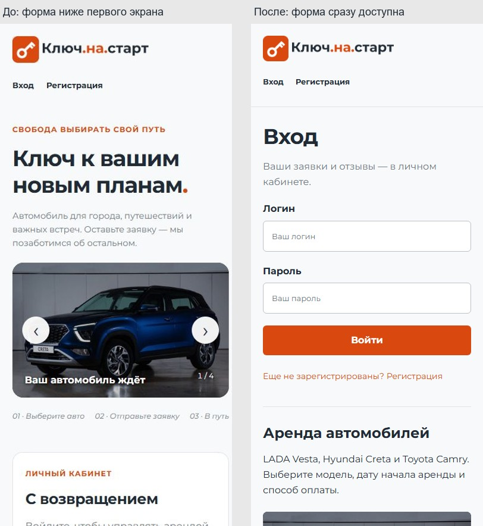
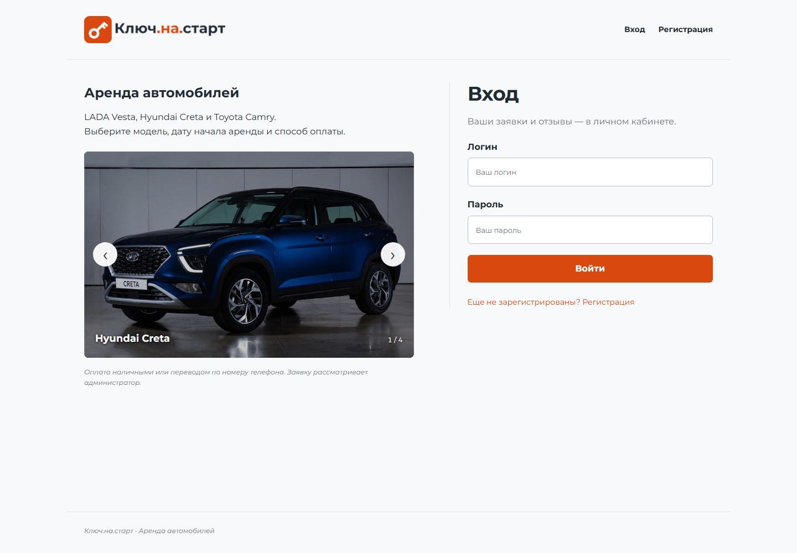

# Компоновка и материалы: предметный сервис проката

Выбранное пользователем направление — фотографии моделей, чёткие формы и компактные заявки.
Сравнение первого мобильного экрана:

## Свежий аудит

1. **Вход, desktop — работоспособно, подача слишком общая.** Снимок
   `tmp/design-audit/01-login.jpg`: общий слоган не объясняет, какие автомобили доступны.
   Большая одинаковая карточка формы и повторные надзаголовки добавляют визуальный шум.
2. **Вход, 390×844 — существенная проблема компоновки.** Снимок
   `tmp/design-audit/04-login-mobile.jpg`: первое поле y=874, ниже первого экрана.
3. **Регистрация, desktop/mobile — поля понятны, но мобильный сценарий отодвинут.**
   Снимки `02-register-desktop.jpg`/`03-register-mobile.jpg`: первое поле y=890.
   Отдельная рекламная часть перед формой увеличивает прокрутку до основной задачи.

Три шага сохранены и просмотрены в текущем запуске аудита через in-app browser.
Подписи полей, локальные изображения и стрелки слайдера присутствуют. Полного заключения
о доступности по снимкам не делаем: скринридеры и увеличение масштаба отдельно не проверялись.

## Выполненные изменения

- Формы — первыми в HTML, визуально справа на desktop, первыми на телефоне.
  Свежая проверка входа: первое поле y=331, нижняя граница383 при высоте844.
- Заголовки «Вход»/«Регистрация», названия трёх моделей и реальные способы оплаты
  заменяют общие слоганы, декоративные шаги и надзаголовки.
- Большая обводка формы убрана. Более строгие отступы, разделители и небольшое скругление
  сохраняют исходную палитру и Montserrat. Рабочие страницы используют компактный список.
- Общий `_booking.html` объединяет разметку истории и администратора; серверные проверки
  владельца, роли, статуса и CSRF сохранены.
- Фото Vesta/Creta используются в истории, автопарк — в форме заявки и как общая иллюстрация,
  передача ключей — в пустом состоянии. Слайдер с четырьмя прежними изображениями сохранён.

## Почему используются не все изображения

Изначально были выбраны4 слайда и2 логотипа: приоритетом была функциональная основа экзамена.
Связь иллюстраций с рабочими экранами была проработана недостаточно. Теперь используются
9 исходников сайта из24, включая варианты логотипов. В задании нет явного требования
разместить каждый файл; основной смысл отбора — подходящий контекст.

| Материал | Использование |
|---|---|
| `logo_full.png`, `logo_icon.png` | Шапка и favicon |
| Фото Creta, дороги, загородной поездки, ключей | Четыре слайда |
| `1200x900.webp` → `vesta.jpg` | LADA Vesta в заявках |
| `135246346_s63iN0L.jpeg` → `fleet.jpg` | Форма аренды и общее фото автопарка |
| `cf5de6e2a09af74ff13aad23c69466a4.jpg` → `handover.jpg` | Пустой кабинет |
| Белый логотип | Резерв для тёмного фона; в текущей светлой шапке не требуется |
| Mercedes, Lamborghini, Tesla, минивэн | Не выдаются за модели из доступного списка |
| Сервис, мойка, салон, офис | Возможны в информационных разделах, если потребуется такое содержание |
| Медиа и Roboto из «Группы Таймыр» | Относятся к отдельному модулю4, со стилем проката не смешиваются |

Фото другого автомобиля не подписывается Toyota Camry: для этой заявки показано общее
изображение автопарка с соответствующим alt. Цены, скидки, адрес и график работы не выдуманы.
Коллаж/фоновое фото допустимы как акцент входного экрана, но в выбранном предметном
направлении они не должны конкурировать с формами и данными заявок.

## Проверка после изменения

11 функциональных тестов проходят. Браузерный сценарий прошёл регистрацию, вход, две заявки,
администрирование, фильтр, завершение, отзыв, оба управления слайдером и сброс таймера.
Проверены 390×844 и1440×1000, модельное фото и отсутствие горизонтального выхода/внешних запросов.
Все свежие снимки просмотрены; независимый review не нашёл существенных регрессий.
Набор фотографий в спецификации уточнён после review: прежние4 слайда оставлены,
дополнительные3 фото применены в рабочих экранах, чтобы расширить применение исходников.

Объём: `code-volume.md`. Финальное руководство ручного воспроизведения не создавалось.
